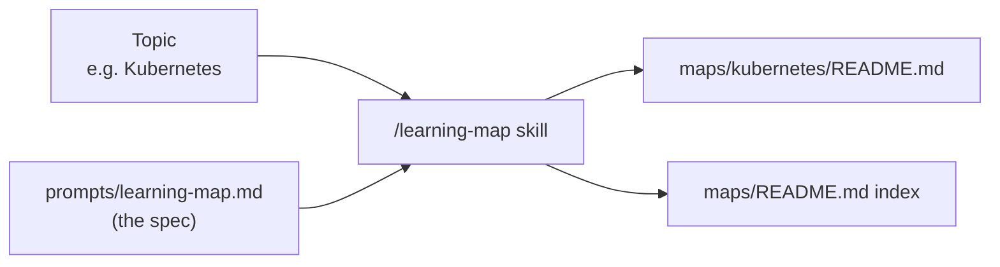

# Learning Map

**AI Era Learning Map Generator.** Send it any tool, technology, subject, methodology, or domain; get back a README.md that gives you an accurate mental model of it — not a tutorial.

When AI does the operational work, the scarce skill is no longer *how to use X* but *knowing that X exists, when to reach for it, and what it changes*. Each map answers exactly that.



## Usage

In Claude Code, from this directory:

```
/learning-map Kubernetes
/learning-map double-entry bookkeeping --audience software engineer
/learning-map 量子计算 --lang 中文
```

Without Claude Code: copy `prompts/learning-map.md`, replace `{{TOPIC}}`, paste into any LLM.

## What every map contains

| # | Section | Question it answers |
|---|---|---|
| 1 | Essence | What is it, why does it exist, what came before? |
| 2 | World Model | Objects, actors, state changes, workflows, systems, value |
| 3 | Concept Map | 2–3 layers of Entity · Action · Purpose · Relationships |
| 4 | Decision Map | Situation → Decision → Reason → Expected Outcome |
| 5 | Search Space Expansion | Questions you didn't know to ask, up to mastery |
| 6 | Ecosystem | Upstream, downstream, alternatives, complements |
| 7 | Transferable Principles | What's stable vs. changing; what to remember vs. delegate |
| 8 | Minimum Mental Model | The 10–20 concepts that matter most |
| 9 | Common Misconceptions | Misunderstanding → why → better model |
| 10 | Summary | "What I truly gain is not ___, but ___." |

Diagrams are Mermaid (mind maps, concept graphs, system maps, dependency graphs, decision trees, lifecycles) and render directly on GitHub.

## Customizing

Edit `prompts/learning-map.md` to change sections, depth, or diagram rules — the skill always reads it fresh, so every future map follows the new spec.

Browse generated maps in [`maps/`](maps/README.md).
