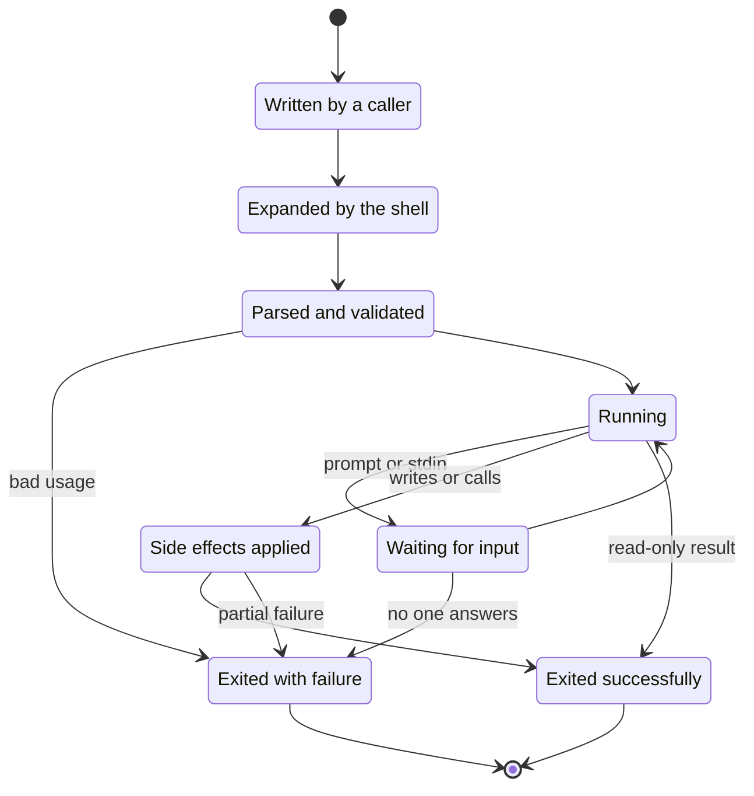
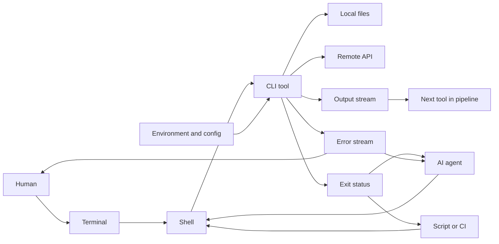
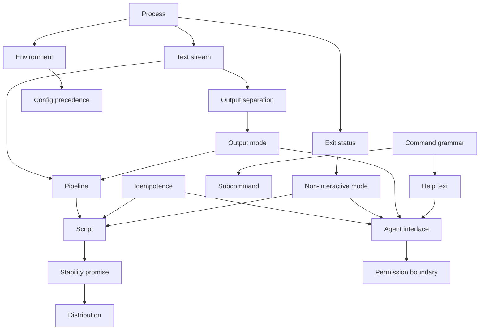
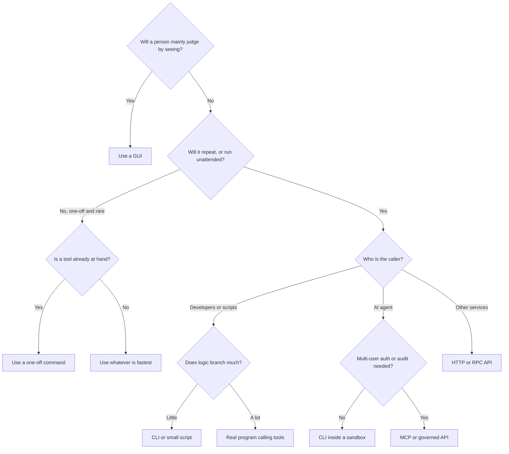
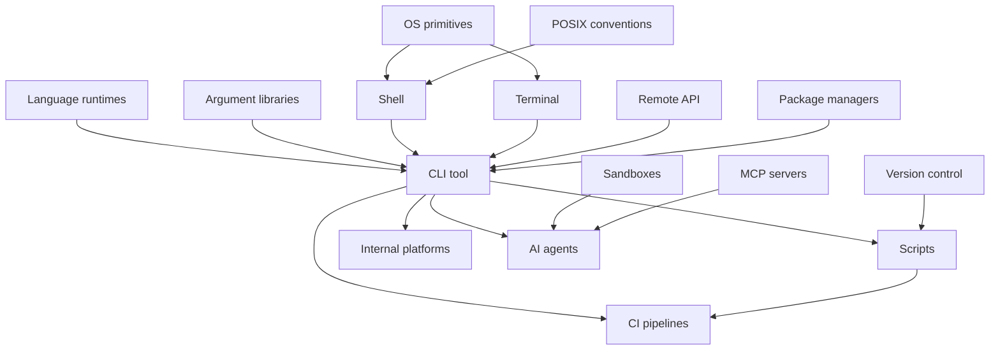
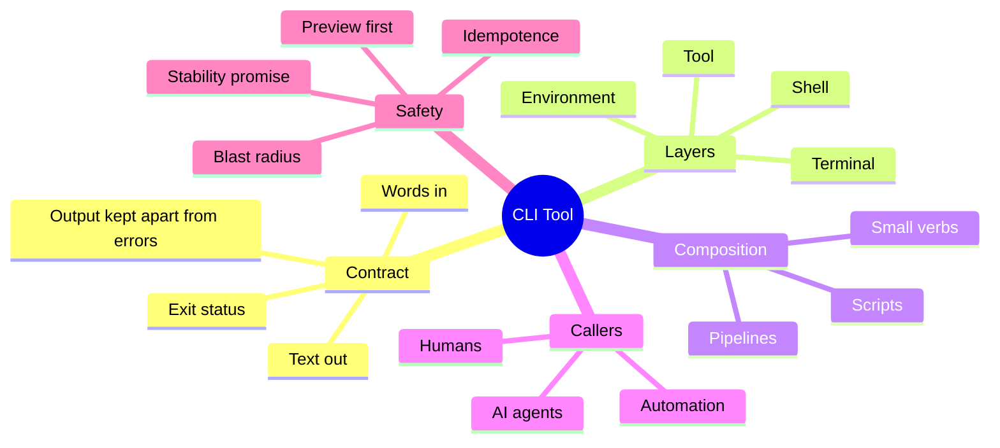

# CLI Tool — Learning Map

> A CLI tool is a program you operate by sending it words and reading text back, which makes its interface a contract that people, scripts, and AI agents can all use in the same way.

**Generated:** 2026-11-02 · **Lens:** mental model, not manual

*Interpretation: "CLI tool" here means the command-line program as a category of software — what it is, why it survives, and where it fits — not any one tool. For deep maps of a single tool or the craft behind them, see [Git](../git/README.md) and [Programming](../programming/README.md).*

*A Chinese version of this map: [CLI 工具 — 学习地图](README.zh.md).*

## Contents

1. [Essence](#1-essence)
2. [World Model](#2-world-model)
3. [Concept Map](#3-concept-map)
4. [Decision Map](#4-decision-map)
5. [Search Space Expansion](#5-search-space-expansion)
6. [Ecosystem](#6-ecosystem)
7. [Transferable Principles](#7-transferable-principles)
8. [Minimum Mental Model](#8-minimum-mental-model)
9. [Common Misconceptions](#9-common-misconceptions)
10. [Summary](#10-summary)

---

## 1. Essence

### What is it fundamentally?

A CLI tool is a **capability exposed as a verb**. A graphical app shows you what is possible and waits for you to point. A CLI tool shows nothing: you state the whole intent up front as one line of text, it runs, and it reports back through three narrow channels — normal output, error output, and a numeric exit status.

That narrowness is the point. Because a request is only text, it can be written down, repeated, reviewed, generated, or sent to another machine. **An action taken in a CLI is already a record of itself.** A click disappears the moment it happens; a command line can be saved, and saving it is the first step of automation.

### Why does it exist?

It began as an accident of hardware: early interactive computers talked through teletypes, so text was the only channel. It survived for a different reason. Unix in the 1970s found that small programs joined by text streams could solve problems no single author had planned for. Text had stopped being a limitation and become a **universal connector between programs that know nothing about each other**.

### What problem does it solve?

| Problem                                                  | What a CLI tool does                                                      |
| -------------------------------------------------------- | ------------------------------------------------------------------------- |
| Graphical actions cannot be repeated exactly             | Turns an action into a line of text that runs the same way next time      |
| Software built by different people does not interoperate | Offers a shared lowest common denominator: text in, text out, exit status |
| Work must happen on machines with no screen              | Runs over a remote connection, in a container, or in a CI job             |
| Repetitive work scales with human attention              | Lets one instruction apply to ten thousand files unattended               |
| Knowing how something was done gets lost                 | Leaves commands that can live in scripts, docs, and history               |
| Every interface has to be built twice                    | Gives a small program a usable interface without any UI work              |

### What did people do before it?

Before interactive terminals, people submitted **batch jobs** on punched cards and collected results hours later. Command lines replaced that wait with a conversation. After them came the **GUI** (popularized in the 1980s), which traded repeatability for discoverability and won ordinary users — the CLI retreated to where repetition, remote work, and composition matter. Today its siblings are web dashboards, HTTP APIs, and agent protocols. All of them compete for the same question: *how should a capability be reached?*

### What new possibilities does it create?

- **Unplanned composition**: tools from different decades cooperate without any integration project.
- **The ladder from typing to automation**: a one-off command becomes a script, a script becomes a scheduled job, and nothing has to be rewritten along the way.
- **Infrastructure as text**: servers, builds, and deployments become things you can version and review.
- **Remote leverage**: one person can operate a fleet over a thin connection.
- **AI hands (2024–2026)**: language models read and write text natively, so a CLI is an interface they can already use. The terminal, once treated as a legacy surface, became a primary home for coding agents.

---

## 2. World Model

### Objects

| Object                         | What it is                                                                                        |
| ------------------------------ | ------------------------------------------------------------------------------------------------- |
| **Command**                    | The verb: the executable program, sometimes with subcommands beneath it                           |
| **Arguments and flags**        | The sentence: what to act on and how                                                              |
| **Environment**                | Ambient inputs: working directory, environment variables, user identity                           |
| **Standard streams**           | Input, output, and error channels, which can each point at a terminal, a file, or another program |
| **Exit status**                | The one-number verdict that automation actually branches on                                       |
| **Config and credentials**     | State that persists between runs, in files, a keychain, or the environment                        |
| **Files and remote resources** | The world being read or changed                                                                   |
| **Terminal**                   | The display surface that renders text and passes keystrokes; separate from the shell and the tool |

### Actors

| Actor                              | Role                                                                            |
| ---------------------------------- | ------------------------------------------------------------------------------- |
| **Human operator**                 | Explores and makes judgment calls; wants readable output and forgiveness        |
| **Shell**                          | The interpreter that expands a line, launches programs, and wires them together |
| **Script or CI runner**            | An unattended caller; cannot answer prompts and needs stable output             |
| **AI agent**                       | A new caller that reads help, guesses, retries, and pays for every output token |
| **Tool author**                    | Defines the contract and lives with it for as long as anyone depends on it      |
| **Package manager or distributor** | Decides which version is present on which machine                               |

### State changes

An invocation is a short-lived process. It exists to turn a request into a verdict, and anything it wants to keep must leave through the filesystem, the network, or its output.

The dangerous states are *waiting for input*, where unattended callers hang, and *partial failure*, where the world has changed but the verdict says failed.

### Workflows

| Workflow               | The recurring sequence                                                       |
| ---------------------- | ---------------------------------------------------------------------------- |
| **Explore**            | Ask what is here → narrow it → inspect one thing → form a hypothesis         |
| **Pipeline**           | Produce a stream → filter → transform → summarize                            |
| **Dry run then apply** | Preview a change → review it → execute it → verify the result                |
| **Crystallize**        | Solve once by hand → save the line → parameterize → schedule it              |
| **Agent loop**         | Read help → try → read the error → adjust → verify                           |
| **Release**            | Change behavior → version it → deprecate the old form → remove it much later |

### Systems

Individual tools form three larger structures:

- **The composition system**: shell plus streams, where small tools become one-off programs.
- **The automation system**: scripts, CI, and schedulers, where commands run with nobody watching.
- **The control-plane client**: tools such as cloud and cluster CLIs, which are thin text frontends to remote APIs that own the real state.

### Value

- **Created** when one line replaces a repeated human procedure, or when a command makes a piece of operational knowledge explicit.
- **Captured** by whoever owns the contract other automation is built on. A widely scripted output format is a moat, and a burden.
- **Destroyed** by silently changed output that breaks downstream scripts, by destructive defaults, by commands that hang waiting for input in CI, and by output so noisy that people and agents stop reading it.

---

## 3. Concept Map

### Layer 1: Foundations — the contract

| Entity                | Action                               | Purpose                                       | Relationships                                                   |
| --------------------- | ------------------------------------ | --------------------------------------------- | --------------------------------------------------------------- |
| **Process**           | Starts, runs, exits                  | Gives each run isolated, disposable state     | Created by the shell; receives environment and streams          |
| **Text stream**       | Carries bytes between programs       | Serves as the universal connector             | Links tools; can be redirected without their knowledge          |
| **Exit status**       | Reports success or failure           | Lets automation branch without parsing prose  | Read by scripts, CI, and agents                                 |
| **Output separation** | Keeps results apart from diagnostics | Stops messages from corrupting data           | Depends on both standard streams                                |
| **Environment**       | Supplies ambient context             | Configures a run without changing the command | Inherited by child processes; a source of "works on my machine" |

### Layer 2: Mechanisms — the interface design

| Entity                   | Action                                   | Purpose                              | Relationships                                |
| ------------------------ | ---------------------------------------- | ------------------------------------ | -------------------------------------------- |
| **Command grammar**      | Structures verbs, nouns, and options     | Makes capabilities guessable         | Shapes help text and shell completion        |
| **Subcommand**           | Groups related verbs                     | Lets one binary hold a large surface | Common in control-plane clients              |
| **Help and man pages**   | Describe usage in place                  | Replace visual discoverability       | Now also read by agents at runtime           |
| **Output mode**          | Switches between human and machine forms | Serves both audiences from one tool  | Often keyed off whether output is a terminal |
| **Config precedence**    | Resolves flags, environment, and files   | Gives predictable overrides          | Depends on documentation to be usable        |
| **Idempotence**          | Makes a repeat run safe                  | Allows retries after partial failure | Essential for scripts and agents             |
| **Non-interactive mode** | Replaces prompts with explicit input     | Lets unattended callers finish       | Prevents the hanging state                   |

### Layer 3: Practice — the tool in the world

| Entity                  | Action                                | Purpose                                   | Relationships                                    |
| ----------------------- | ------------------------------------- | ----------------------------------------- | ------------------------------------------------ |
| **Pipeline**            | Chains tools                          | Builds an ad hoc program                  | Composes text streams; fails in subtle ways      |
| **Script**              | Freezes a procedure                   | Turns knowledge into something executable | Depends on stable tool output                    |
| **Stability promise**   | Defines what will not change          | Protects downstream automation            | Tied to versioning and deprecation               |
| **Distribution**        | Places the right version on a machine | Makes the tool available at all           | Packaged binaries, runtimes, containers          |
| **Agent interface**     | Lets a model invoke the tool          | Extends leverage to AI                    | Competes and combines with protocols such as MCP |
| **Permission boundary** | Limits what a run may touch           | Contains mistakes by people and models    | Sandbox, credentials, allowlists                 |

### Concept Graph

---

## 4. Decision Map

| Situation                                                                 | Decision                                                       | Reason                                                          | Expected Outcome                                |
| ------------------------------------------------------------------------- | -------------------------------------------------------------- | --------------------------------------------------------------- | ----------------------------------------------- |
| A task will be repeated, or must be exactly reproducible                  | Express it as a CLI command or script                          | Text is repeatable and reviewable; clicks are not               | The procedure stops living in someone's head    |
| Non-technical people need the capability                                  | **Don't use a CLI as the main interface**; build a GUI or form | A blank prompt offers no discoverability, and errors are costly | Adoption does not depend on training            |
| The task is visual: layout, image editing, comparing a design             | **Don't use a CLI**                                            | The feedback is spatial, and text cannot carry it               | Faster judgment with direct manipulation        |
| You are exposing a service to developers                                  | Ship the API first, then a CLI over it                         | The CLI is a thin client; the API remains the source of truth   | Scripts and integrations share one model        |
| The output will be consumed by scripts or agents                          | Offer a structured format and promise its stability            | Scraping human-readable text is fragile                         | Upgrades stop breaking downstream users         |
| An operation is destructive                                               | Require explicit intent, offer a preview, default to safe      | The speed of a CLI also makes mistakes fast                     | Fewer irreversible errors                       |
| An AI agent needs a capability that is local and already has a mature CLI | Let the agent call the CLI                                     | Existing tools are cheap to describe and easy to verify         | Less integration work and less context consumed |
| An agent needs multi-user auth, audit, or tenant-scoped access            | Use a governed protocol such as MCP or an API                  | Shell access inherits one identity and leaves weak audit trails | Access can be attributed and revoked            |
| Input is structured and logic is growing                                  | Move from a pipeline to a real program                         | Pipelines hide error handling and quoting problems              | Failure behavior becomes explicit               |
| A small script needs to be shared across a team                           | Package it as a named tool with help and versioning            | The cost of an undocumented script grows with every user        | Institutional knowledge has an owner            |
| A CLI must work on Windows, macOS, and Linux with no setup                | Choose a single-binary distribution                            | Runtime dependencies are the biggest cause of install failure   | The tool arrives working                        |

---

## 5. Search Space Expansion

### Beginner questions rarely asked

| Question                                                           | Why it matters                                                         |
| ------------------------------------------------------------------ | ---------------------------------------------------------------------- |
| What is the difference between a terminal, a shell, and a command? | Most confusion comes from treating three separate layers as one        |
| Who actually expands the text I type, the shell or the tool?       | It explains a whole family of baffling quoting and wildcard surprises  |
| Why does success print nothing in many old tools?                  | Silence is a design choice that makes output composable                |
| Where does a command come from when I type its name?               | Lookup paths explain "installed but not found" and wrong-version bugs  |
| Why does a tool behave differently when its output is piped?       | Tools detect their audience, and that affects both color and buffering |
| What does a CLI remember between runs?                             | Hidden state is why the same line can give different results           |

### Questions experts ask

| Question                                                         | Why it matters                                                |
| ---------------------------------------------------------------- | ------------------------------------------------------------- |
| Which part of this tool's output is a public API?                | Anything people parse becomes a contract, intended or not     |
| What happens at every point if the process is killed midway?     | Partial failure, not success, defines reliability             |
| What is the precedence between flags, environment, and config?   | Debugging and support depend on it being predictable          |
| Does a pipeline's failure reach the final verdict?               | By default, an early failure can be masked by a later success |
| How does this behave with no terminal, no network, and no human? | CI, containers, and agents are the true test environment      |
| What does a mistyped argument cost?                              | Interface design should scale with blast radius               |
| How would we remove this flag in three years?                    | Deprecation is where CLI design debt comes due                |

### Questions worth exploring next

| Question                                                          | Why it matters                                                            |
| ----------------------------------------------------------------- | ------------------------------------------------------------------------- |
| How should a tool be designed when its main reader is a model?    | Token cost, error wording, and discoverability become new design criteria |
| When does a CLI beat a protocol such as MCP for agents?           | The answer shapes how tools get built for the agent era                   |
| How should permissions work when an agent holds the shell?        | Inherited user authority is a new class of risk                           |
| What can structured-data shells teach about the text contract?    | They challenge the assumption that bytes are the right common format      |
| Why are so many classic tools being rewritten in newer languages? | It shows what users now value: speed, defaults, portability               |
| How do TUIs change the deal between human and machine use?        | Rich terminal interfaces gain usability and give up composability         |

### Questions that define mastery

| Question                                                               | Why it matters                                                              |
| ---------------------------------------------------------------------- | --------------------------------------------------------------------------- |
| Can you predict how a tool will fail before reading its code?          | Mastery means seeing the contract, not memorizing the flags                 |
| Which operations in your work should not be typed at all anymore?      | Experts know when to crystallize or delegate, not just how to type          |
| Can one interface serve a tired human, a script, and an agent at once? | This is the central design tension of modern CLIs                           |
| What guarantee would you refuse to make, and why?                      | Promises in a CLI are expensive and almost permanent                        |
| When is the shell the wrong abstraction for a task?                    | Knowing where text stops being enough marks real judgment                   |
| How would you safely grant a model real authority over production?     | It joins interface, permissions, reversibility, and review into one problem |

---

## 6. Ecosystem

### Upstream

- **Operating system primitives**: processes, file descriptors, permissions, and signals.
- **The Unix tradition and POSIX**: the conventions most tools inherit.
- **Language runtimes and argument libraries**: they shape how tools feel, and whether they ship as a single binary.
- **Terminals and shells**: they set what can be displayed and how lines are interpreted.

### Downstream

- **Scripts and CI pipelines**: the largest silent consumers of tool behavior.
- **Developer platforms and internal tooling**: company knowledge wrapped as commands.
- **Infrastructure control planes**: cloud, cluster, and database administration.
- **AI coding agents**: both built as CLIs and heavy users of CLIs.

### Alternatives

| Alternative                       | Choose it instead when                                                                                              |
| --------------------------------- | ------------------------------------------------------------------------------------------------------------------- |
| **GUI**                           | Discoverability and visual judgment matter more than repeatability                                                  |
| **Web dashboard**                 | Many people need shared, always-current views without installing anything                                           |
| **HTTP or RPC API**               | The caller is software that needs typed, versioned, networked access                                                |
| **Library or SDK**                | The caller is in-process code that needs rich types and low overhead, and can accept a language lock-in             |
| **MCP or similar agent protocol** | Agents need discoverable tools, per-user auth, and audit, at the cost of more infrastructure and often more context |
| **TUI**                           | An interactive expert workflow benefits from a live screen, at the cost of composition                              |
| **Natural-language agent**        | The intent is clear but the procedure is not, and the result can be verified, at the cost of determinism            |

### Complements

- **Version control**: makes the changes CLI tools produce safe to attempt.
- **Containers and sandboxes**: make environments reproducible and limit the damage.
- **Secret managers**: keep credentials out of command lines and history.
- **Documentation and shell completion**: restore some of the discoverability that a blank prompt lacks.
- **GUIs on the same core**: many strong products offer both, with the CLI for repetition and the GUI for exploration.

---

## 7. Transferable Principles

### First principles

- **Text is the universal interface.** The less two programs assume about each other, the longer their connection lasts.
- **Every published behavior becomes a contract.** Users depend on what a tool does, not on what its docs promise.
- **A recorded action can be reused.** Anything expressed in text can be versioned, reviewed, and automated.
- **Interface power and interface risk grow together.** Whatever makes one line do ten thousand things can also do ten thousand wrong things.
- **Discoverability and efficiency trade off.** A prompt is fast for those who know and blank for those who don't.

### Transferable methodologies

- **Separate results from commentary**, in any system that talks to other systems.
- **Preview before commit**, wherever an action is broad or irreversible.
- **Design for the unattended caller first**, then add comfort for humans.
- **Crystallize repeated work upward**: command, script, tool, service.
- **Fail loudly and early with a next step**, because errors are part of the interface.

### Implementation details

Which argument library to use, flag spellings, color conventions, completion setup, packaging formats, and the exact syntax of any shell. Important in the moment, and exactly what AI can handle.

### Stable knowledge (true in 10 years)

- Processes take inputs and return verdicts.
- Unattended callers cannot answer questions.
- Automation depends on stable output.
- Destructive operations need explicit intent.
- Humans and machines want different renderings of the same result.

### Changing knowledge (likely different in 2 years)

- **Terminal agents (as of 2026):** the terminal is a primary home for coding agents such as Claude Code, Codex CLI, and many open alternatives; names, leaders, and business models are moving quickly.
- **CLI versus MCP for agents (as of 2026):** reports often find CLIs lighter on context, while other benchmarks favor MCP on reliability, and MCP keeps the edge on auth and audit. Most numbers come from interested vendors, and the emerging consensus is a hybrid.
- **Agent-readable tools (as of 2026):** conventions for structured output and instructions aimed at models are still forming.
- **Language fashions (as of 2026):** Rust and Go dominate new single-binary tools, a preference that may shift.
- **Distribution channels (as of 2026):** package managers and installer conventions vary and keep changing.

### Where to invest memory

| Invest memory in                                       | Delegate to AI                         |
| ------------------------------------------------------ | -------------------------------------- |
| The contract: streams, exit status, environment        | Exact flags and syntax                 |
| The distinction between terminal, shell, and tool      | Quoting and escaping details           |
| When to use a CLI, API, GUI, or protocol               | Writing pipelines and one-off scripts  |
| Failure modes: partial failure, hanging, masked errors | Argument parsing boilerplate           |
| Blast radius and permissions                           | Packaging and completion scripts       |
| What to verify after a command runs                    | Translating intent into a command line |

The more AI writes commands for you, the more your value moves from *composing the line* to *knowing what it could do* before you approve it.

---

## 8. Minimum Mental Model

1. **Capability as a verb**: a CLI tool exposes what software can do as something you can name.
2. **Text contract**: words go in, text comes out, and that is why anything can call it.
3. **Exit status**: automation trusts this number, not the prose.
4. **Output versus errors**: separating them keeps data clean for the next program.
5. **Terminal, shell, tool**: three different layers that are easily mistaken for one.
6. **Environment**: invisible inputs that explain why the same line behaves differently.
7. **Composition**: small tools combine into programs nobody planned.
8. **Crystallization**: a typed line can climb into a script, a job, and a tool.
9. **Three callers**: humans, automation, and agents need different things from one interface.
10. **Non-interactive operation**: if a caller can't answer a prompt, the tool must not need one.
11. **Output as API**: anything people parse becomes a promise.
12. **Idempotence**: a repeat run must be safe, because retries are inevitable.
13. **Blast radius**: one short line can have an enormous effect, so safety must scale with it.
14. **Thin client**: many modern CLIs are text frontends for a remote API.
15. **Agent hands**: for a language model, a CLI is an already-readable way to act on the world.

---

## 9. Common Misconceptions

| Common misunderstanding                              | Why it happens                            | Better mental model                                                                                         |
| ---------------------------------------------------- | ----------------------------------------- | ----------------------------------------------------------------------------------------------------------- |
| CLIs are legacy, soon to be replaced by GUIs and AI  | Black terminals look old                  | CLIs survive because text composes; AI strengthened them by becoming a new caller                           |
| Learning CLIs means memorizing commands              | Tutorials teach lists of flags            | Learn the contract and the shape of tools; lookups are cheap and now delegable                              |
| The terminal is the shell is the tool                | They appear in one window                 | Three layers: display, interpreter, and program                                                             |
| If it printed no error, it worked                    | Humans read screens                       | Check the exit status and verify the result; messages are for people, not proof                             |
| Pretty output is good output                         | Modern demos reward polish                | Polish belongs to the human mode; decoration in a machine mode breaks consumers                             |
| A CLI is automatically automation-friendly           | It runs from text, so it must script well | Prompts, unstable output, and vague exit statuses can make a CLI hostile to automation                      |
| Letting an agent run commands is just a faster human | Agents appear to type like us             | Agents act on your authority with no hesitation; sandboxes and review carry the caution they lack           |
| CLI and MCP are rival winners-take-all standards     | Online debate favors verdicts             | They are different layers with different strengths: cheap local action versus governed, discoverable access |

---

## 10. Summary

> What I truly gain is not memorized commands and flags, but the ability to see any capability as a text contract — and to judge who can call it, how it fails, and how far it can safely scale.

A CLI tool turns what software can do into a verb that can be written down. Its narrow contract of words, text, and exit status is why tools written decades apart still cooperate, why one typed line can grow into automation, and why language models took to it so quickly. Its cost is a blank prompt: low discoverability, fast mistakes, and promises that are hard to withdraw once people depend on them. As AI takes over composing the command, the lasting human work is choosing the right interface, reading the contract, limiting the blast radius, and verifying the result.
