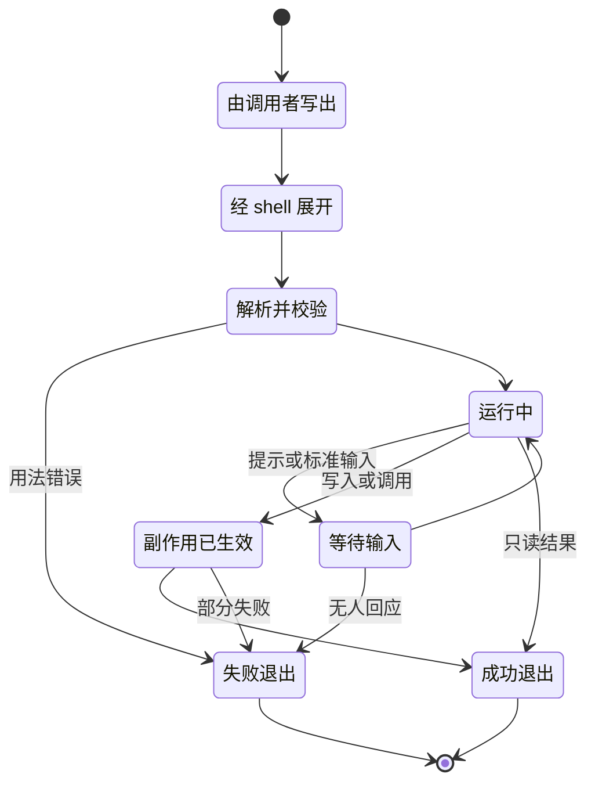
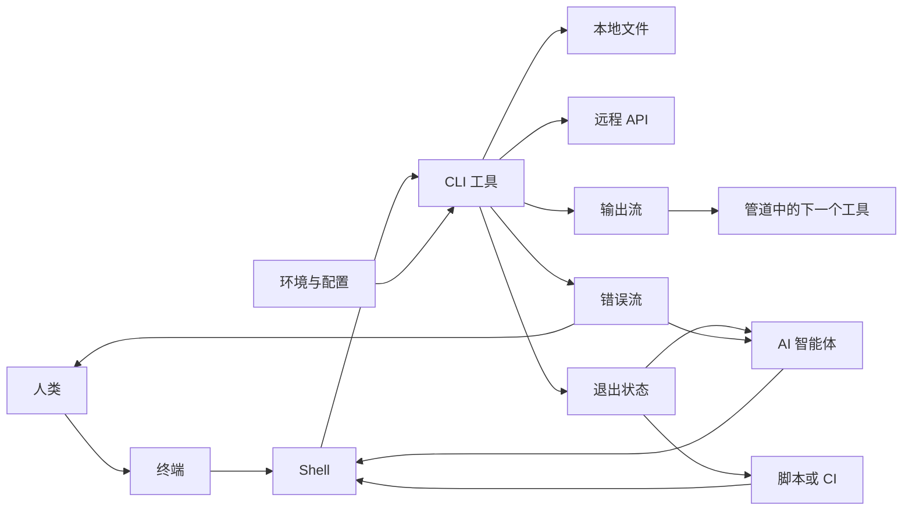
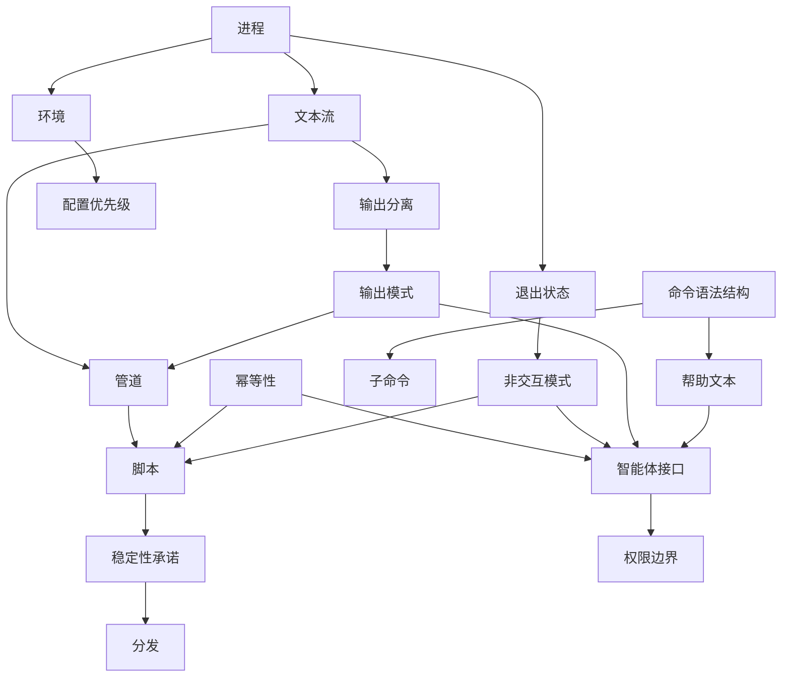
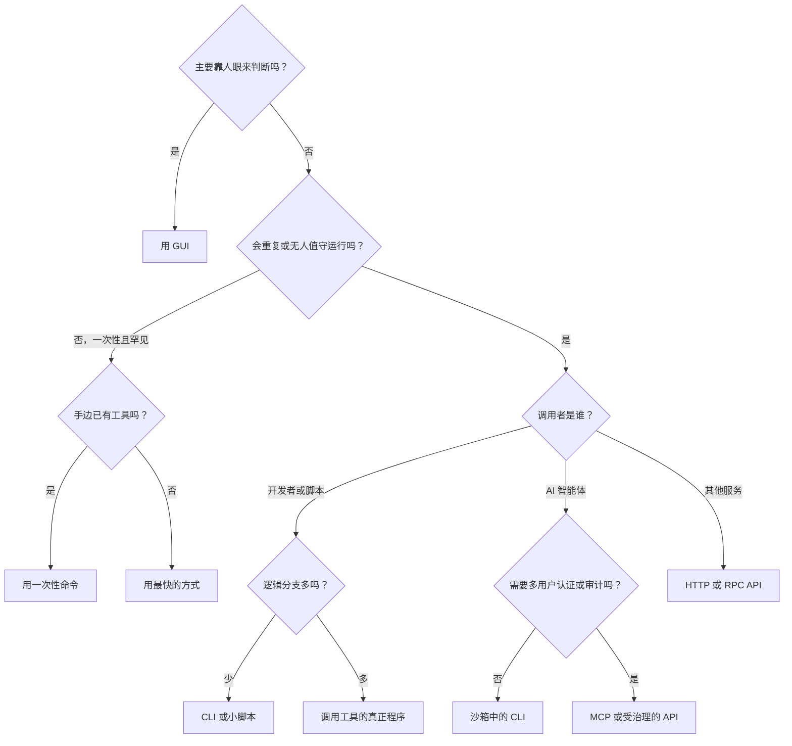
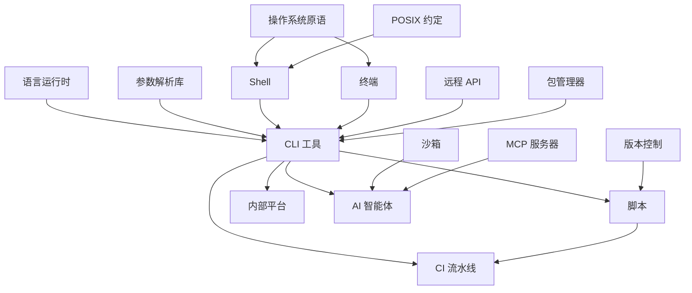
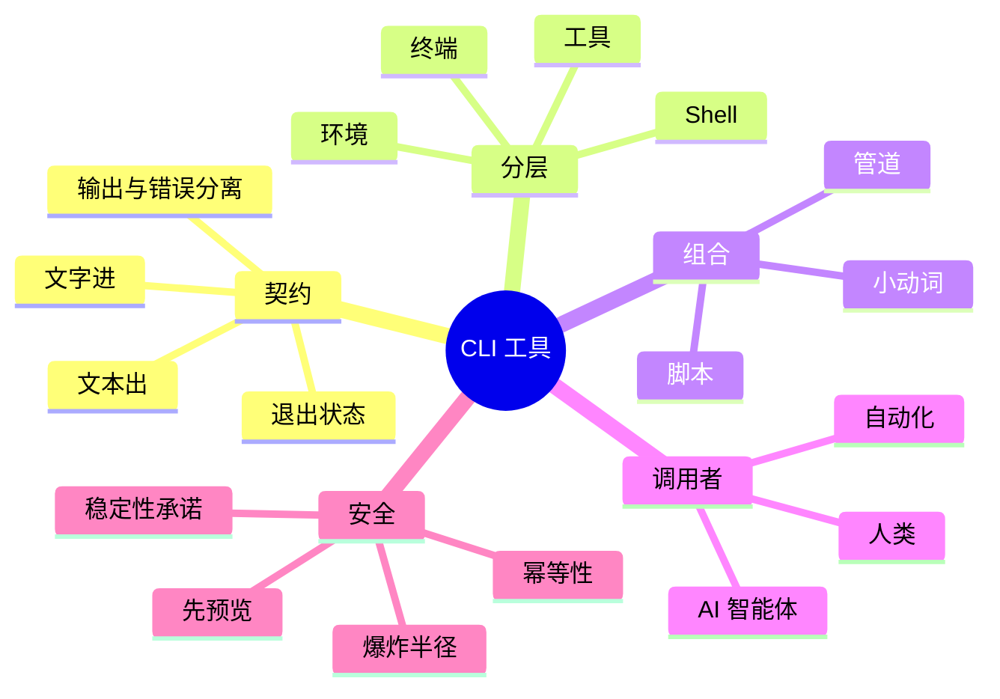

# CLI 工具 — 学习地图

> CLI 工具是一种靠发送文字来操作、并以文本回应的程序，这让它的界面成为一份人、脚本和 AI 智能体都能以同样方式使用的契约。

**生成日期：** 2026-11-02 · **视角：** 心智模型，而非操作手册

*解读：此处的"CLI 工具"（命令行工具）指命令行程序这一类软件——它是什么、为何长存、处在什么位置——而非某一个具体工具。关于单个工具或其背后技艺的深入地图，见 [Git](../git/README.md) 与 [Programming](../programming/README.md)（英文）。*

*本地图的英文版：[CLI Tool — Learning Map](README.md)。*

## 目录

1. [本质](#1-本质)
2. [世界模型](#2-世界模型)
3. [概念地图](#3-概念地图)
4. [决策地图](#4-决策地图)
5. [探索空间扩展](#5-探索空间扩展)
6. [生态系统](#6-生态系统)
7. [可迁移的原则](#7-可迁移的原则)
8. [最小心智模型](#8-最小心智模型)
9. [常见误解](#9-常见误解)
10. [总结](#10-总结)

---

## 1. 本质

### 它根本上是什么？

CLI 工具是**以动词形式暴露出来的能力**。图形应用把可能的操作摆在你面前，等你去点。CLI 工具什么也不展示：你用一行文字一次说完全部意图，它运行，然后通过三条狭窄的通道回应——正常输出、错误输出，以及一个数字形式的退出状态。

这种狭窄正是关键。因为请求只是文本，它可以被写下、重复、审查、生成，或发送到另一台机器。**在 CLI 中执行的动作，本身就已经是对这个动作的记录。**一次点击发生后便消失了；一行命令却可以保存下来，而保存正是自动化的第一步。

### 为什么会有它？

它起源于硬件上的偶然：早期交互式计算机通过电传打字机通信，文本是唯一的通道。它能存活下来却另有原因。1970 年代的 Unix 发现，用文本流连接的小程序，可以解决任何一位作者都未曾计划过的问题。文本不再是限制，而成了**互不了解的程序之间的通用连接器**。

### 它解决什么问题？

| 问题 | CLI 工具做了什么 |
|---|---|
| 图形操作无法精确重复 | 把动作变成一行文本，下次以同样的方式运行 |
| 不同人写的软件彼此不互通 | 提供共同的最低标准：文本进、文本出、退出状态 |
| 工作必须在没有屏幕的机器上完成 | 可以通过远程连接、在容器内或在 CI 任务中运行 |
| 重复性工作随人的注意力线性增长 | 一条指令就能无人值守地作用于上万个文件 |
| 事情是怎么做成的，这种知识会丢失 | 留下可以进入脚本、文档和历史记录的命令 |
| 每个界面都要重新做一遍 | 让小程序无需任何 UI 工作就有可用的界面 |

### 在它之前，人们做什么？

在交互式终端出现之前，人们用穿孔卡片提交**批处理作业**，几小时后才拿到结果。命令行把这种等待变成了对话。在它之后出现的**图形界面**（1980 年代普及）用可重复性换来了可发现性，赢得了普通用户——CLI 则退守到重复、远程和组合最重要的地方。今天，它的同类是 Web 控制台、HTTP API 和智能体协议。它们都在回答同一个问题：*一项能力应该如何被触达？*

### 它打开了什么可能性？

- **计划之外的组合**：来自不同年代的工具无需任何集成项目就能协作。
- **从手敲到自动化的阶梯**：一次性命令变成脚本，脚本变成定时任务，途中无需重写。
- **基础设施即文本**：服务器、构建和部署都成了可以版本化、可以审查的东西。
- **远程杠杆**：一个人可以通过一条细细的连接操作一整批机器。
- **AI 的双手（2024–2026）**：语言模型天生读写文本，所以 CLI 是它们已经能用的界面。曾被视为遗留界面的终端，成了编程智能体的主要栖息地。

---

## 2. 世界模型

### 对象（Objects）

| 对象 | 是什么 |
|---|---|
| **命令** | 动词：可执行程序，下面有时还带子命令 |
| **参数与选项** | 句子：对什么操作、怎么操作 |
| **环境** | 隐含的输入：工作目录、环境变量、用户身份 |
| **标准流** | 输入、输出、错误三条通道，每条都可以指向终端、文件或另一个程序 |
| **退出状态** | 一个数字的裁决，自动化真正依据它来分支 |
| **配置与凭据** | 跨运行保留的状态，存在文件、钥匙串或环境中 |
| **文件与远程资源** | 被读取或被改变的世界 |
| **终端** | 渲染文本、传递按键的显示界面；与 shell 和工具是两回事 |

### 行动者（Actors）

| 行动者 | 角色 |
|---|---|
| **人类操作者** | 探索并做判断；需要易读的输出和容错 |
| **Shell** | 解释器，负责展开一行文字、启动程序并把它们连起来 |
| **脚本或 CI 运行器** | 无人值守的调用者；无法回答提示，需要稳定的输出 |
| **AI 智能体** | 新的调用者，会读帮助、猜测、重试，并为每个输出的 token 付费 |
| **工具作者** | 定义契约，只要还有人依赖就得一直背负它 |
| **包管理器或分发者** | 决定哪台机器上存在哪个版本 |

### 状态变化（State changes）

一次调用就是一个短命的进程。它存在的目的，是把请求变成裁决；凡是想留下的东西，都必须通过文件系统、网络或输出离开。

危险的状态有两个：*等待输入*，无人值守的调用者会在这里挂起；*部分失败*，世界已经改变，裁决却是失败。

### 工作流（Workflows）

| 工作流 | 反复出现的序列 |
|---|---|
| **探索** | 看看这里有什么 → 缩小范围 → 检查一个对象 → 形成假设 |
| **管道** | 产生数据流 → 过滤 → 转换 → 汇总 |
| **先预演再执行** | 预览改动 → 审查 → 执行 → 验证结果 |
| **结晶** | 手动解决一次 → 保存这行命令 → 参数化 → 定时运行 |
| **智能体循环** | 读帮助 → 尝试 → 读错误 → 调整 → 验证 |
| **发布** | 改变行为 → 标记版本 → 弃用旧形式 → 很久以后才移除 |

### 系统（Systems）

单个工具组成三种更大的结构：

- **组合系统**：shell 加数据流，小工具在这里变成一次性程序。
- **自动化系统**：脚本、CI 和调度器，命令在这里无人看管地运行。
- **控制平面客户端**：云和集群 CLI 之类的工具，它们是远程 API 的轻量文本前端，真正的状态在 API 那边。

### 价值（Value）

- **创造**：一行命令取代了反复的人工流程，或者一条命令把某项运维知识变得明确。
- **捕获**：谁拥有其他自动化所依赖的契约，价值就归谁。被广泛脚本化的输出格式既是护城河，也是包袱。
- **毁灭**：输出悄悄改变导致下游脚本崩溃；默认行为具有破坏性；命令在 CI 中等待输入而挂起；输出过于嘈杂，人和智能体都不再读它。

---

## 3. 概念地图

### 第一层：基础——契约

| 实体 | 动作 | 目的 | 关系 |
|---|---|---|---|
| **进程** | 启动、运行、退出 | 让每次运行都有隔离且用完即弃的状态 | 由 shell 创建；接收环境和数据流 |
| **文本流** | 在程序间传递字节 | 充当通用连接器 | 连接工具；可在工具不知情时重定向 |
| **退出状态** | 报告成败 | 让自动化不必解析文字就能分支 | 由脚本、CI 和智能体读取 |
| **输出分离** | 把结果和诊断信息分开 | 防止提示信息污染数据 | 依赖两条标准流 |
| **环境** | 提供隐含上下文 | 不改命令就能配置一次运行 | 由子进程继承；"我机器上是好的"的来源之一 |

### 第二层：机制——界面设计

| 实体 | 动作 | 目的 | 关系 |
|---|---|---|---|
| **命令语法结构** | 组织动词、名词和选项 | 让能力可以被猜到 | 决定帮助文本和 shell 补全的形态 |
| **子命令** | 把相关动词分组 | 让一个程序容纳庞大的功能面 | 常见于控制平面客户端 |
| **帮助与手册页** | 就地描述用法 | 替代视觉上的可发现性 | 现在也被智能体在运行时读取 |
| **输出模式** | 在人读和机读形式之间切换 | 用一个工具服务两类受众 | 通常取决于输出是否指向终端 |
| **配置优先级** | 协调选项、环境和文件 | 让覆盖规则可预测 | 必须有文档才真正可用 |
| **幂等性** | 让重复运行也安全 | 允许在部分失败后重试 | 对脚本和智能体至关重要 |
| **非交互模式** | 用明确的输入代替提示 | 让无人值守的调用者能跑完 | 避免挂起状态 |

### 第三层：实践——现实中的工具

| 实体 | 动作 | 目的 | 关系 |
|---|---|---|---|
| **管道** | 串联工具 | 临时搭出一个程序 | 组合文本流；失败方式很隐蔽 |
| **脚本** | 冻结一段流程 | 把知识变成可执行的东西 | 依赖工具输出的稳定 |
| **稳定性承诺** | 规定什么不会变 | 保护下游自动化 | 与版本管理和弃用绑定 |
| **分发** | 把正确的版本放到机器上 | 让工具真正可得 | 打包的二进制、运行时、容器 |
| **智能体接口** | 让模型调用工具 | 把杠杆延伸给 AI | 与 MCP 等协议既竞争又结合 |
| **权限边界** | 限制一次运行能碰什么 | 控制人和模型犯错的范围 | 沙箱、凭据、允许列表 |

### 概念图

---

## 4. 决策地图

| 情境 | 决策 | 理由 | 预期结果 |
|---|---|---|---|
| 任务会重复，或必须精确复现 | 用 CLI 命令或脚本来表达 | 文本可重复、可审查，点击不行 | 流程不再只存在于某个人的脑子里 |
| 需要这项能力的是非技术人员 | **不要把 CLI 作为主要界面**；做 GUI 或表单 | 空白提示符毫无可发现性，出错代价也高 | 使用不再依赖培训 |
| 任务是视觉性的：排版、修图、比较设计 | **不要用 CLI** | 反馈是空间性的，文本承载不了 | 直接操作，判断更快 |
| 要向开发者开放一项服务 | 先做 API，再在其上做 CLI | CLI 是轻量客户端，API 才是事实来源 | 脚本和集成共享同一个模型 |
| 输出会被脚本或智能体消费 | 提供结构化格式并承诺稳定 | 解析人读文本很脆弱 | 升级不再破坏下游用户 |
| 操作具有破坏性 | 要求明确意图，提供预览，默认安全 | CLI 的速度同样让错误来得很快 | 不可逆的错误减少 |
| AI 智能体需要的能力在本地，且已有成熟 CLI | 让智能体调用 CLI | 现成工具描述成本低、结果易验证 | 集成工作更少，消耗的上下文也更少 |
| 智能体需要多用户认证、审计或按租户隔离的访问 | 使用 MCP 或 API 这类受治理的方式 | Shell 访问沿用单一身份，审计痕迹很弱 | 访问可追溯、可撤销 |
| 输入是结构化的，逻辑不断增长 | 从管道转向真正的程序 | 管道掩盖了错误处理和引号问题 | 失败行为变得明确 |
| 小脚本需要在团队内共享 | 打包成有名字、有帮助、有版本的工具 | 无文档脚本的代价随用户数增长 | 组织知识有了负责人 |
| CLI 必须在 Windows、macOS 和 Linux 上免配置运行 | 选择单一二进制的分发方式 | 运行时依赖是安装失败的最大来源 | 工具拿到手就能用 |

---

## 5. 探索空间扩展

### 很少有人问的新手问题

| 问题 | 为什么重要 |
|---|---|
| 终端、shell 和命令有什么区别？ | 大多数困惑都来自把三个独立的层当成一个 |
| 我敲的文字到底是谁在展开，shell 还是工具？ | 它解释了一整类令人费解的引号和通配符意外 |
| 为什么很多老工具成功时什么也不输出？ | 沉默是一种设计选择，让输出可以组合 |
| 我敲下一个名字时，命令是从哪里来的？ | 查找路径解释了"装了却找不到"和版本不对的问题 |
| 为什么输出接到管道后，工具的行为会变？ | 工具会判断受众，这同时影响颜色和缓冲 |
| CLI 在两次运行之间记住了什么？ | 隐藏状态是同一行命令结果不同的原因 |

### 专家会问的问题

| 问题 | 为什么重要 |
|---|---|
| 这个工具的输出，哪部分算公开 API？ | 凡是有人解析的东西都会成为契约，无论是否有意 |
| 如果进程在任意时刻被杀死，会发生什么？ | 定义可靠性的是部分失败，而不是成功 |
| 选项、环境和配置之间的优先级是什么？ | 排错和支持都依赖它的可预测性 |
| 管道中的失败能传到最终裁决吗？ | 默认情况下，前面的失败可能被后面的成功掩盖 |
| 没有终端、没有网络、没有人时它会怎样？ | CI、容器和智能体才是真正的测试环境 |
| 一个参数敲错要付出什么代价？ | 界面设计应该与爆炸半径相称 |
| 三年后我们要怎样移除这个选项？ | CLI 设计债务正是在弃用时到期 |

### 值得接下来探索的问题

| 问题 | 为什么重要 |
|---|---|
| 当主要读者是模型时，工具该如何设计？ | token 成本、错误措辞和可发现性成了新的设计标准 |
| 对智能体而言，CLI 何时胜过 MCP 这类协议？ | 答案决定智能体时代的工具如何构建 |
| 智能体掌握 shell 时，权限该如何运作？ | 继承用户权限是一类新的风险 |
| 结构化数据 shell 能教给我们关于文本契约的什么？ | 它们挑战了"字节是正确的通用格式"这一假设 |
| 为什么那么多经典工具正在被用新语言重写？ | 它显示出用户如今看重什么：速度、默认行为、可移植性 |
| TUI 如何改变人与机器使用之间的交易？ | 丰富的终端界面提升了易用性，放弃了可组合性 |

### 定义精通的问题

| 问题 | 为什么重要 |
|---|---|
| 不读代码，你能预测一个工具会怎样失败吗？ | 精通意味着看见契约，而不是记住选项 |
| 你工作中哪些操作已经不该再手敲了？ | 专家知道何时结晶或委托，而不只是怎么敲 |
| 一个界面能同时服务疲惫的人、脚本和智能体吗？ | 这是现代 CLI 设计的核心张力 |
| 你会拒绝做出哪项保证，为什么？ | CLI 中的承诺昂贵且近乎永久 |
| 什么时候 shell 是错误的抽象？ | 知道文本在哪里不再够用，才是真正的判断力 |
| 怎样才能安全地把生产环境的真实权限交给模型？ | 它把界面、权限、可逆性和审查合成了一个问题 |

---

## 6. 生态系统

### 上游（Upstream）

- **操作系统原语**：进程、文件描述符、权限和信号。
- **Unix 传统与 POSIX**：大多数工具继承的约定。
- **语言运行时与参数解析库**：决定工具的手感，以及能否以单一二进制发布。
- **终端和 shell**：决定能显示什么、命令行如何被解释。

### 下游（Downstream）

- **脚本和 CI 流水线**：工具行为最大的沉默消费者。
- **开发者平台与内部工具**：被包装成命令的公司知识。
- **基础设施控制平面**：云、集群和数据库的管理。
- **AI 编程智能体**：既以 CLI 形式构建，又大量使用 CLI。

### 替代方案（Alternatives）

| 替代方案 | 何时选择它 |
|---|---|
| **GUI** | 可发现性和视觉判断比可重复性更重要时 |
| **Web 控制台** | 许多人需要共享且始终最新的视图，又不想安装任何东西时 |
| **HTTP 或 RPC API** | 调用者是软件，需要有类型、有版本、可联网的访问时 |
| **库或 SDK** | 调用者是进程内代码，需要丰富类型和低开销，并能接受语言绑定时 |
| **MCP 或类似的智能体协议** | 智能体需要可发现的工具、按用户认证和审计时，代价是更多基础设施，且常常更耗上下文 |
| **TUI** | 专家的交互式工作流受益于实时屏幕时，代价是失去组合能力 |
| **自然语言智能体** | 意图明确而流程不明、结果又可验证时，代价是失去确定性 |

### 互补品（Complements）

- **版本控制**：让 CLI 工具产生的改动可以放心尝试。
- **容器和沙箱**：让环境可复现，并限制损害范围。
- **密钥管理器**：让凭据远离命令行和历史记录。
- **文档和 shell 补全**：找回一部分空白提示符所缺少的可发现性。
- **共享同一核心的 GUI**：很多优秀产品两者都提供，CLI 负责重复，GUI 负责探索。

---

## 7. 可迁移的原则

### 第一性原理

- **文本是通用界面。** 两个程序对彼此的假设越少，它们的连接就持续得越久。
- **每个公开的行为都会变成契约。** 用户依赖的是工具实际做了什么，而不是文档承诺了什么。
- **被记录的动作可以被复用。** 凡是能用文本表达的，都能被版本化、审查和自动化。
- **界面的力量与风险一同增长。** 能让一行命令做一万件事的东西，也能让它做一万件错事。
- **可发现性与效率相互取舍。** 提示符对懂的人很快，对不懂的人一片空白。

### 可迁移的方法论

- **把结果和评论分开**，适用于任何与其他系统对话的系统。
- **先预览再提交**，适用于任何范围广或不可逆的动作。
- **先为无人值守的调用者设计**，再为人类增加舒适度。
- **把重复的工作向上结晶**：命令、脚本、工具、服务。
- **尽早响亮地失败，并给出下一步**，因为错误也是界面的一部分。

### 实现细节

用哪个参数解析库、选项怎么拼写、配色约定、补全配置、打包格式，以及任何一种 shell 的具体语法。这些在当下很重要，也恰恰是 AI 能代劳的。

### 稳定知识（10 年后依然成立）

- 进程接收输入并返回裁决。
- 无人值守的调用者无法回答问题。
- 自动化依赖稳定的输出。
- 破坏性操作需要明确的意图。
- 人和机器需要同一结果的不同呈现。

### 变化中的知识（2 年内可能不同）

- **终端智能体（截至 2026 年）：** 终端是 Claude Code、Codex CLI 以及许多开源替代品等编程智能体的主要栖息地；名字、领先者和商业模式都在快速变化。
- **智能体用 CLI 还是 MCP（截至 2026 年）：** 许多报告发现 CLI 更省上下文，也有基准测试显示 MCP 更可靠，而 MCP 在认证和审计上仍占优势。多数数字来自利益相关的厂商，正在形成的共识是混合使用。
- **面向智能体的工具（截至 2026 年）：** 结构化输出和写给模型的说明，相关约定仍在形成中。
- **语言潮流（截至 2026 年）：** 新的单一二进制工具以 Rust 和 Go 为主，这一偏好可能改变。
- **分发渠道（截至 2026 年）：** 包管理器和安装约定各不相同，并在持续变化。

### 该把记忆投资在哪里

| 值得记住 | 交给 AI |
|---|---|
| 契约：数据流、退出状态、环境 | 具体的选项和语法 |
| 终端、shell 与工具的区别 | 引号和转义细节 |
| 何时用 CLI、API、GUI 或协议 | 编写管道和一次性脚本 |
| 失败模式：部分失败、挂起、被掩盖的错误 | 参数解析样板代码 |
| 爆炸半径和权限 | 打包和补全脚本 |
| 命令运行后要验证什么 | 把意图翻译成命令行 |

AI 替你写的命令越多，你的价值就越从*拼出这行命令*转向在批准之前*知道它可能做什么*。

---

## 8. 最小心智模型

1. **能力即动词**：CLI 工具把软件能做的事暴露为可以叫出名字的东西。
2. **文本契约**：文字进、文本出，所以任何东西都能调用它。
3. **退出状态**：自动化信任这个数字，而不是那些文字。
4. **输出与错误**：把两者分开，才能为下一个程序保持数据干净。
5. **终端、shell、工具**：三个不同的层，却很容易被当成一个。
6. **环境**：看不见的输入，解释了为什么同一行命令表现不同。
7. **组合**：小工具能组合成无人计划过的程序。
8. **结晶**：敲过的一行命令可以逐级升为脚本、任务和工具。
9. **三类调用者**：人、自动化和智能体对同一界面的需求各不相同。
10. **非交互运行**：如果调用者无法回答提示，工具就不该需要提示。
11. **输出即 API**：凡是有人解析的东西都成了承诺。
12. **幂等性**：重复运行必须安全，因为重试不可避免。
13. **爆炸半径**：一行短命令可能影响巨大，安全措施要与之相称。
14. **轻量客户端**：许多现代 CLI 是远程 API 的文本前端。
15. **智能体的双手**：对语言模型来说，CLI 是一种本来就读得懂的、作用于世界的方式。

---

## 9. 常见误解

| 常见误解 | 为什么会这样 | 更好的心智模型 |
|---|---|---|
| CLI 是遗留物，很快会被 GUI 和 AI 取代 | 黑色的终端看起来很老 | CLI 长存是因为文本能组合；AI 成为新的调用者，反而强化了它 |
| 学 CLI 就是背命令 | 教程教的是一串串选项 | 学契约和工具的形状；查询很便宜，现在还可以委托 |
| 终端、shell 和工具是一回事 | 它们出现在同一个窗口里 | 三个层：显示、解释器和程序 |
| 没有报错就是成功了 | 人习惯看屏幕 | 检查退出状态并验证结果；提示信息是给人看的，不是证据 |
| 漂亮的输出就是好输出 | 现代演示奖励精致 | 精致属于人读模式；机读模式中的装饰会破坏消费者 |
| CLI 天然适合自动化 | 既然靠文本运行，应该很好脚本化 | 提示、不稳定的输出和含糊的退出状态都会让 CLI 敌视自动化 |
| 让智能体运行命令，不过是更快的人 | 智能体看起来像我们一样在打字 | 智能体用你的权限行动且毫不犹豫；谨慎要靠沙箱和审查来补上 |
| CLI 和 MCP 是赢家通吃的对手 | 网络辩论偏爱下结论 | 它们是优势不同的层：廉价的本地动作，对比受治理、可发现的访问 |

---

## 10. 总结

> 我真正获得的不是记住的命令和选项，而是一种能力：把任何能力都看成一份文本契约，并判断谁能调用它、它会怎样失败、它能安全地扩展到多远。

CLI 工具把软件能做的事变成了可以写下来的动词。文字、文本和退出状态构成的狭窄契约，正是相隔几十年的工具仍能协作的原因，也是一行命令能长成自动化、语言模型能迅速上手的原因。它的代价是一个空白的提示符：可发现性低、错误来得快，而且一旦有人依赖，承诺就很难收回。随着 AI 接手拼写命令，人类长期要做的工作，是选对界面、读懂契约、限制爆炸半径，并验证结果。
