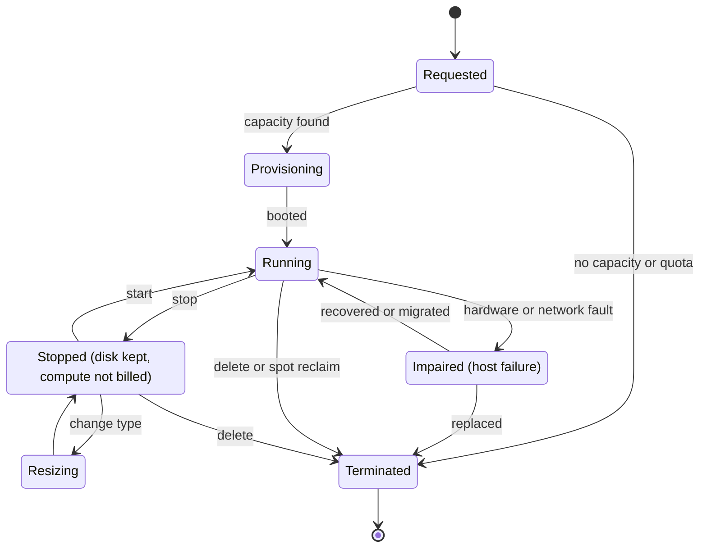
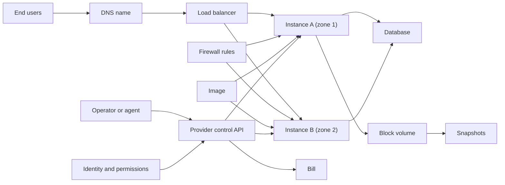
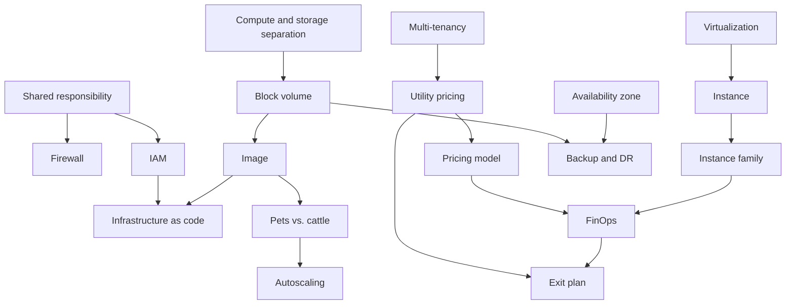
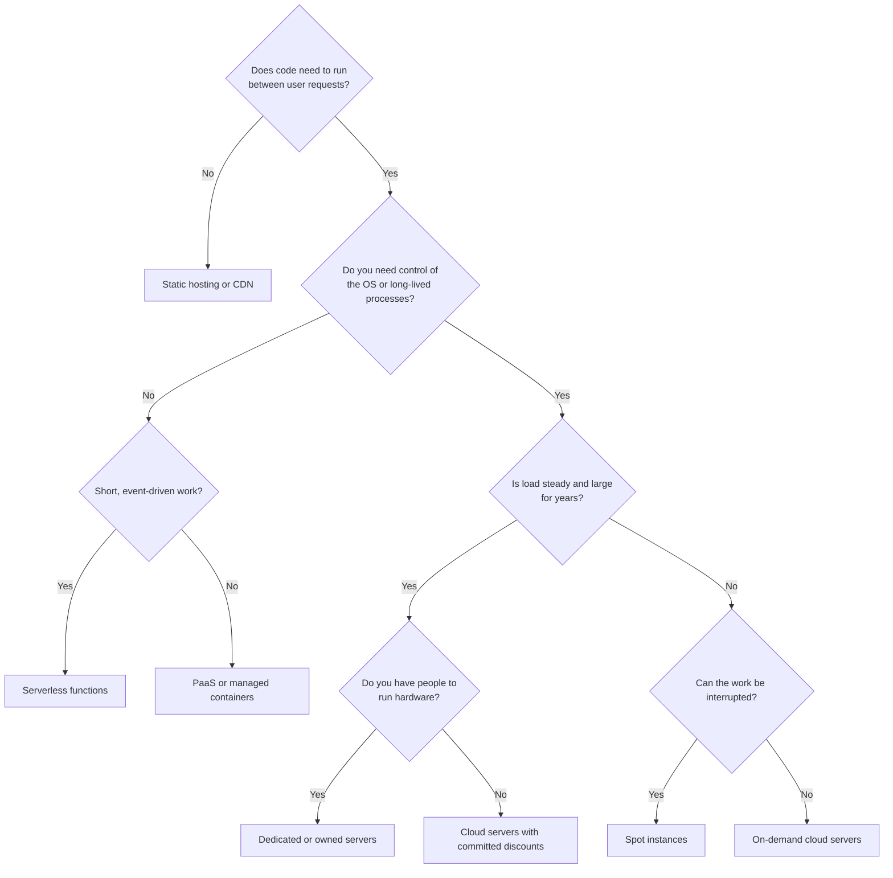
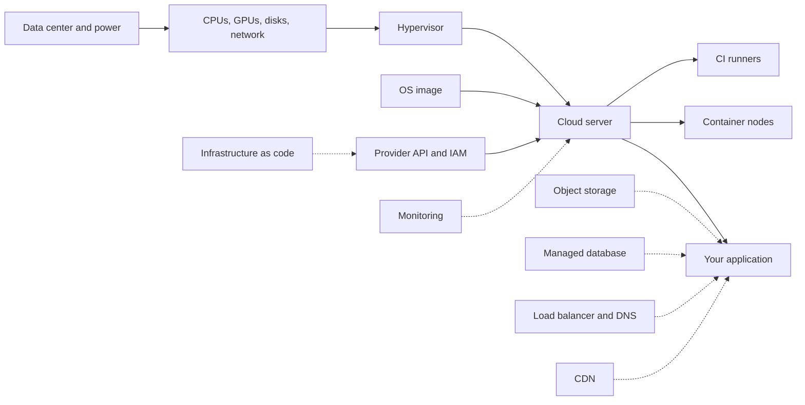
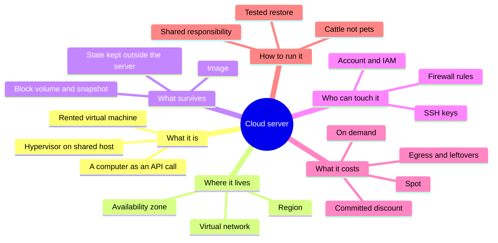

# Cloud Server — Learning Map

> A cloud server is a computer you rent by the hour over the internet: a slice of someone else's data center that you create with a request, own completely while it runs, and throw away when you are done.

**Generated:** 2026-11-06 · **Lens:** mental model, not manual

*Interpretation: "cloud server" here means a rented virtual machine (also called a cloud instance, VM, or VPS) from a provider such as AWS, Azure, Google Cloud, Hetzner, or DigitalOcean. It is the "Infrastructure as a Service" layer. Containers, serverless functions, and managed databases show up as neighbors, not as the subject. For the text interface most people use to operate one, see [CLI Tool](../cli-tool/README.md).*

*A Chinese version of this map: [云服务器 — 学习地图](README.zh.md).*

## Contents

1. [Essence](#1-essence)
2. [World Model](#2-world-model)
3. [Concept Map](#3-concept-map)
4. [Decision Map](#4-decision-map)
5. [Search Space Expansion](#5-search-space-expansion)
6. [Ecosystem](#6-ecosystem)
7. [Transferable Principles](#7-transferable-principles)
8. [Minimum Mental Model](#8-minimum-mental-model)
9. [Common Misconceptions](#9-common-misconceptions)
10. [Summary](#10-summary)

---

## 1. Essence

### What is it fundamentally?

A cloud server is **a computer that has become a rentable, programmable resource instead of a purchased object**. It behaves like a whole machine: it has an operating system, a disk, memory, a network address, and you have full administrator control. But it does not physically exist as "your" box. It is a virtual machine cut from a much larger physical host by a **hypervisor** (the software layer that splits one physical computer into many isolated ones). It appears seconds after you ask for it, and it stops costing money when you delete it.

The deep change is not the hardware. It is that **a computer became an API call**. Anything you can request with a message, you can also request from a script, a template, or an AI agent. That makes servers repeatable, disposable, and countable in a way physical machines never were.

### Why does it exist?

Big internet companies in the 2000s had to build huge fleets for their peak traffic, and most of that capacity sat idle most of the time. Virtualization had made it possible to split one machine safely between many tenants. Combining the two produced a business: **sell the spare capacity by the hour, and let the provider absorb the risk of buying hardware**. Amazon's EC2 (launched 2006) made this the default model. Everything later — containers, serverless, managed AI — is built on top of rented virtual machines like these.

### What problem does it solve?

| Problem                                                       | What a cloud server changes                                                    |
| ------------------------------------------------------------- | ------------------------------------------------------------------------------ |
| Buying a server takes weeks and a large upfront payment       | A server exists in under a minute and is paid for by the second or hour       |
| You must guess capacity years ahead                           | You size for today and resize or add machines when traffic changes            |
| Hardware failure is your problem                              | Physical repairs, power, cooling, and spare parts become the provider's problem |
| Experiments are expensive to start and to stop                | A test machine costs cents and can be deleted after the experiment             |
| Reaching users far away requires your own foreign data center | You choose a region near your users from a list                               |
| A machine's setup lives in one admin's memory                 | The machine can be described as an image or template and rebuilt identically  |

### What did people do before it?

- **Own hardware in your own building**: full control, large upfront cost, slow to change.
- **Colocation**: your hardware in a rented rack; the building's power and network are shared, but the box is still yours to buy and repair.
- **Dedicated server rental**: a hosting company rents you a physical machine by the month — closer to the cloud, but still slow to get and not programmable.
- **Shared hosting**: many websites on one machine with no root access — cheap but tightly limited.

The cloud server kept the control of a dedicated machine and added the speed and flexibility of software.

### What new possibilities does it create?

- **Disposable infrastructure**: you replace a broken machine instead of repairing it.
- **Elasticity**: a fleet that grows during the day and shrinks at night, with cost following load.
- **Global reach for small teams**: a two-person company can run servers on three continents.
- **Infrastructure as code**: whole environments described in reviewed, versioned text.
- **Short-lived heavy compute**: renting 64 cores or a GPU for one afternoon instead of buying it.
- **Agent-operated infrastructure (2025–2026)**: because every action is an API call, AI agents can create, inspect, and repair servers — which makes guardrails and budgets more important than manual skill.

---

## 2. World Model

### Objects

| Object                        | What it is                                                                                                   |
| ----------------------------- | ------------------------------------------------------------------------------------------------------------ |
| **Instance**                  | The running virtual machine: CPU, memory, and a network identity, billed while it exists                     |
| **Instance type (size)**      | A fixed menu item that sets CPU count, memory, and sometimes GPU or local disk                               |
| **Image**                     | A frozen starting disk (operating system plus software) that new instances are copied from                   |
| **Block volume**              | A network disk attached to an instance; it can outlive the instance or be moved to another one               |
| **Snapshot**                  | A point-in-time copy of a volume, used for backup or for making new images                                   |
| **Virtual network and subnet** | Your private address space inside the provider, which decides what can talk to what                        |
| **Firewall rule (security group)** | Allow-lists for which traffic may enter or leave an instance                                           |
| **Public IP address**         | The address the internet reaches; it can be fixed or change on every restart                                 |
| **Identity and key**          | SSH keys, cloud accounts, and roles that decide who may log in and who may call the provider's API           |
| **Region and zone**           | Where the hardware is: a region is a city-level location, a zone is an independent building or set of buildings inside it |
| **Bill**                      | The meter: every object above has a price, including some that keep charging after the instance is gone     |

### Actors

| Actor                          | Role                                                                                         |
| ------------------------------ | -------------------------------------------------------------------------------------------- |
| **Cloud provider**             | Owns buildings, hardware, hypervisors, and the control API; responsible for the physical layer |
| **Account owner**              | Pays the bill and holds final authority; often the only one who notices runaway cost         |
| **Operator (you or your team)** | Decides what runs, patches the operating system, and secures access                         |
| **Automation**                 | Templates, scripts, autoscalers, and CI that create and destroy instances without a person   |
| **AI agent**                   | A newer operator that can act quickly through the API and needs the narrowest permissions     |
| **End users**                  | Never see the server; they only feel its speed, uptime, and location                         |
| **Attackers**                  | Constantly scan every public IP address for open ports, weak passwords, and leaked keys      |

### State changes

An instance has a lifecycle that is mostly about **what you are still paying for** and **what data survives**.

Two lessons hide in this diagram. *Stopped* is not free: the disks and reserved addresses still bill. *Terminated* is final: anything stored only on local or attached-but-deleted disks is gone.

### Workflows

| Workflow                   | The recurring sequence                                                                                  |
| -------------------------- | ------------------------------------------------------------------------------------------------------- |
| **Launch**                 | Choose region → choose image → choose size → attach network and firewall → add keys → boot             |
| **Harden**                 | Close every port not needed → disable password login → apply updates → limit who can call the API      |
| **Deploy**                 | Build the software → put it on the server (or bake it into an image) → switch traffic → watch it      |
| **Scale**                  | Measure load → resize one machine (vertical) or add machines behind a load balancer (horizontal)       |
| **Back up and restore**    | Snapshot regularly → copy off the machine → actually test a restore                                    |
| **Replace, don't repair**  | Notice a sick instance → start a fresh one from the image → move traffic → delete the old one           |
| **Cost review**            | Read the bill → find idle or forgotten resources → right-size → commit to discounts for steady load    |

### Systems

Single servers combine into larger structures:

- **The single box**: one server holds the app, database, and files. Simple, cheap, and one failure away from downtime.
- **The tiered system**: load balancer → several app servers → a separate database. Losing one app server no longer matters.
- **The fleet**: an autoscaling group, or a container orchestrator such as Kubernetes, treats servers as interchangeable "cattle", not named "pets".
- **The control plane**: the provider's API and its identity system — the real master of everything above. Whoever controls the account controls every server.

### Value

- **Created** when capacity follows demand, when a new idea can be tested in an hour, and when hardware risk moves to someone with thousands of spare parts.
- **Captured** by the provider through convenience: data that is cheap to put in but costs to take out, managed services that only exist on one platform, and discounts that reward long commitments.
- **Destroyed** by forgotten instances and volumes that bill for months, by leaked keys used to run crypto miners on your account, by single-zone setups that fall over with one building, and by "lift and shift" migrations that copy old habits into a more expensive place.

---

## 3. Concept Map

### Layer 1: Foundations — what makes a rented computer possible

| Entity                     | Action                                       | Purpose                                             | Relationships                                                  |
| -------------------------- | -------------------------------------------- | --------------------------------------------------- | -------------------------------------------------------------- |
| **Virtualization**         | Splits one physical host into isolated VMs   | Lets many customers share hardware safely           | Underlies instances; its isolation is a security boundary      |
| **Multi-tenancy**          | Places different customers on shared hosts   | Spreads hardware cost over many buyers               | Creates "noisy neighbor" effects and isolation concerns         |
| **Utility pricing**        | Bills by time and usage                      | Turns capital cost into operating cost               | Rewards turning things off; punishes forgetting them            |
| **Separation of compute and storage** | Keeps disks on the network, not inside the machine | Lets a disk outlive or move between instances | Makes "the server" replaceable while data persists       |
| **Shared responsibility**  | Divides security duties                      | Provider secures the hardware; you secure what runs | Explains why most breaches are configuration mistakes          |

### Layer 2: Mechanisms — the controls you actually decide

| Entity                       | Action                                         | Purpose                                         | Relationships                                              |
| ---------------------------- | ---------------------------------------------- | ----------------------------------------------- | ---------------------------------------------------------- |
| **Instance family**          | Balances CPU, memory, GPU, and disk             | Matches the machine to the workload's shape     | Arm and x86 versions compete on price per unit of work     |
| **Burstable vs. dedicated CPU** | Lends spare CPU time vs. guarantees cores   | Cheap for idle-heavy loads; steady for busy ones | Burstable "credits" run out under constant load         |
| **Pricing model**            | On-demand, reserved/committed, or spot          | Trades flexibility for discount                  | Spot can be taken back with short warning                  |
| **Availability zone**        | Places copies in separate buildings             | Survives a building-level failure                | Cross-zone traffic can cost money                          |
| **Security group / firewall** | Allows only named traffic                      | Shrinks what attackers can reach                 | Works together with SSH keys and IAM                       |
| **Identity and access (IAM)** | Grants API powers to people and machines       | Limits damage from any one leaked credential     | Instance roles avoid storing keys on the disk              |
| **Image and boot script**    | Defines the starting state                      | Makes servers reproducible                       | Basis for "replace, don't repair"                          |

### Layer 3: Practice — running servers in the world

| Entity                       | Action                                         | Purpose                                              | Relationships                                         |
| ---------------------------- | ---------------------------------------------- | ---------------------------------------------------- | ----------------------------------------------------- |
| **Infrastructure as code**   | Describes servers in versioned text             | Makes environments reviewable and repeatable         | Uses images, IAM, and the provider API                |
| **Autoscaling**              | Adds and removes instances on a signal          | Keeps cost close to demand                           | Needs stateless servers and a load balancer           |
| **Pets vs. cattle**          | Chooses between nursing and replacing machines  | Decides how much you depend on one machine           | Cattle require images and external state              |
| **Observability**            | Collects metrics, logs, and alerts              | Lets you know a server is sick before users do       | Feeds autoscaling and incident response               |
| **FinOps (cost practice)**   | Tags, measures, and right-sizes spending        | Keeps the bill tied to value                         | Uses pricing models and lifecycle discipline          |
| **Backup and disaster recovery** | Copies data away and rehearses restores    | Survives deletion, ransomware, and region outages    | Uses snapshots and other regions or providers         |
| **Exit plan**                | Keeps the option to move providers              | Limits lock-in and price risk                        | Shaped by egress costs and managed-service use        |

### Concept Graph

---

## 4. Decision Map

| Situation                                                                 | Decision                                                        | Reason                                                                                         | Expected Outcome                                              |
| ------------------------------------------------------------------------- | --------------------------------------------------------------- | ---------------------------------------------------------------------------------------------- | ------------------------------------------------------------- |
| A static website or blog                                                  | **Don't use a server**; use static hosting                      | Nothing needs to run between requests, so a whole machine is pure maintenance                  | Near-zero cost, nothing to patch                              |
| A small side project with steady, light traffic                          | One small VPS from a simple provider                            | Predictable flat price, full control, easy to understand                                       | A few dollars a month; one machine to look after              |
| You need a long-running process: a game server, bot, or queue worker    | Cloud server                                                    | Serverless functions have time limits; containers on a platform may sleep                       | A process that stays up and keeps its connections             |
| Traffic varies 10× between day and night                                 | Several instances behind a load balancer with autoscaling       | Paying for peak all day wastes most of the money                                               | Cost follows load; one failure doesn't take you down          |
| Steady, predictable load running for years                               | Commit to a reserved/savings plan, or consider dedicated or owned hardware | Discounts reward commitment; at large steady scale, renting by the hour is expensive | Lower unit cost, less flexibility                             |
| Batch jobs that can be restarted (rendering, data processing, AI training checkpoints) | Spot / preemptible instances                     | Large discount in exchange for possible interruption                                           | Much cheaper compute; jobs must tolerate being stopped        |
| You need a database                                                      | Prefer a managed database over installing one on your own server | Backups, failover, and patching are where self-hosting usually fails                           | Higher unit price, far less risk of losing data               |
| You only want to run a web app and don't want to manage an OS            | Platform-as-a-service or containers-as-a-service instead        | Operating-system patching and security become someone else's job                               | Less control, less work                                       |
| Users and data must stay in one country by law                           | Choose region (or a sovereign/local provider) first, size later | Location is a legal constraint; size is a technical one                                        | Compliance that does not need retrofitting                    |
| You need a GPU for a few hours                                           | Rent an on-demand GPU instance or a GPU-specialist cloud        | Buying a GPU for occasional use rarely pays off; specialist clouds may have more stock          | Pay only for the hours used; watch availability               |
| A server misbehaves and nobody knows why                                 | Replace it from the image instead of debugging live             | A known-good starting state is faster than archaeology                                         | Quick recovery; investigate a snapshot later if needed        |
| An AI agent will manage your infrastructure                              | Give it a separate account or role with spending limits and no delete rights on data | Speed amplifies mistakes as much as successes                           | Fast automation with a bounded worst case                     |

### Decision Tree

---

## 5. Search Space Expansion

### Beginner questions rarely asked

| Question                                                                     | Why it matters                                                                     |
| ---------------------------------------------------------------------------- | ---------------------------------------------------------------------------------- |
| What keeps charging me after I delete the server?                            | Volumes, snapshots, IP addresses, and load balancers often outlive the instance    |
| Who else can reach this machine right now?                                   | A public server is scanned by bots within minutes of booting                       |
| What happens to my data if the physical host dies?                           | Separates local disks (lost) from network volumes (kept)                           |
| Is "1 vCPU" a full core?                                                     | Usually it is one hardware thread, sometimes shared or burstable                   |
| What does it cost to move data *out*?                                        | Outbound traffic is often the hidden line that dominates the bill                  |
| Who on my team can delete everything?                                        | Account permissions matter more than the server's own security                     |
| If I had to rebuild this server tonight, could I?                            | Tests whether the setup lives in code or only in someone's memory                  |

### Questions experts ask

| Question                                                                     | Why it matters                                                                     |
| ---------------------------------------------------------------------------- | ---------------------------------------------------------------------------------- |
| What is the blast radius of one leaked credential?                           | Defines the real security boundary, which is the account, not the machine          |
| Where is the state, and is everything else disposable?                       | Systems that keep state in a few known places can heal by replacement              |
| What happens when a whole zone or region is lost?                            | Separates "highly available" claims from tested reality                            |
| What is our unit cost (per user, per request) and how does it trend?         | Turns the bill from a total into an engineering signal                             |
| What would it take to leave this provider?                                   | Measures lock-in before it becomes a negotiation problem                           |
| Are we capacity-constrained in this region for the type we need?             | Popular and GPU types can be unavailable exactly when you scale                    |
| Which parts of this are we paying a premium to not think about?              | Makes the managed-vs-self-run trade-off explicit                                   |

### Questions worth exploring next

| Question                                                                     | Why it matters                                                                     |
| ---------------------------------------------------------------------------- | ---------------------------------------------------------------------------------- |
| How does a hypervisor keep tenants isolated, and when has it failed?         | Explains the security model you are trusting                                       |
| How do Arm instances change price per unit of work?                          | Chip choice is now a major cost lever                                              |
| When does renting stop being cheaper than owning?                            | The "cloud repatriation" debate depends on this curve                              |
| How do containers and Kubernetes change what a "server" means?               | They hide individual machines behind a scheduler                                   |
| How do regulations like data residency and data-portability rules shape choices? | Law is becoming a design input for infrastructure                              |
| How should an AI agent be sandboxed when it operates infrastructure?         | Agent operators are new and their failure modes are fast                           |

### Questions that define mastery

| Question                                                                     | Why it matters                                                                     |
| ---------------------------------------------------------------------------- | ---------------------------------------------------------------------------------- |
| Can you predict next month's bill from the architecture diagram?             | Shows that cost is understood as a design property                                 |
| Can any server be deleted right now without users noticing?                  | The real test of "cattle, not pets"                                                |
| Can you restore last week's data in a different region within your target time? | Backup is only real when restore is rehearsed                                  |
| Can you explain which failures the provider covers and which you own?        | Shared responsibility made concrete                                                |
| Can you choose between VM, container, serverless, and owned hardware for a new workload in five minutes, with reasons? | The decision map has become intuition          |
| Can a new teammate or agent rebuild the environment from the repository alone? | Knowledge has moved from heads into code                                        |

---

## 6. Ecosystem

### Upstream

- **Physical layer**: data centers, power, cooling, and network fiber — increasingly limited by electricity and by AI demand.
- **Chips**: x86 (Intel, AMD) and Arm designs (AWS Graviton, Google Axion, Azure Cobalt, Ampere), plus GPUs and AI accelerators.
- **Virtualization stack**: hypervisors (KVM-based ones dominate) and offload hardware that moves networking and storage off the main CPU.
- **Operating systems and images**: Linux distributions above all; Windows Server where needed.

### Downstream

- **Applications and websites** that run on the server.
- **Containers and orchestration**: Docker hosts and Kubernetes nodes are mostly cloud servers underneath.
- **Managed services**: managed databases, serverless platforms, and many AI services run on the provider's own fleets of the same machines.
- **CI runners and development environments**: temporary servers that build and test code.

### Alternatives

| Alternative                          | Choose it instead when…                                                                           |
| ------------------------------------ | ------------------------------------------------------------------------------------------------- |
| **Static hosting / CDN**             | Nothing needs to run on the server side                                                           |
| **Serverless functions**             | Work is short, event-driven, and spiky, and you don't want to manage an OS                        |
| **PaaS / managed containers**        | You want to ship an app, not a machine, and accept less control                                   |
| **Bare-metal cloud**                 | You need full hardware performance or licenses tied to physical cores, but still want renting     |
| **Dedicated rental / colocation / owned hardware** | Load is large, steady, and predictable, and you have people to run it                 |
| **A home server or single-board computer** | Learning, private hobby use, and you accept home internet and power reliability            |

### Complements

- **Object storage** for files and backups that should not live on the server's disk.
- **Managed databases** to keep the hardest state off your own machine.
- **Load balancers and DNS** to make many servers look like one address.
- **CDN** to serve static content close to users and reduce server load.
- **Infrastructure as code and configuration tools** to make servers reproducible.
- **Monitoring and alerting** to know about problems first.
- **Secret managers** to keep credentials off disks and out of code.

### Dependency Graph

Solid arrows are dependencies; dotted arrows are complements you add around the server.

---

## 7. Transferable Principles

### First principles

- **Renting trades a higher unit price for lower commitment.** The cloud is cheapest when your needs are uncertain or variable, not when they are large and fixed.
- **Anything you can create by API, you can lose by API.** Control of the account is control of everything.
- **Make machines disposable and keep state in a few protected places.** Then failures become replacements instead of emergencies.
- **Exposure invites attack.** The internet scans every public address all the time; default-closed is the only safe default.
- **Every resource has a meter.** Cost is an architectural property, not an accounting surprise.

### Transferable methodologies

- **Cattle, not pets** — applies to laptops, test environments, and even documents: rebuildable beats precious.
- **Least privilege** — give each person, script, and agent only the power it needs.
- **Rehearse the restore** — a backup or plan you have never tested is a hope.
- **Design for the failure of one unit** — one zone, one disk, one server, one provider.
- **Right-size, then commit** — measure real use before buying discounts.

### Implementation details (delegate to AI)

- Exact instance type names and their specs.
- Console menus, CLI flags, template syntax, and API field names.
- Current prices per hour, per GB, and per region.
- Step-by-step hardening and setup for a given Linux distribution.

### Stable knowledge (true in 10 years)

- Virtual machines on shared hardware, sold by time.
- The trade-off between flexibility (on-demand) and commitment (discounts).
- Separation of compute from durable storage.
- Shared responsibility between provider and customer.
- Regions and zones as units of failure and of law.
- Identity and permissions as the true security perimeter.

### Changing knowledge (likely different in 2 years)

| Claim (as of 2026)                                                                                                                           | Why it may change                                                |
| -------------------------------------------------------------------------------------------------------------------------------------------- | ---------------------------------------------------------------- |
| Arm instances (Graviton, Axion, Cobalt, Ampere) are widely offered and often cheaper per unit of work than comparable x86, while the newest x86 chips still lead in raw speed in some benchmarks | Chip generations change every 1–2 years                          |
| The EU Data Act (applying since September 2025) requires providers to remove switching charges, including for moving data out, by about January 2027 | Enforcement details and provider responses are still forming     |
| Data sovereignty and "sovereign cloud" offerings are a growing reason to choose regional providers                                           | Politics and regulation move quickly                             |
| GPU capacity is scarce and partly served by GPU-specialist clouds                                                                             | Supply and demand for AI hardware are shifting fast              |
| Some workloads are moving back from public cloud to owned or dedicated hardware ("repatriation") over cost and lock-in                        | Depends on prices, discounts, and regulation                     |
| AI agents increasingly create and operate servers through provider APIs                                                                       | Tools, permissions models, and norms for this are young          |

### Where to invest your memory

Remember the **first principles, the lifecycle, the decision tree, and the cost and security shapes**. Delegate everything that has a version number, a price, or a menu location to AI and documentation.

---

## 8. Minimum Mental Model

1. **Rented virtual machine** — a slice of a provider's physical host that acts like a full computer.
2. **Hypervisor** — the software that splits one physical machine into isolated tenants.
3. **A computer as an API call** — servers are created and destroyed by requests, so they can be automated.
4. **Region** — the city-level location; it decides latency to users and which laws apply.
5. **Availability zone** — an independent building inside a region; the basic unit of failure.
6. **Virtual network** — your private address space that decides which machines can talk.
7. **Image** — the frozen starting disk that makes new servers identical.
8. **Block volume and snapshot** — data that can outlive the server, and its point-in-time copies.
9. **State outside the server** — keep important data in volumes, databases, or object storage, so servers stay replaceable.
10. **Firewall rules** — default-closed doors; open only what is needed.
11. **SSH keys** — how humans log in; passwords should be off.
12. **Account and IAM** — the real perimeter; whoever controls it controls every server.
13. **On-demand pricing** — maximum flexibility at the highest unit price.
14. **Committed discount** — lower price for promising steady use.
15. **Spot instances** — deep discounts on capacity that can be taken back.
16. **Egress and leftovers** — outbound data and forgotten resources are the usual bill surprises.
17. **Cattle, not pets** — replace sick servers instead of nursing them.
18. **Shared responsibility** — the provider secures the hardware; you secure what you configure and run.
19. **Tested restore** — a backup counts only after you have restored from it.

---

## 9. Common Misconceptions

| Common misunderstanding                                    | Why it happens                                                                       | Better mental model                                                                                                  |
| ---------------------------------------------------------- | ------------------------------------------------------------------------------------ | -------------------------------------------------------------------------------------------------------------------- |
| "The cloud is always cheaper."                             | Small starting bills and marketing about no upfront cost                             | The cloud is cheaper for *uncertain or variable* load; large steady load is often cheaper on owned or dedicated hardware |
| "The provider keeps my server secure."                     | The provider's buildings and hardware are very secure, so people assume the rest is too | Under shared responsibility, the OS, open ports, keys, and permissions are yours — and most breaches happen there |
| "My data is backed up because it's in the cloud."          | Providers advertise durability of their storage                                      | Durable storage protects against hardware failure, not against you deleting it, ransomware, or a bad script          |
| "A cloud server is a physical machine reserved for me."    | It looks and behaves like one                                                        | It is a virtual slice of a shared host, and the host can fail, be maintained, or be noisy                            |
| "Stopped means free."                                      | "Off" sounds like "not billing"                                                      | Stopping ends compute charges; disks, snapshots, and reserved IPs keep billing until deleted                         |
| "Bigger instance = faster app."                            | More cores feels like more speed                                                     | Many apps are limited by database, disk, network, or a single thread; measure the bottleneck first                   |
| "Moving to the cloud is just copying my servers there."    | "Lift and shift" is the easiest first step                                           | Copying old servers keeps old costs and fragility; the benefits come from disposable machines, autoscaling, and managed state |
| "Multi-cloud protects me from lock-in automatically."      | Spreading risk sounds safe                                                           | Running on two clouds doubles the operational surface; real portability comes from simple, standard building blocks and a tested exit plan |

---

## 10. Summary

> What I truly gain is not **a remote computer I can log into**, but **the ability to treat computers as disposable, metered, programmable resources — and the responsibility to design for cost, failure, and access on purpose**.

A cloud server is a virtual machine rented from a provider's shared hardware, created and destroyed by API calls. Its value is speed and flexibility: you pay a premium per hour to avoid committing to hardware and to hand physical risk to someone else. The important design questions are not about the machine itself, but about where the state lives, who can call the API, what keeps billing, and what happens when a zone fails. Treat servers as replaceable, keep data in a few protected places, and keep the account locked down. Then decide, workload by workload, whether a whole machine is even the right unit, or whether static hosting, serverless, managed services, or owned hardware fits better.
