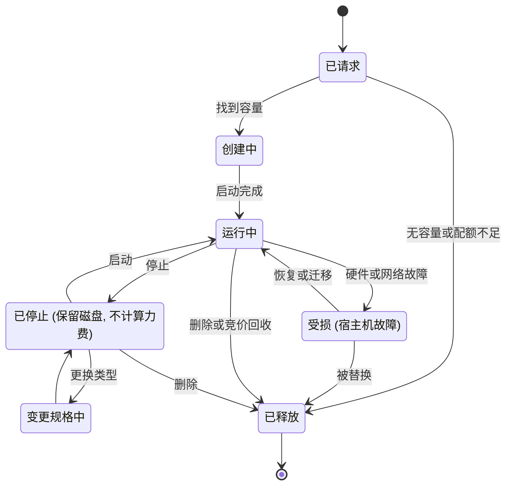
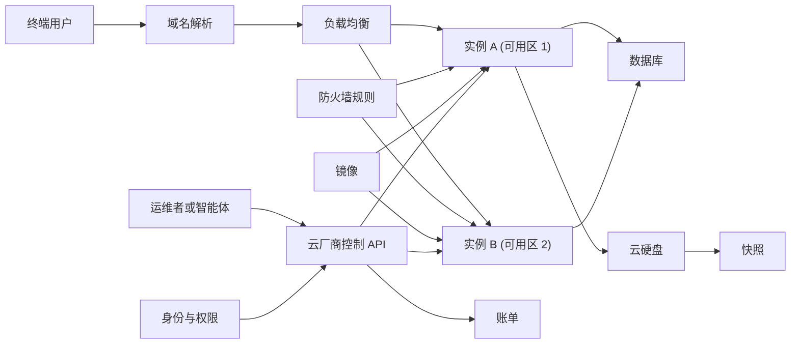
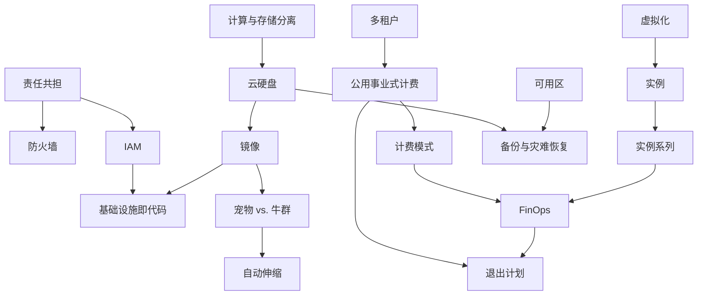
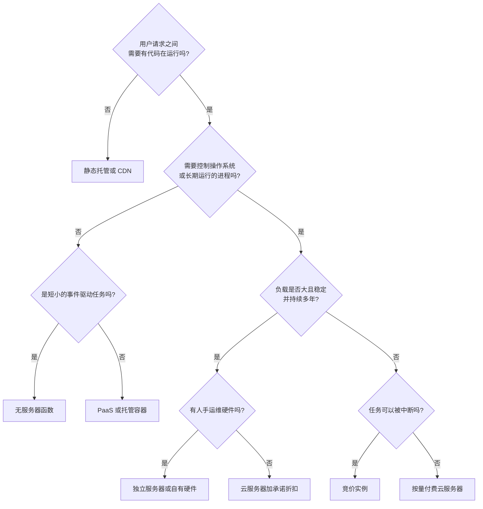
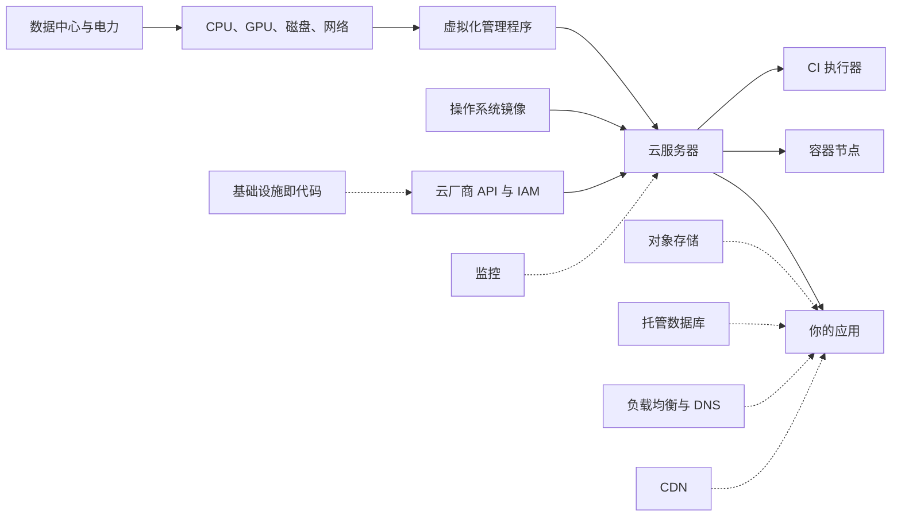
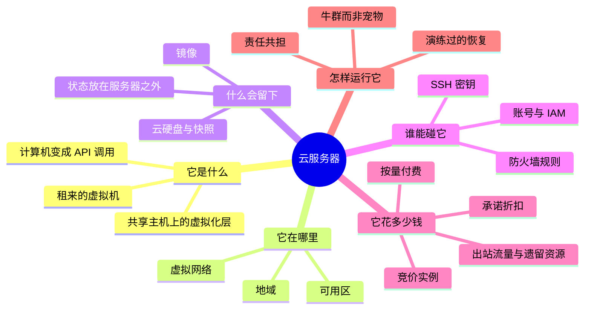

# 云服务器 — 学习地图

> 云服务器是一台通过互联网按小时租用的计算机：它是别人数据中心里的一小块，你发一个请求就能创建，运行期间完全归你控制，用完即可丢弃。

**生成日期：** 2026-11-06 · **视角：** 心智模型，而非操作手册

*解读：此处的"云服务器"指从 AWS、Azure、Google Cloud、阿里云、腾讯云、Hetzner、DigitalOcean 等云厂商租用的虚拟机（也叫云主机、实例、VM 或 VPS），即"基础设施即服务"（IaaS）这一层。容器、无服务器函数、托管数据库作为邻居出现，而不是主题。关于操作它最常用的文本界面，见 [CLI 工具](../cli-tool/README.zh.md)。*

*本地图的英文版：[Cloud Server — Learning Map](README.md)。*

## 目录

1. [本质](#1-本质)
2. [世界模型](#2-世界模型)
3. [概念地图](#3-概念地图)
4. [决策地图](#4-决策地图)
5. [探索空间扩展](#5-探索空间扩展)
6. [生态系统](#6-生态系统)
7. [可迁移的原则](#7-可迁移的原则)
8. [最小心智模型](#8-最小心智模型)
9. [常见误解](#9-常见误解)
10. [总结](#10-总结)

---

## 1. 本质

### 它根本上是什么？

云服务器是**一台从"买来的物件"变成了"可租用、可编程的资源"的计算机**。它表现得像一台完整的机器：有操作系统、磁盘、内存、网络地址，你拥有完整的管理员权限。但它并不是一台实体上属于"你"的盒子。它是由**虚拟化管理程序**（hypervisor，把一台物理计算机切分成多台相互隔离的计算机的软件层）从一台大得多的物理主机上切出来的虚拟机。你一提出请求，几秒钟后它就出现；你一删除它，它就不再花钱。

深层的变化不在硬件，而在于**一台计算机变成了一次 API 调用**。凡是能用一条消息请求的东西，也就能由脚本、模板或 AI 智能体来请求。这让服务器变得可重复、可丢弃、可计量——这是实体机器从来做不到的。

### 为什么会有它？

2000 年代的大型互联网公司必须按流量峰值建设庞大的机群，而这些容量大部分时间都闲着。与此同时，虚拟化技术已经能把一台机器安全地分给多个租户使用。两者结合就产生了一门生意：**按小时出售多余的容量，让云厂商来承担购买硬件的风险**。亚马逊的 EC2（2006 年推出）让这种模式成为默认。后来的一切——容器、无服务器、托管 AI——都建立在这类租来的虚拟机之上。

### 它解决什么问题？

| 问题 | 云服务器带来的改变 |
|---|---|
| 买服务器要几周时间和一大笔预付款 | 不到一分钟就有一台服务器，按秒或按小时付费 |
| 必须提前几年猜测容量 | 按今天的需求选规格，流量变化时再调整大小或加机器 |
| 硬件故障是你的问题 | 物理维修、供电、散热、备件都变成云厂商的问题 |
| 实验启动和停止都很贵 | 一台测试机只花几分钱，实验结束就删掉 |
| 服务远方用户需要自建海外机房 | 从列表里选一个离用户近的地域 |
| 机器的配置只存在于某个管理员的记忆里 | 机器可以被描述成镜像或模板，并完全一致地重建 |

### 在它之前，人们做什么？

- **在自己的机房放自己的硬件**：完全掌控，前期投入大，改变很慢。
- **服务器托管（colocation）**：你的硬件放在租来的机柜里；电力和网络共享，但机器仍要自己买、自己修。
- **独立服务器租用**：托管商按月租给你一台物理机——更接近云，但获取仍然慢，也无法编程控制。
- **虚拟主机（共享主机）**：许多网站共用一台机器，没有 root 权限——便宜但限制很多。

云服务器保留了独立服务器的控制力，又加上了软件的速度和灵活性。

### 它打开了什么可能性？

- **可丢弃的基础设施**：机器坏了就换一台，而不是修。
- **弹性**：机群白天扩大、夜里缩小，成本跟着负载走。
- **小团队的全球覆盖**：两个人的公司也能在三个大洲运行服务器。
- **基础设施即代码**：整个环境用经过审查、有版本的文本来描述。
- **短时的重型算力**：花一个下午租 64 核或一块 GPU，而不是买下来。
- **由智能体操作的基础设施（2025–2026）**：既然每个动作都是 API 调用，AI 智能体就能创建、检查和修复服务器——这让防护栏和预算上限比手工技能更重要。

---

## 2. 世界模型

### 对象（Objects）

| 对象 | 它是什么 |
|---|---|
| **实例（Instance）** | 正在运行的虚拟机：CPU、内存和一个网络身份，只要存在就计费 |
| **实例类型（规格）** | 一个固定的菜单项，决定 CPU 数、内存，有时还包括 GPU 或本地盘 |
| **镜像（Image）** | 冻结的起始磁盘（操作系统加软件），新实例从它复制而来 |
| **块存储卷（云硬盘）** | 挂载到实例上的网络磁盘；可以比实例活得更久，也能挂到另一台实例上 |
| **快照（Snapshot）** | 某个时间点的磁盘副本，用于备份或制作新镜像 |
| **虚拟网络与子网** | 你在云厂商内部的私有地址空间，决定谁能和谁通信 |
| **防火墙规则（安全组）** | 允许哪些流量进出实例的白名单 |
| **公网 IP 地址** | 互联网能访问到的地址；可以固定，也可能每次重启都变 |
| **身份与密钥** | SSH 密钥、云账号和角色，决定谁能登录机器、谁能调用云厂商的 API |
| **地域与可用区** | 硬件所在的位置：地域是城市级的位置，可用区是地域里一个或一组独立的机房 |
| **账单** | 计量表：上面每个对象都有价格，有些在实例删除后还会继续收费 |

### 行动者（Actors）

| 行动者 | 角色 |
|---|---|
| **云厂商** | 拥有机房、硬件、虚拟化层和控制 API；负责物理层 |
| **账号所有者** | 付账单，拥有最终权限；往往是唯一会注意到成本失控的人 |
| **运维者（你或你的团队）** | 决定运行什么、给操作系统打补丁、保护访问入口 |
| **自动化** | 模板、脚本、自动伸缩器和 CI，在无人参与时创建和销毁实例 |
| **AI 智能体** | 新的运维者，能通过 API 快速行动，需要最小的权限 |
| **终端用户** | 从不看到服务器；只感受到它的速度、可用性和位置 |
| **攻击者** | 持续扫描每一个公网 IP，寻找开放端口、弱密码和泄露的密钥 |

### 状态变化（State changes）

实例的生命周期，主要关乎**你还在为什么付钱**以及**哪些数据会留下来**。

这张图藏着两个教训。*已停止*不等于免费：磁盘和保留的地址还在计费。*已释放*是终点：只存在本地盘或随实例删除的磁盘上的数据，都没了。

### 工作流（Workflows）

| 工作流 | 反复出现的步骤 |
|---|---|
| **创建** | 选地域 → 选镜像 → 选规格 → 挂网络和防火墙 → 加密钥 → 启动 |
| **加固** | 关掉所有不需要的端口 → 禁用密码登录 → 安装更新 → 限制谁能调用 API |
| **部署** | 构建软件 → 放到服务器上（或打进镜像）→ 切换流量 → 观察 |
| **扩展** | 测量负载 → 给单台机器升配（纵向）或在负载均衡后面加机器（横向） |
| **备份与恢复** | 定期快照 → 复制到机器之外 → 真的演练一次恢复 |
| **替换而非修理** | 发现一台实例异常 → 从镜像新开一台 → 迁移流量 → 删除旧的 |
| **成本复盘** | 看账单 → 找出闲置或被遗忘的资源 → 调整规格 → 为稳定负载购买承诺折扣 |

### 系统（Systems）

单台服务器会组合成更大的结构：

- **单机**：一台服务器装下应用、数据库和文件。简单、便宜，但一次故障就停服。
- **分层系统**：负载均衡 → 多台应用服务器 → 独立的数据库。丢掉一台应用服务器不再要紧。
- **机群**：自动伸缩组，或 Kubernetes 这样的容器编排系统，把服务器当成可互换的"牛群"，而不是有名字的"宠物"。
- **控制平面**：云厂商的 API 和身份系统——上面一切的真正主人。谁控制了账号，谁就控制了每一台服务器。

### 价值（Value）

- **创造于**：容量跟随需求变化时；一个新想法一小时内就能试验时；硬件风险转移给拥有成千上万备件的一方时。
- **被获取于**：云厂商通过便利性获取价值——数据放进去便宜、拿出来要钱；只存在于某一平台的托管服务；奖励长期承诺的折扣。
- **被摧毁于**：被遗忘、连续计费数月的实例和磁盘；泄露的密钥被用来在你的账号上挖矿；只部署在单一可用区、一个机房出事就整体宕机的架构；把旧习惯原样搬到更贵地方的"直接搬迁"式迁移。

---

## 3. 概念地图

### 第一层：基础——租用一台计算机为什么可能

| 实体 | 动作 | 目的 | 关系 |
|---|---|---|---|
| **虚拟化** | 把一台物理主机切成多台隔离的虚拟机 | 让许多客户安全地共享硬件 | 是实例的基础；它的隔离就是一道安全边界 |
| **多租户** | 把不同客户放在共享主机上 | 把硬件成本分摊给许多买家 | 带来"吵闹邻居"效应和隔离方面的顾虑 |
| **公用事业式计费** | 按时间和用量收费 | 把资本支出变成运营支出 | 奖励关机，惩罚遗忘 |
| **计算与存储分离** | 磁盘放在网络上，而不是机器里 | 让磁盘比实例活得久，或在实例间移动 | 让"服务器"可替换，数据却能留下 |
| **责任共担** | 划分安全职责 | 云厂商保护硬件；你保护在上面运行的东西 | 解释了为什么大多数安全事件是配置错误 |

### 第二层：机制——你真正要做的选择

| 实体 | 动作 | 目的 | 关系 |
|---|---|---|---|
| **实例系列** | 平衡 CPU、内存、GPU 和磁盘 | 让机器匹配工作负载的形状 | Arm 与 x86 版本在单位工作价格上竞争 |
| **突发型 vs. 独享 CPU** | 借出空闲 CPU 时间 vs. 保证核心 | 前者适合大多闲置的负载，后者适合持续繁忙的负载 | 持续高负载下，突发型的"积分"会耗尽 |
| **计费模式** | 按量、包年包月/承诺、或竞价 | 用灵活性换折扣 | 竞价实例可能在短暂预警后被收回 |
| **可用区** | 把副本放在不同机房 | 扛住机房级故障 | 跨可用区流量可能要收费 |
| **安全组 / 防火墙** | 只放行指定流量 | 缩小攻击者能触及的范围 | 与 SSH 密钥和 IAM 配合 |
| **身份与访问管理（IAM）** | 给人和机器分配 API 权限 | 限制任一凭证泄露造成的损害 | 实例角色让密钥不必存放在磁盘上 |
| **镜像与启动脚本** | 定义起始状态 | 让服务器可复现 | "替换而非修理"的基础 |

### 第三层：实践——在现实中运行服务器

| 实体 | 动作 | 目的 | 关系 |
|---|---|---|---|
| **基础设施即代码** | 用有版本的文本描述服务器 | 让环境可审查、可重复 | 用到镜像、IAM 和云厂商 API |
| **自动伸缩** | 根据信号增减实例 | 让成本贴近需求 | 需要无状态的服务器和负载均衡 |
| **宠物 vs. 牛群** | 在"照料"和"替换"机器之间选择 | 决定你对单台机器的依赖程度 | 牛群需要镜像和外置的状态 |
| **可观测性** | 收集指标、日志和告警 | 在用户之前知道服务器出问题 | 为自动伸缩和故障响应提供输入 |
| **FinOps（成本实践）** | 打标签、计量、调整规格 | 让账单与价值挂钩 | 用到计费模式和生命周期纪律 |
| **备份与灾难恢复** | 把数据复制出去并演练恢复 | 扛住误删、勒索软件和地域故障 | 用到快照以及其他地域或厂商 |
| **退出计划** | 保留更换云厂商的选项 | 限制锁定和涨价风险 | 受出站流量费用和托管服务使用程度影响 |

### 概念图

---

## 4. 决策地图

| 情境 | 决策 | 理由 | 预期结果 |
|---|---|---|---|
| 一个静态网站或博客 | **不要用服务器**；用静态托管 | 请求之间没有东西需要运行，整台机器纯属维护负担 | 成本接近零，没有东西要打补丁 |
| 流量稳定且很小的个人项目 | 选一个简单云厂商的小规格 VPS | 价格固定可预期，完全掌控，容易理解 | 每月几美元；只需照看一台机器 |
| 需要长期运行的进程：游戏服务器、机器人、队列消费者 | 云服务器 | 无服务器函数有时长限制；平台上的容器可能休眠 | 进程一直在线，连接得以保持 |
| 日夜流量相差 10 倍 | 负载均衡后放多台实例并开启自动伸缩 | 全天按峰值付费会浪费大部分钱 | 成本跟随负载；一台故障不会让服务停掉 |
| 稳定、可预测的负载要运行好几年 | 购买包年包月/节省计划，或考虑独立服务器、自有硬件 | 折扣奖励承诺；在大规模稳定负载下按小时租很贵 | 单位成本更低，灵活性更少 |
| 可重启的批处理任务（渲染、数据处理、有检查点的 AI 训练） | 竞价 / 抢占式实例 | 用可能被中断换取大幅折扣 | 算力便宜得多；任务必须能承受被停 |
| 需要一个数据库 | 优先用托管数据库，而不是装在自己的服务器上 | 备份、故障切换和打补丁正是自建最常出问题的地方 | 单价更高，丢数据的风险小得多 |
| 只想跑一个 Web 应用，不想管操作系统 | 改用 PaaS 或托管容器服务 | 系统补丁和安全变成别人的事 | 控制更少，工作也更少 |
| 法律要求用户和数据留在某个国家 | 先选地域（或主权云、本地厂商），再选规格 | 位置是法律约束；规格是技术问题 | 合规不需要事后补救 |
| 需要用几个小时 GPU | 租按量 GPU 实例或 GPU 专业云 | 偶尔用就买 GPU 很少划算；专业云可能库存更多 | 只为用到的小时付费；注意可用性 |
| 一台服务器行为异常，没人知道原因 | 从镜像替换它，而不是在线排查 | 回到已知良好的起点，比考古更快 | 快速恢复；如有需要再基于快照事后调查 |
| 要让 AI 智能体管理你的基础设施 | 给它独立的账号或角色，设置支出上限，不给删除数据的权限 | 速度放大错误，就像放大成功一样 | 自动化很快，最坏情况有边界 |

### 决策树

---

## 5. 探索空间扩展

### 很少有人问的新手问题

| 问题 | 为什么重要 |
|---|---|
| 删掉服务器之后，还有什么在继续收费？ | 云硬盘、快照、IP 地址、负载均衡常常比实例活得久 |
| 现在还有谁能访问这台机器？ | 公网服务器启动几分钟内就会被机器人扫描 |
| 物理主机坏了，我的数据会怎样？ | 区分本地盘（丢失）和网络云硬盘（保留） |
| "1 vCPU"是一个完整的核心吗？ | 通常是一个硬件线程，有时是共享或突发型的 |
| 把数据*传出去*要花多少钱？ | 出站流量常常是账单里隐藏的大头 |
| 团队里谁能删除一切？ | 账号权限比服务器本身的安全更重要 |
| 如果今晚必须重建这台服务器，我做得到吗？ | 检验配置是存在代码里，还是只存在某人记忆里 |

### 专家会问的问题

| 问题 | 为什么重要 |
|---|---|
| 一个凭证泄露的爆炸半径有多大？ | 定义了真正的安全边界——是账号，不是机器 |
| 状态在哪里？其余一切都可丢弃吗？ | 状态只放在少数已知位置的系统，才能靠替换来自愈 |
| 整个可用区或地域丢失时会怎样？ | 把"高可用"的说法和经过检验的现实区分开 |
| 我们的单位成本（每用户、每请求）是多少，趋势如何？ | 把账单从一个总数变成一个工程信号 |
| 离开这家云厂商需要付出什么？ | 在锁定变成谈判难题之前先量出它 |
| 在这个地域，我们需要的类型容量够吗？ | 热门类型和 GPU 类型可能恰好在你扩容时没货 |
| 我们在为哪些"不用操心"支付溢价？ | 让托管与自建之间的取舍变得明确 |

### 值得接下来探索的问题

| 问题 | 为什么重要 |
|---|---|
| 虚拟化管理程序如何隔离租户？什么时候失败过？ | 解释你所信任的安全模型 |
| Arm 实例如何改变单位工作的价格？ | 芯片选择如今是重要的成本杠杆 |
| 什么时候租用不再比拥有便宜？ | "云回迁"之争取决于这条曲线 |
| 容器和 Kubernetes 如何改变"服务器"的含义？ | 它们把单台机器藏在调度器后面 |
| 数据驻留和数据可携带等法规如何影响选择？ | 法律正在成为基础设施的设计输入 |
| AI 智能体操作基础设施时，应如何加沙箱？ | 智能体运维者是新事物，它们的失败来得很快 |

### 定义精通的问题

| 问题 | 为什么重要 |
|---|---|
| 你能从架构图预测下个月的账单吗？ | 说明成本被理解为一种设计属性 |
| 现在任意删掉一台服务器，用户会察觉吗？ | 是"牛群而非宠物"的真正检验 |
| 你能在目标时间内，把上周的数据恢复到另一个地域吗？ | 只有演练过恢复，备份才是真的 |
| 你能说清哪些故障由云厂商负责、哪些由你负责吗？ | 让责任共担变得具体 |
| 面对一个新负载，你能在五分钟内在虚拟机、容器、无服务器和自有硬件之间做出选择并说出理由吗？ | 决策地图已经变成直觉 |
| 新同事或智能体能只凭代码仓库重建整个环境吗？ | 知识已经从脑子里搬进了代码 |

---

## 6. 生态系统

### 上游（Upstream）

- **物理层**：数据中心、电力、散热、光纤网络——越来越受电力和 AI 需求的限制。
- **芯片**：x86（Intel、AMD）和 Arm 设计（AWS Graviton、Google Axion、Azure Cobalt、Ampere），以及 GPU 和 AI 加速器。
- **虚拟化栈**：虚拟化管理程序（基于 KVM 的占主导）以及把网络和存储从主 CPU 上卸载出去的专用硬件。
- **操作系统与镜像**：以 Linux 发行版为主；需要时用 Windows Server。

### 下游（Downstream）

- 运行在服务器上的**应用和网站**。
- **容器与编排**：Docker 主机和 Kubernetes 节点底下大多就是云服务器。
- **托管服务**：托管数据库、无服务器平台和许多 AI 服务，都运行在云厂商自己的同类机群上。
- **CI 执行器和开发环境**：用来构建和测试代码的临时服务器。

### 替代方案（Alternatives）

| 替代方案 | 在什么情况下选它 |
|---|---|
| **静态托管 / CDN** | 服务端不需要运行任何东西 |
| **无服务器函数** | 任务短小、事件驱动、流量突发，并且不想管理操作系统 |
| **PaaS / 托管容器** | 想交付的是应用而不是机器，并接受更少的控制 |
| **裸金属云** | 需要完整硬件性能，或许可证按物理核心计算，但仍想租用 |
| **独立服务器租用 / 托管 / 自有硬件** | 负载大、稳定、可预测，并且有人手运维 |
| **家用服务器或单板计算机** | 用于学习或私人爱好，并接受家庭网络和供电的可靠性 |

### 互补品（Complements）

- **对象存储**：存放不该留在服务器磁盘上的文件和备份。
- **托管数据库**：把最难管的状态从自己的机器上移走。
- **负载均衡与 DNS**：让多台服务器看起来像一个地址。
- **CDN**：在离用户近的地方提供静态内容，减轻服务器负载。
- **基础设施即代码与配置工具**：让服务器可复现。
- **监控与告警**：先于用户知道问题。
- **密钥管理服务**：让凭证不落在磁盘上、不写进代码。

### 依赖图

实线箭头是依赖；虚线箭头是你在服务器周围添加的互补品。

---

## 7. 可迁移的原则

### 第一性原理

- **租用是用更高的单价换取更低的承诺。** 云在需求不确定或多变时最便宜，而不是在需求大且固定时。
- **凡是能通过 API 创建的，也能通过 API 失去。** 控制了账号就控制了一切。
- **让机器可丢弃，把状态放在少数受保护的地方。** 这样故障就变成替换，而不是紧急事件。
- **暴露就会招来攻击。** 互联网时刻扫描每一个公网地址；默认关闭是唯一安全的默认值。
- **每个资源都有计量表。** 成本是架构属性，不是会计上的意外。

### 可迁移的方法论

- **牛群而非宠物**——同样适用于笔记本电脑、测试环境，甚至文档：可重建胜过珍贵。
- **最小权限**——每个人、每个脚本、每个智能体只拿它需要的权力。
- **演练恢复**——从没测试过的备份或预案只是一个希望。
- **为单个单元的失败而设计**——一个可用区、一块磁盘、一台服务器、一家云厂商。
- **先调整规格，再做承诺**——先测出真实用量，再买折扣。

### 实现细节（交给 AI）

- 具体实例类型的名称和规格。
- 控制台菜单、CLI 参数、模板语法、API 字段名。
- 当前每小时、每 GB、每个地域的价格。
- 针对某个 Linux 发行版的分步加固与配置。

### 稳定知识（10 年后依然成立）

- 共享硬件上的虚拟机，按时间出售。
- 灵活（按量）与承诺（折扣）之间的取舍。
- 计算与持久存储分离。
- 云厂商与客户之间的责任共担。
- 地域和可用区既是故障单位，也是法律单位。
- 身份与权限才是真正的安全边界。

### 变化中的知识（2 年内可能不同）

| 论断（截至 2026 年） | 为什么可能改变 |
|---|---|
| Arm 实例（Graviton、Axion、Cobalt、Ampere）已广泛提供，单位工作价格常低于同类 x86；但在部分基准测试中，最新的 x86 芯片原始速度仍领先 | 芯片每 1–2 年换一代 |
| 欧盟《数据法案》（2025 年 9 月起适用）要求云厂商在约 2027 年 1 月前取消切换费用，包括把数据迁出的费用 | 执行细节和厂商的应对仍在形成中 |
| 数据主权和"主权云"正成为选择区域性云厂商的一个日益重要的理由 | 政治和监管变化很快 |
| GPU 容量紧张，部分需求由 GPU 专业云满足 | AI 硬件的供需变化很快 |
| 出于成本和锁定的考虑，部分负载正从公有云迁回自有或独立硬件（"云回迁"） | 取决于价格、折扣和监管 |
| AI 智能体越来越多地通过云厂商 API 创建和运维服务器 | 相关工具、权限模型和规范都还很年轻 |

### 该把记忆投资在哪里

记住**第一性原理、生命周期、决策树，以及成本与安全的形状**。凡是带版本号、价格或菜单位置的东西，都交给 AI 和文档。

---

## 8. 最小心智模型

1. **租来的虚拟机**——云厂商物理主机上的一块，表现得像一台完整的计算机。
2. **虚拟化管理程序**——把一台物理机切分给多个隔离租户的软件。
3. **计算机变成 API 调用**——服务器由请求创建和销毁，所以可以自动化。
4. **地域**——城市级的位置；决定离用户的延迟以及适用哪些法律。
5. **可用区**——地域内的独立机房；最基本的故障单位。
6. **虚拟网络**——你的私有地址空间，决定哪些机器能互相通信。
7. **镜像**——冻结的起始磁盘，让新服务器完全一致。
8. **云硬盘与快照**——能比服务器活得更久的数据，以及它某一时刻的副本。
9. **状态放在服务器之外**——重要数据放在云硬盘、数据库或对象存储里，让服务器保持可替换。
10. **防火墙规则**——默认关闭的门；只开需要的。
11. **SSH 密钥**——人登录的方式；应该关掉密码登录。
12. **账号与 IAM**——真正的边界；谁控制它，谁就控制每一台服务器。
13. **按量付费**——最大的灵活性，最高的单价。
14. **承诺折扣**——承诺稳定使用，换取更低价格。
15. **竞价实例**——可能被收回的容量，换来大幅折扣。
16. **出站流量与遗留资源**——出站数据和被遗忘的资源，是账单上常见的意外。
17. **牛群而非宠物**——替换生病的服务器，而不是照料它。
18. **责任共担**——云厂商保护硬件；你保护你配置和运行的东西。
19. **演练过的恢复**——只有真正从备份恢复过，备份才算数。

---

## 9. 常见误解

| 常见误解 | 为什么会这样 | 更好的心智模型 |
|---|---|---|
| 云总是更便宜 | 起步账单很小，加上"无需预付"的宣传 | 云对*不确定或多变*的负载更便宜；大而稳定的负载往往在自有或独立硬件上更便宜 |
| 云厂商会保护我的服务器安全 | 云厂商的机房和硬件非常安全，于是人们以为其余部分也是 | 在责任共担下，操作系统、开放端口、密钥和权限归你管——大多数安全事件就发生在这里 |
| 数据在云上，所以已经备份了 | 云厂商宣传存储的持久性 | 持久存储防的是硬件故障，防不了你自己误删、勒索软件或一个出错的脚本 |
| 云服务器是专门为我保留的一台物理机 | 它看起来、用起来都像一台 | 它是共享主机上的一个虚拟切片，宿主机可能故障、维护或被邻居拖慢 |
| 停机就不收费 | "关掉"听起来像"不计费" | 停机只停止算力费用；磁盘、快照和保留 IP 会一直计费，直到删除 |
| 实例越大，应用越快 | 核心越多感觉越快 | 许多应用卡在数据库、磁盘、网络或单线程上；先测量瓶颈 |
| 上云就是把服务器复制过去 | "直接搬迁"是最容易的第一步 | 原样复制会带上旧的成本和脆弱性；好处来自可丢弃的机器、自动伸缩和托管的状态 |
| 多云会自动帮我避免锁定 | 分散风险听起来很安全 | 同时运行两朵云会让运维面翻倍；真正的可迁移性来自简单、标准的构件和演练过的退出计划 |

---

## 10. 总结

> 我真正获得的不是**一台可以远程登录的计算机**，而是**把计算机当作可丢弃、可计量、可编程的资源来使用的能力——以及有意识地为成本、故障和访问做设计的责任**。

云服务器是从云厂商共享硬件上租来的虚拟机，通过 API 调用创建和销毁。它的价值在于速度和灵活：你按小时支付溢价，以免除对硬件的承诺，并把物理风险交给别人。重要的设计问题并不在机器本身，而在于状态放在哪里、谁能调用 API、什么还在计费、一个可用区出事时会怎样。把服务器当作可替换的，把数据放在少数受保护的地方，并锁好账号。然后针对每个负载判断：一整台机器是否真是合适的单位，还是静态托管、无服务器、托管服务或自有硬件更合适。
