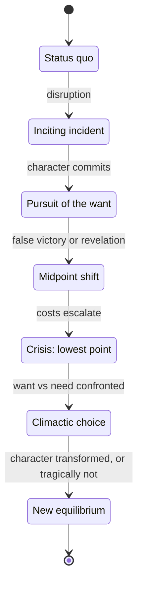
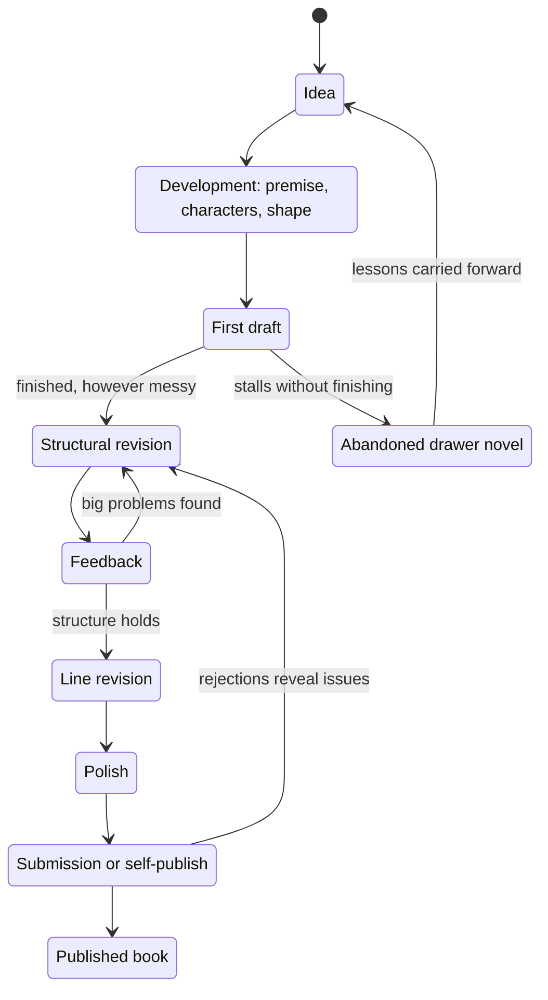
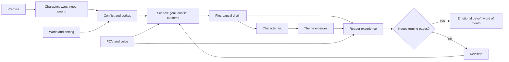
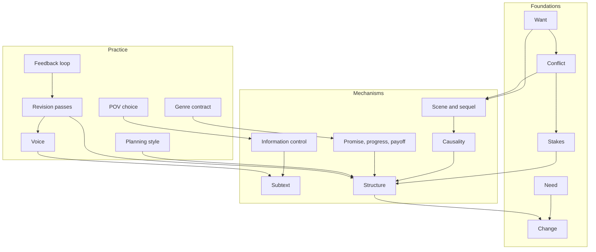
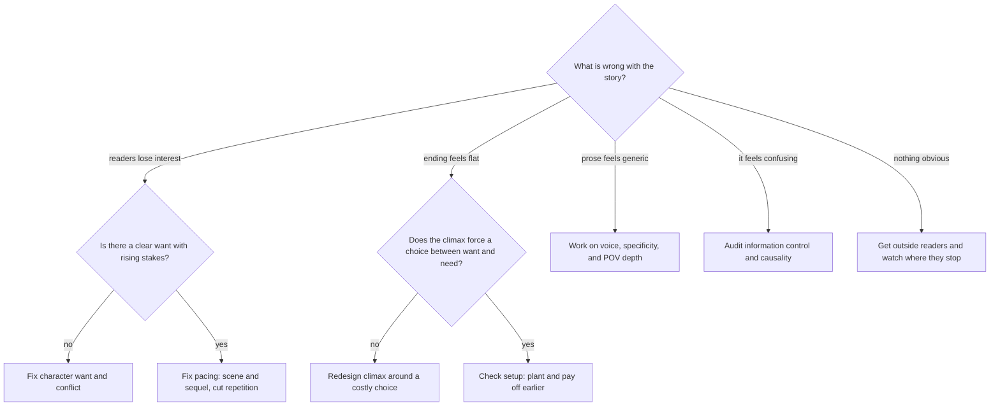
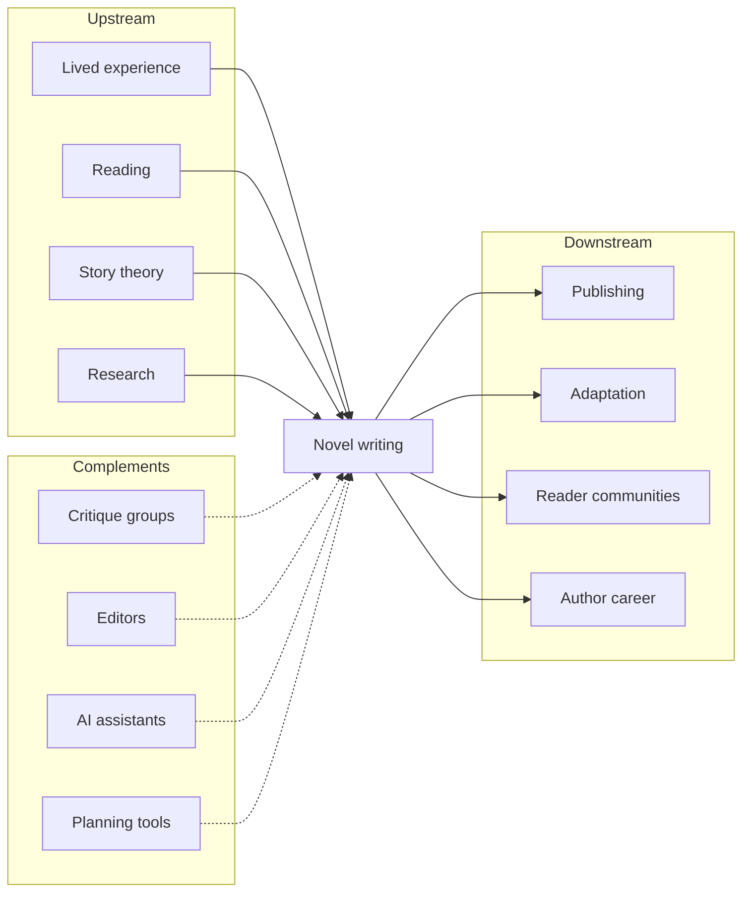
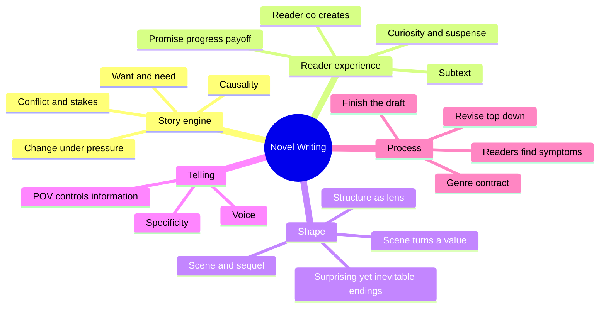

# Fiction Novel Writing — Learning Map

> Writing a fiction novel is designing a long, controlled experience for a reader: a sequence of choices about who wants what, what stands in the way, and what changes — rendered in prose so the reader feels it happen rather than being told it.

**Generated:** 2026-10-22 · **Lens:** mental model, not manual

*Interpretation: "how to write a fiction novel" is mapped here as the craft and system of novel writing — why stories work and where the real decisions lie — not as a step-by-step writing course.*

## Contents

1. [Essence](#1-essence)
2. [World Model](#2-world-model)
3. [Concept Map](#3-concept-map)
4. [Decision Map](#4-decision-map)
5. [Search Space Expansion](#5-search-space-expansion)
6. [Ecosystem](#6-ecosystem)
7. [Transferable Principles](#7-transferable-principles)
8. [Minimum Mental Model](#8-minimum-mental-model)
9. [Common Misconceptions](#9-common-misconceptions)
10. [Summary](#10-summary)

---

## 1. Essence

### What is it fundamentally?

A novel is **a simulation the reader runs in their own head**. The writer doesn't transmit events; they supply cues — a character's want, a threat, a detail, a withheld fact — and the reader's mind builds the world, predicts what happens next, and feels the gap between prediction and outcome. Writing a novel is engineering that gap across 70,000–120,000 words.

At its core, a story is **change under pressure**: a character wants something, obstacles force choices, and choices reveal and alter who they are. Everything else — prose, setting, structure — exists to make that change felt.

### Why does it exist?

- **Humans learn through simulated experience.** Stories let us rehearse fear, loss, love, and moral dilemmas without paying their real cost.
- **Interiority is the novel's unique power.** Film shows behavior; a novel can sit inside a mind and show the distance between what someone thinks, says, and does.
- **Length allows transformation.** Short forms capture a moment; a novel has room for a person — or a society — to become something else.

### What problem does it solve?

For the reader: the need for meaning, empathy, escape, and understanding other lives. For the writer: turning a vague sense ("there's something about grief and lighthouses") into a coherent, communicable experience that strangers will choose to spend ten hours inside.

The craft problem is **sustained attention**: how do you make someone want to turn the page 300 times, and leave feeling the time was worth it?

### What did people do before it?

| Before | What the novel added |
|---|---|
| Oral epics and myths | Private, individual psychology instead of public heroic deeds |
| Drama and theater | Access to thoughts, not only speech and action |
| Letters, diaries, chronicles | Deliberate shape — causality, rising tension, payoff |
| Sermons and moral fables | Ambiguity; readers judge instead of being told the lesson |

### What new possibilities does it create?

- **Empathy at scale** — inhabiting a life radically unlike your own.
- **Ideas tested in human terms** — a political or philosophical question run through characters who pay the consequences.
- **World-building** — entire societies, magic systems, or futures explored with internal consistency.
- **In the AI era** — when fluent prose is cheap, the scarce assets become *taste*, *specificity of vision*, *structural judgment*, and *lived truth*. The writer's job shifts toward deciding what the story is and why it matters, and judging whether a page is alive.

---

## 2. World Model

### Objects

| Object | What it is |
|---|---|
| **Premise** | The core situation with built-in tension: *what if* + a character who must deal with it. |
| **Character** | A bundle of want, need, wound, and contradiction that generates choices. |
| **Conflict** | Anything opposing the want — another person, society, nature, the self. |
| **Scene** | The atomic unit of story: a character pursues a goal, meets resistance, and something changes. |
| **Plot** | The causal chain of scenes — *because of that*, not *and then*. |
| **Theme** | The question the story keeps asking, answered through consequences rather than statements. |
| **Point of view & voice** | Whose perception filters the story, and the personality of the telling. |
| **Manuscript** | The physical artifact, moving through drafts toward a finished book. |

### Actors

- **Writer** — makes the story decisions; increasingly a director of drafts rather than sole typist.
- **Reader** — co-creator; supplies imagination, prediction, and emotion. The ultimate judge.
- **Characters** — behave as autonomous agents within the fiction; when they "refuse" an action, the plot is usually wrong.
- **Beta readers and critique partners** — early signals of where reader experience diverges from intent.
- **Editors** (developmental, line, copy) — shape structure, then sentences, then correctness.
- **Agents and publishers** — gatekeepers and amplifiers in the traditional path.
- **Market and platforms** — retailers, algorithms, communities (BookTok, Goodreads) that decide discoverability.
- **AI tools** — brainstorming partners, draft generators, consistency checkers, and critics; powerful at fluency, weak at intention.

### State changes

Two lifecycles run in parallel: **the character changes inside the story**, and **the manuscript changes outside it**.

### Workflows

1. **Discover** — find the premise, the character's want and wound, the central question.
2. **Shape** — decide how much to plan: outline (plotter), explore (discovery writer), or a hybrid scaffold.
3. **Draft** — get a complete version into existence; completion matters more than quality.
4. **Revise top-down** — structure and character arcs first, scenes second, sentences last.
5. **Test** — watch where real readers get bored, confused, or moved.
6. **Ship** — query agents, self-publish, or serialize; then build toward the next book.

### Systems

### Value

- **Created** when the reader experiences something they couldn't have predicted but recognize as inevitable — surprise plus rightness.
- **Captured** through reader loyalty: readers follow *voices* and *series*, so value compounds across books rather than within one.
- **Destroyed** by broken promises (a thriller with no tension, a romance with no payoff), unearned endings, generic prose, and — in the AI era — sameness: competent text with no particular person behind it.

---

## 3. Concept Map

### Layer 1 — Foundations: what a story is made of

| Entity | Action | Purpose | Relationships |
|---|---|---|---|
| **Want** | Drives action | Gives the reader something to root for and track | Opposed by Conflict; often at odds with Need |
| **Need** | Lurks beneath the want | The inner change the character must make | Revealed by Crisis; its resolution is the Arc |
| **Conflict** | Resists the want | Creates tension and forces choices | Produces Stakes; fuels every Scene |
| **Stakes** | Raise the cost of failure | Make the reader care about outcomes | Must escalate across the Plot |
| **Change** | Occurs through choices | The point of the story; static stories feel inert | The Arc is change in the character; the Plot is change in the situation |

### Layer 2 — Mechanisms: how stories hold attention

| Entity | Action | Purpose | Relationships |
|---|---|---|---|
| **Promise, progress, payoff** | Set up and fulfill expectations | Builds trust between reader and writer | Opening pages make the Promise; ending must pay it off |
| **Scene and sequel** | Alternate action and reaction | Controls pacing and emotional digestion | Scene = goal, conflict, disaster; sequel = reaction, dilemma, decision |
| **Causality** | Links events with *because* | Makes plot feel inevitable rather than arbitrary | Weak causality = episodic story |
| **Information control** | Withholds and reveals | Creates curiosity, suspense, and surprise | Dramatic irony: reader knows more than the character |
| **Subtext** | Implies rather than states | Engages the reader as co-creator | The gap between dialogue and intent |
| **Structure** | Shapes the whole | Places turning points where attention would sag | Three-act, hero's journey, kishōtenketsu are lenses, not laws |

### Layer 3 — Practice: how the work gets made

| Entity | Action | Purpose | Relationships |
|---|---|---|---|
| **Planning style** | Determines how much is decided before drafting | Matches process to the writer's mind | Plotters outline; discovery writers revise more |
| **POV choice** | Filters all information | Decides intimacy, reliability, and what can be known | First, close third, omniscient — each enables different reveals |
| **Voice** | Gives the telling a personality | The main reason readers choose *this* writer | Hardest element to fake; easiest to flatten with AI |
| **Revision passes** | Rework from large to small | Most of the real writing happens here | Developmental → line → copy |
| **Genre contract** | Defines reader expectations | Tells you which promises are mandatory | Romance needs a happy ending; mystery needs a fair solution |
| **Feedback loop** | Reveals reader experience | Writers can't see their own blind spots | Beta readers, critique groups, editors, AI critique |

### Cross-layer concept graph

---

## 4. Decision Map

| Situation | Decision | Reason | Expected Outcome |
|---|---|---|---|
| You have a vivid world but no story | Find a character whose want collides with that world | Settings don't generate plot; desires do | A premise with built-in conflict |
| The middle of the draft sags | Add a midpoint reversal and escalate stakes | Sagging middles come from repetition without escalation | Renewed momentum and a sharper second half |
| You keep rewriting chapter one | Stop and finish the draft first | You can't know what the opening must promise until you know the ending | A complete draft to revise from |
| Readers say "I didn't care about the protagonist" | Clarify the want and show it early in an active choice | Readers bond with desire and agency, not likeability | Engagement from page one |
| Plot twist feels cheap | Plant clues earlier so it's surprising yet inevitable | Twists work when they recontextualize, not when they come from nowhere | A reveal readers want to reread toward |
| Choosing POV | Pick the POV that best controls the key information | POV decides what can be withheld and revealed | Suspense and intimacy where the story needs them |
| Using AI to draft prose | Use AI for options, consistency checks, and critique; keep voice and key choices yours | AI produces fluent averages; novels live on specificity | Faster iteration without losing a distinct voice |
| Feedback conflicts across readers | Trust the *location* of the problem more than the suggested fix | Readers detect symptoms reliably and diagnose poorly | Targeted revisions rather than chasing opinions |
| Choosing a genre | Choose one deliberately and learn its contract | Genre is a promise; breaking it unknowingly disappoints readers | Satisfied readers and a findable book |
| Deciding between traditional and self-publishing | Match the path to your goals: validation and distribution vs. control and speed | Each path trades different costs | A publishing plan you can sustain |
| The story isn't working and revision feels endless | Diagnose at the premise level before fixing sentences | Sentence polish can't save a broken engine | Efficient revision, or a clean decision to move on |
| Wanting to write but having no novel idea | **Don't** start a novel yet; write short stories or scenes | Short forms build craft cheaply and reveal what you care about | Skills and a premise worth 300 pages |

### Central decision tree

---

## 5. Search Space Expansion

### Beginner questions rarely asked

| Question | Why it matters |
|---|---|
| What promise does my first page make? | Readers decide within a few pages what kind of book this is. |
| What does my protagonist want in *this* scene? | Scenes without goals feel like filler even when well written. |
| What is the reader curious about right now? | Curiosity, not action, is what turns pages. |
| What genre shelf does this belong on? | Without a shelf, there is no reader and no agent pitch. |
| What should I deliberately *not* explain? | Over-explaining kills subtext and reader engagement. |
| Why does this story need to be a novel and not a short story or film? | Form should fit the story's scope and interiority. |

### Questions experts ask

| Question | Why it matters |
|---|---|
| Where does the reader know more than the character, and is that intentional? | Dramatic irony is a primary suspense engine. |
| Is every scene turning a value — from positive to negative or vice versa? | Scenes that don't turn don't move the story. |
| What is the character's lie, and when is it challenged? | The arc depends on a false belief under pressure. |
| What does the ending make the reader re-understand about the beginning? | Strong endings retroactively charge earlier pages. |
| Which genre expectations am I fulfilling, subverting, or ignoring? | Subversion only works if the expectation is felt. |
| Whose story is this really? | The POV character and the changed character are not always the same. |

### Questions worth exploring next

| Question | Why it matters |
|---|---|
| How do different structural models (three-act, kishōtenketsu, braided narratives) produce different reader experiences? | Expands the shapes you can choose from. |
| How is voice built from syntax, diction, and attention? | Voice is learnable when broken into components. |
| How do series and serial fiction change story design? | Many modern careers are built on series, not standalone books. |
| How should a writer integrate AI without losing authorship? | Defines your workflow and your legal and ethical position. |
| How do discoverability systems (algorithms, communities) shape which books succeed? | Craft and distribution are now intertwined. |
| What can screenwriting, game narrative, and stand-up teach novelists? | Adjacent forms isolate specific mechanics like pacing and timing. |

### Questions that define mastery

| Question | Why it matters |
|---|---|
| Can you diagnose why a page is dead and fix it in one pass? | Mastery is diagnosis, not inspiration. |
| Can you break a rule deliberately and have readers love it? | Shows understanding of what the rule protected. |
| Can you make the reader feel an emotion you never name? | The hallmark of subtext and control. |
| Can you finish books repeatedly, not just once? | Sustainable process is part of craft. |
| Can you write an ending that is surprising and inevitable at the same time? | The hardest balance in narrative. |
| Can you tell which parts of your work only you could have written? | In the AI era, that is the part that matters. |

---

## 6. Ecosystem

### Upstream — what feeds novel writing

- **Lived experience and observation** — the source of specificity.
- **Reading widely and deeply** — the training data for a writer's instincts.
- **Story theory** — Aristotle's Poetics, Campbell's monomyth, Swain's scene and sequel, McKee's Story.
- **Research** — history, science, cultures, professions that give fiction texture and authority.
- **Language and rhetoric** — grammar, rhythm, imagery.

### Downstream — what novel writing feeds

- **Publishing** — traditional houses, independent presses, self-publishing platforms.
- **Adaptation** — film, TV, games, audiobooks, comics.
- **Reader communities** — fandoms, book clubs, social platforms.
- **Author career** — series, backlist, brand, teaching, newsletters.

### Alternatives

| Alternative | Choose it instead when… |
|---|---|
| **Short stories** | You want to test ideas and build craft quickly with lower cost. |
| **Screenwriting** | The story is primarily visual and external, and you want collaborative production. |
| **Interactive fiction and game narrative** | The reader's choices should shape the story. |
| **Narrative nonfiction or memoir** | The truth itself is the hook. |
| **Serial web fiction** | You want direct reader feedback and ongoing income from chapters. |
| **Poetry** | Compression and language matter more than plot and length. |

### Complements

- **Writing communities and critique groups** — accountability and outside eyes.
- **Editors and book coaches** — professional diagnosis.
- **AI writing assistants** — brainstorming, consistency tracking, critique, research summaries.
- **Story-planning tools** — outlining, timelines, story bibles.
- **Marketing and platform-building** — newsletters, social media, author websites.

---

## 7. Transferable Principles

| Category | Content | Remember or delegate? |
|---|---|---|
| **First principles** | Story is change under pressure. Readers engage through desire, curiosity, and uncertainty. Causality beats coincidence. Specificity creates belief. The reader co-creates meaning. | **Remember** — they apply to every story you will ever tell or judge. |
| **Transferable methodologies** | Draft fast, revise slow. Revise top-down from structure to sentences. Test with real readers. Set up and pay off. Show the consequence, not the explanation. | **Remember** — useful for pitches, presentations, product narratives, and teaching. |
| **Implementation details** | Beat sheets, outline templates, word-count goals, formatting manuscripts, query letter formats, publishing logistics. | **Delegate** — AI and tools handle these well. |
| **Stable knowledge** | Character want vs. need; conflict and stakes; scene structure; promise and payoff; genre contracts; voice as a differentiator. | **Remember** — true in 10 years and true 2,000 years ago. |
| **Changing knowledge** | AI-assisted drafting norms; disclosure and copyright rules for AI-generated text (shifting since 2023, unsettled as of 2026); platform algorithms; publishing economics; trending genres and tropes. | **Track lightly** — check current rules when you publish. |

---

## 8. Minimum Mental Model

1. **Change under pressure** — a story is a character transformed by choices under conflict.
2. **Want and need** — what the character pursues vs. what they actually require.
3. **Conflict and stakes** — no opposition, no story; no cost, no tension.
4. **Causality** — events connected by *because*, not *and then*.
5. **Promise, progress, payoff** — set expectations early, advance them, fulfill them.
6. **Curiosity and suspense** — unanswered questions keep pages turning.
7. **Subtext** — the meaning beneath what is said.
8. **The reader co-creates** — leave room for imagination and inference.
9. **Every scene turns a value** — something must be different at the end of each scene.
10. **Scene and sequel** — rhythm of action and reaction controls pacing.
11. **Structure is a lens, not a law** — models help diagnose, not dictate.
12. **Surprising yet inevitable** — the gold standard for twists and endings.
13. **POV controls information** — whose eyes decide what can be known.
14. **Voice** — the personality of the telling; the reason readers choose you.
15. **Specificity** — the concrete detail that makes fiction feel true.
16. **Finish the draft** — a finished bad draft beats a perfect first chapter.
17. **Revise top-down** — fix structure before sentences.
18. **Readers find symptoms, writers find causes** — trust where readers stumble, not their fixes.
19. **Genre is a contract** — know the promises your shelf requires.

---

## 9. Common Misconceptions

| Misunderstanding | Why it happens | Better mental model |
|---|---|---|
| "Good writing means beautiful sentences." | Prose is the visible surface of a book. | Readers stay for story engine — want, conflict, curiosity. Beautiful sentences on a dead engine still bore. |
| "Inspiration comes first, then you write." | Myths of genius and muse. | Ideas mostly emerge from drafting and revising; process generates inspiration. |
| "The first draft should be good." | Readers only see finished books. | First drafts exist to discover the story; quality arrives in revision. |
| "Characters must be likeable." | Confusing liking with caring. | Readers follow characters who want something intensely and act on it, even when unlikeable. |
| "Show, don't tell — always." | Rule repeated without context. | Telling compresses; showing dramatizes. Mastery is choosing which, when. |
| "Structure formulas make stories formulaic." | Templates look mechanical. | Structure describes where attention needs turning points; it's a diagnostic lens, not a script. |
| "AI can write the novel, so the writer's role is gone." | AI produces fluent, plausible prose quickly. | AI generates average text; novels win on specificity, intention, and voice. The writer becomes the director and the judge of what is alive. |
| "Getting published is the finish line." | Publishing is the visible milestone. | Careers are built on the next book and reader relationships; one book rarely defines a writer. |

---

## 10. Summary

> What I truly gain is not **a method for producing 80,000 words**, but **a model of how stories create experiences in a reader's mind — so I can make, judge, and direct the choices that turn text into something people feel.**

A novel is a long, designed experience built from desire, conflict, and change, delivered through controlled information and a distinctive voice. Its mechanics — promise and payoff, causality, scene turns, subtext — are stable across centuries and genres, and they transfer to any form of storytelling. The process favors finishing over perfecting and revising from the top down, guided by where real readers stumble. As AI makes fluent prose abundant, the scarce work is deciding what the story is, why it matters, and which pages are truly alive — the part only the writer can do.
