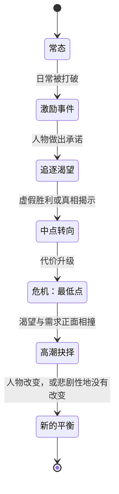
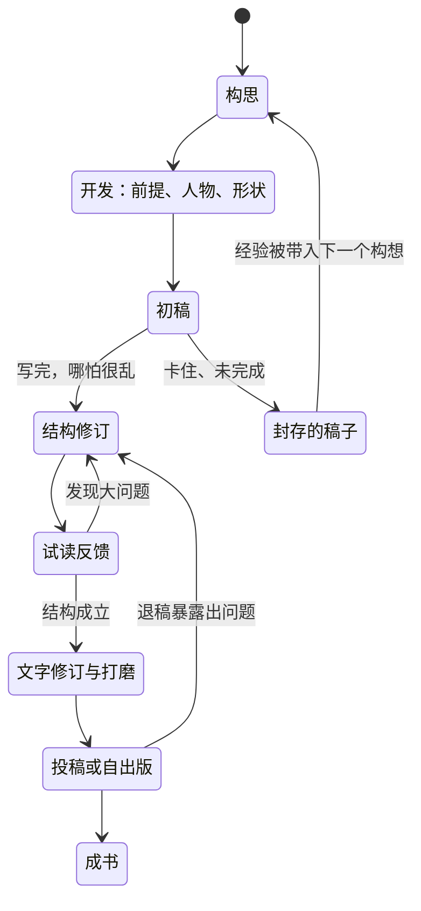
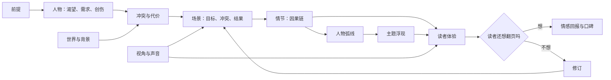
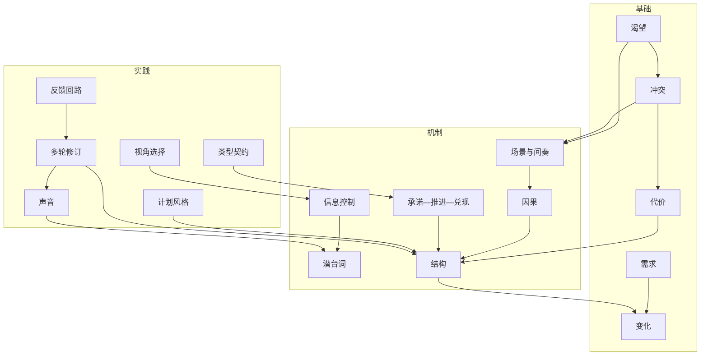
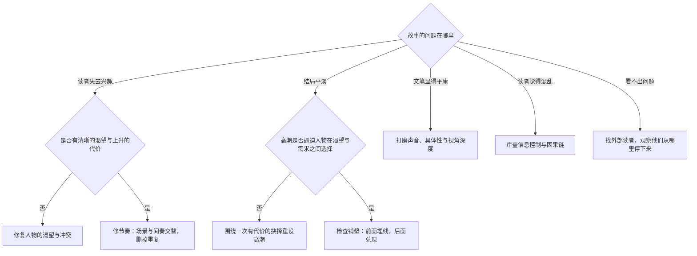
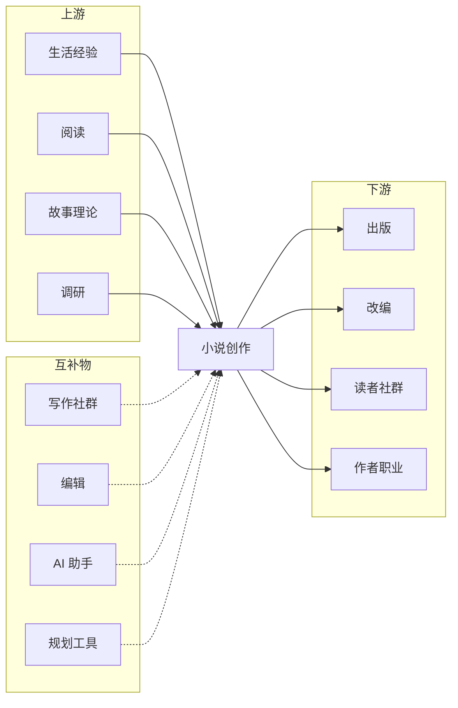
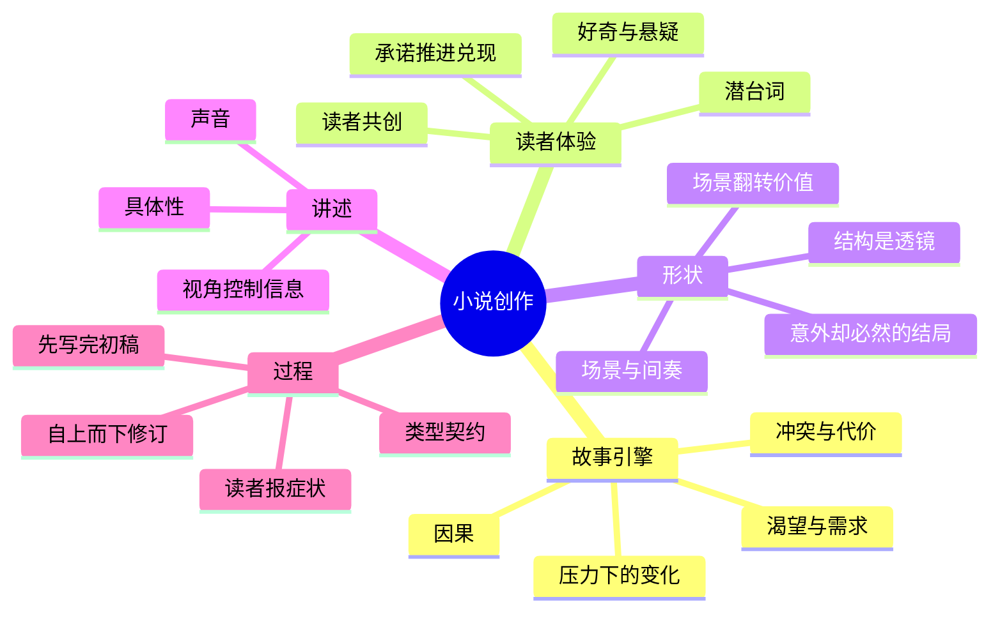

# 小说创作 — 学习地图

> 写小说，是在读者脑中设计并运行一场漫长的体验：围绕"谁想要什么、什么在阻拦、什么发生了变化"做出一连串选择，并用文字让读者亲身感受，而不是被告知。

**生成日期：** 2026-10-25 · **视角：** 心智模型，而非操作手册

*解读：此处的"小说创作"指虚构长篇小说的技艺与系统——为什么故事能起作用、真正的决策发生在哪里——而非一套写作教程。*

## 目录

1. [本质](#1-本质)
2. [世界模型](#2-世界模型)
3. [概念地图](#3-概念地图)
4. [决策地图](#4-决策地图)
5. [探索空间扩展](#5-探索空间扩展)
6. [生态系统](#6-生态系统)
7. [可迁移的原则](#7-可迁移的原则)
8. [最小心智模型](#8-最小心智模型)
9. [常见误解](#9-常见误解)
10. [总结](#10-总结)

---

## 1. 本质

### 它根本上是什么？

小说是**读者在自己脑中运行的一场模拟**。作者并不传送事件，而是给出线索——一个人的渴望、一个威胁、一处细节、一个被扣住的事实——读者的心智据此搭建世界、预测接下来会发生什么，并在预测与结果之间感到落差。写小说，就是为了在十万字量级上持续制造这种落差。

更核心地说，故事是**压力之下的变化**：一个人想要什么，阻力迫使他做出选择，选择揭示并改变了他。文笔、场景、结构，都是为了让这种变化被"感到"。

### 为什么会有它？

人类靠"谁想要什么、后来怎样了"来理解世界和彼此，而现实生活不给完整的因果、也给不了浓缩的情感。小说提供**被压缩、被校准的经验**：让我们安全地经历他人的一生，练习我们对选择、代价与人性的判断。

### 它解决什么问题？

它解决了人类最古老的三件事：**讲不清楚的意义、无法承受的情感、难以记住的教训**。说理给结论，小说让结论在读者自己身上长出来——因此可信、难忘，并在不同文化间穿行。

### 在它之前，人们做什么？

| 形式 | 小说带来什么新东西 |
|---|---|
| 史诗与神话 | 把英雄伟绩换成私人的、个别的心理 |
| 戏剧 | 让人进入思想，而不只是对白与行动 |
| 书信、日记、编年史 | 有意的形状——因果、张力上升、回收 |
| 寓言与道德训诫 | 意义变得含混，读者自己判断而不是被宣判 |

### 它打开了什么可能性？

- **内在性**：能写别人看不到的念头与自我欺骗。
- **多线并行与时间回环**：让因果结构本身成为体验。
- **共情外的其他体验**：悬疑、不安、幽默、惊悚，皆可被精密调校。
- **商品化与系列化**：长篇可连载、可系列、可改编，形成职业与产业。

---

## 2. 世界模型

### 对象（Objects）

| 对象 | 它是什么 |
|---|---|
| **前提（Premise）** | 自带张力的核心处境：*如果……会怎样* + 一个必须应对它的人物。 |
| **人物（Character）** | 渴望、需求、创伤与矛盾组成的一组，用来生成选择。 |
| **冲突（Conflict）** | 任何对抗渴望的东西——他人、社会、自然、自我。 |
| **场景（Scene）** | 故事的原子单位：有人追求目标、遇到阻力、有事发生改变。 |
| **情节（Plot）** | 场景之间的因果链——"因此"，而不是"然后"。 |
| **主题（Theme）** | 故事反复追问的同一个问题，由后果而非宣言作答。 |
| **视角与声音（POV & Voice）** | 谁的感知在过滤故事，以及讲述者的人格。 |
| **稿件（Manuscript）** | 物理存在物，经由多稿向成书移动。 |

### 行动者（Actors）

- **作者**——做故事决策；在 AI 时代更多是"导演"而非唯一执笔人。
- **读者**——共创者；提供想象、预测与情感，是最终裁判。
- **人物**——在虚构中像自主主体一样行动；当人物"不肯"做某件事时，通常是情节错了。
- **试读读者与写作小组**——最早感知"读者体验"与"作者意图"分叉的地方。
- **编辑**（结构编辑、文字编辑、校对）——先塑结构，再磨句子，最后保正确。
- **经纪人、出版社与传统发行链**——守门人与放大器。
- **市场与平台**——算法、社群、图书社区（如豆瓣、BookTok、Goodreads）决定一本书能否被看见。
- **AI 工具**——头脑风暴者、草稿生成器、一致性检查者、批评者；擅长流畅，不擅长"意图"。

### 状态变化（State changes）

两条生命周期并行：**故事内人物的变化**与**故事外稿件的演化**。

### 工作流（Workflows）

1. **发现**——找到前提、主角的渴望与创伤、全书的核心问题。
2. **塑形**——决定计划程度：大纲派（先定框架）、探索派（边写边发现）、或混合脚手架。
3. **写初稿**——先让完整版本存在；完成比质量重要。
4. **自上而下修订**——先结构与人物弧线，再场景，最后句子。
5. **测试**——观察真实读者在哪里无聊、困惑或被打动。
6. **交付**——投经纪人或出版社、自出版或连载；随后转向下一本书。

### 系统（Systems）

### 价值（Value）

- **被创造**：当读者体验到某种无法预料、却认得"就该如此"的东西——意外加正确。
- **被捕获**：通过读者忠诚。读者追随的是**声音**和**系列**，因此价值在书与书之间复利，而非只体现在一本里。
- **被摧毁**：承诺被打破（惊悚没有张力、言情没有回报）、结局不成立、文笔平庸；以及 AI 时代的**同质化**——流畅但背后没有具体的人。

---

## 3. 概念地图

### 第一层——基础：故事由什么组成

| 实体 | 动作 | 目的 | 关系 |
|---|---|---|---|
| **渴望** | 驱动行动 | 给读者可以追随的方向 | 被冲突对抗；常与需求相悖 |
| **需求** | 藏在渴望之下 | 人物必须完成的内在转变 | 由危机揭示；其完成即人物弧线 |
| **冲突** | 抵抗渴望 | 制造张力、逼出选择 | 产生代价；驱动每一个场景 |
| **代价** | 提高失败的后果 | 让读者在乎结果 | 必须随情节升级 |
| **变化** | 经由选择发生 | 故事的意义所在；静止的故事是死的故事 | 人物弧线=人物的变化；情节=处境的变化 |

### 第二层——机制：故事如何抓住注意力

| 实体 | 动作 | 目的 | 关系 |
|---|---|---|---|
| **承诺—推进—兑现** | 建立并满足预期 | 建立作者与读者间的信任 | 开头做出承诺，结尾必须兑现 |
| **场景与间奏** | 行动与反应交替 | 控制节奏与情感消化 | 场景=目标/冲突/挫败；间奏=反应/两难/决定 |
| **因果** | 用"因为"连接事件 | 让情节显得必然而非随意 | 因果弱=拼贴式故事 |
| **信息控制** | 扣住与揭示 | 制造好奇、悬疑、惊讶 | 戏剧反讽：读者知道得比人物多 |
| **潜台词** | 暗示而不直说 | 让读者成为共创者 | 存在于对白与意图之间的缝隙 |
| **结构** | 塑造整体 | 在注意力会涣散处放置转折 | 三幕、英雄之旅、起承转合都是透镜，不是律法 |

### 第三层——实践：作品如何被做出来

| 实体 | 动作 | 目的 | 关系 |
|---|---|---|---|
| **计划风格** | 决定动笔前定多少 | 让流程匹配写作者的头脑 | 大纲派少改、探索派多改 |
| **视角选择** | 过滤所有信息 | 决定亲密感、可靠性与可被知道的范围 | 第一人称、贴身第三人称、全知各开启不同的揭示可能 |
| **声音** | 给讲述赋予人格 | 读者选择"这个作家"的首要原因 | 最难伪造，最容易被 AI 抹平 |
| **多轮修订** | 从大到小重做 | 真正的写作大多发生在这里 | 结构→文字→校对 |
| **类型契约** | 定义读者预期 | 告诉你哪些承诺是必须的 | 言情需要情感闭合；推理需要公正的解答 |
| **反馈回路** | 暴露读者体验 | 作者看不见自己的盲点 | 试读者、写作小组、编辑、AI 批评 |

### 跨层概念图

---

## 4. 决策地图

| 处境 | 决策 | 理由 | 预期结果 |
|---|---|---|---|
| 你有一个鲜明的世界，却没有故事 | 找一个渴望与该世界相撞的人物 | 设定不会生成情节，欲望才会 | 自带冲突的前提 |
| 初稿中段疲软 | 加入中点反转并提高代价 | 中段塌陷通常因为重复而没有升级 | 后半程恢复势能，重心前移 |
| 你一直在重写第一章 | 先停下来，把整稿写完 | 在知道结局之前，无从判断开头该承诺什么 | 一份可供修订的完整稿 |
| 读者说"我不在乎主角" | 尽早明确渴望，并通过主动选择展示它 | 读者是由欲望与能动性联结人物的，不是由"讨喜" | 从第一页起就有投入感 |
| 反转显得廉价 | 提前埋线，使其意外却必然 | 反转的力量在于重新解释前面，而非凭空出现 | 让读者想回头重读的揭示 |
| 选择视角 | 选最能控制关键信息的那个视角 | 视角决定哪些信息可以被扣住或揭示 | 在故事需要处产生悬疑与亲密 |
| 用 AI 起草文字 | 用 AI 生成选项、检查一致性、提出批评；声音与关键决策留给自己 | AI 产出的是流畅的平均值，小说赢在具体性 | 迭代更快，但声音仍然是你自己的 |
| 多位读者反馈互相矛盾 | 更相信问题**出现的位置**，而非他们给出的改法 | 读者能可靠地发现症状，却难以正确诊断 | 有针对性的修订，而非追逐意见 |
| 选择类型 | 有意识地选一种，并学会它的契约 | 类型是一种承诺，无意中打破会令读者失望 | 读者被满足，书也找得到货架 |
| 传统出版还是自出版 | 按目标匹配路径：验证与分发 vs 控制与速度 | 两条路交换的是不同的成本 | 一份你能长期坚持的出版计划 |
| 故事不成立，修订看不到头 | 先在前提层面诊断，再改句子 | 句子打磨救不回坏掉的引擎 | 高效修订，或干净地放弃与转向 |
| 很想写书，但没有小说的构思 | **不要**现在写长篇；先写短篇或单场戏 | 短形式低成本练技艺，也能暴露你真正在意什么 | 技能，以及一个值得写三百页的前提 |

### 核心决策树

---

## 5. 探索空间扩展

### 初学者很少问的问题

| 问题 | 为什么重要 |
|---|---|
| 我的第一页做出了什么承诺？ | 读者在前几页就决定了这是什么类型的书。 |
| 主角在**这一场戏**里想要什么？ | 没有目标的场景，即使写得漂亮也像填充物。 |
| 此刻读者好奇的是什么？ | 翻页的动力来自好奇，而非动作。 |
| 这本书该放在哪个类型的书架上？ | 没有书架，就没有读者，也没有提案的落点。 |
| 有什么是我该刻意**不**解释的？ | 解释过头会杀死潜台词与读者的参与感。 |
| 这个故事为什么必须是长篇小说，而不是短篇或电影？ | 形式应匹配故事的尺度与内在性。 |
| 故事里真正的压力来自哪里，我是读者还是作者的立场？ | 区分"我想讲的"和"读者能感到的"是第一步职业化。 |

### 专家会问的问题

| 问题 | 为什么重要 |
|---|---|
| 读者在哪里知道得比人物多，这是有意的吗？ | 戏剧反讽是最主要的悬疑引擎之一。 |
| 每一场戏是否翻转了一个价值——由好变坏或由坏变好？ | 不翻转的场景不推动故事。 |
| 人物的"谎言"是什么，它在何时受到挑战？ | 弧线依赖一个在压力下被检验的错误信念。 |
| 结局让读者重新理解开头的什么？ | 强有力的结局会回溯性地为前面的页码充能。 |
| 我在兑现、颠覆还是无视哪些类型预期？ | 颠覆只有在预期被真切感到时才成立。 |
| 这到底是谁的故事？ | 视角人物与被改变的人物并不总是同一个。 |
| 每一章结束时，钩子来自剧情还是来自人物的处境？ | 剧情钩子会被消耗，人物钩子会累积。 |

### 值得进一步探索的问题

| 问题 | 为什么重要 |
|---|---|
| 不同结构模型（三幕、起承转合、编织式叙事）如何制造不同的阅读体验？ | 扩展你可选择的形状库。 |
| 声音如何由句法、用词和注意力分布构成？ | 拆开之后，声音才是可学的。 |
| 系列与连载如何改变故事设计？ | 现代作家职业常建立在系列而非单本之上。 |
| 写作者应如何整合 AI 而不失去作者性？ | 它定义你的工作流，也定义你的法律与伦理位置。 |
| 发现机制（算法、社群、书评生态）如何影响哪些书能成功？ | 技艺与分发已经纠缠在一起。 |
| 编剧、游戏叙事、脱口秀能教小说家什么？ | 邻近形式能隔离出具体的机制，如节奏与时机。 |

### 定义精通的问题

| 问题 | 为什么重要 |
|---|---|
| 你能诊断一页为什么"死"，并一次改好吗？ | 精通是诊断，不是灵感。 |
| 你能刻意打破一条规则，并让读者喜欢吗？ | 说明你理解那条规则原本在保护什么。 |
| 你能让读者感到一种你从未说出口的情绪吗？ | 潜台词与控制力的标志。 |
| 你能反复写完一本书，而不只是一次？ | 可持续的过程本身就是技艺的一部分。 |
| 你能写出既意外又必然的结局吗？ | 叙事里最难维持的平衡。 |
| 你能分辨作品里哪些部分只有你写得出来吗？ | 在 AI 时代，那正是有意义的部分。 |

---

## 6. 生态系统

### 上游——什么滋养小说创作

- **生活经验与观察**——具体性的源头。
- **广泛且深入的阅读**——写作者直觉的训练数据。
- **故事理论**——亚里士多德《诗学》、坎贝尔的英雄之旅、斯温的场景与间奏、麦基的《故事》、中国古典叙事传统中的章回与起承转合。
- **调研**——历史、科学、文化、行业，给小说以质感与权威。
- **语言与修辞**——语法、节奏、意象。

### 下游——小说创作滋养什么

- **出版**——传统出版社、独立出版、自出版平台、网络文学平台。
- **改编**——影视、游戏、有声书、漫画。
- **读者社群**——同人、读书会、社交平台。
- **作者职业**——系列、长尾作品、个人品牌、教学、通讯订阅。

### 替代方案

| 替代方案 | 何时改选它 |
|---|---|
| **短篇小说** | 你想以更低成本快速测试构想、打磨技艺。 |
| **剧本创作** | 故事主要是视觉与外在的，且你希望协作生产。 |
| **互动小说与游戏叙事** | 读者的选择应当塑造故事。 |
| **非虚构叙事或回忆录** | 事实本身就是钩子。 |
| **网络连载** | 你想要直接的读者反馈，并从章节获得持续收入。 |
| **诗歌** | 压缩与语言比情节和篇幅更重要。 |

### 互补物

- **写作社群与小说批评小组**——陪伴与外部眼睛。
- **编辑与写作教练**——专业诊断。
- **AI 写作助手**——头脑风暴、一致性追踪、批评、调研摘要。
- **故事规划工具**——大纲、时间线、故事设定库。
- **营销与平台建设**——通讯、社交账号、作者官网。

---

## 7. 可迁移的原则

| 类别 | 内容 | 记住还是委托给 AI？ |
|---|---|---|
| **第一性原理** | 故事是压力之下的变化。读者因渴望、好奇与不确定性而投入。因果胜过巧合。具体性制造信任。意义由读者共同创造。 | **记住**——它们适用于你将来讲述或评判的每一个故事。 |
| **可迁移的方法论** | 快起草、慢修订。自上而下修订。用真实读者测试。先埋线后兑现。展示后果而非解释。 | **记住**——同样适用于提案、演讲、产品叙事与教学。 |
| **实现细节** | 节拍表、大纲模板、字数目标、稿件格式、投稿信格式、出版流程。 | **委托**——AI 与工具在这些方面做得很好。 |
| **稳定知识** | 渴望与需求的区分；冲突与代价；场景结构；承诺与兑现；类型契约；声音作为差异化来源。 | **记住**——十年后成立，两千年前也成立。 |
| **变化中的知识** | AI 辅助写作的规范、AI 生成内容的披露与版权规则（2023 年以来持续变化，截至 2026 年仍未定）；平台算法；出版经济；流行类型与套路。 | **轻量跟踪**——发表时再核对当下规则。 |

---

## 8. 最小心智模型

1. **压力下的变化**——故事是一个人在冲突中被选择改变。
2. **渴望与需求**——人物追求的，与人物真正需要的。
3. **冲突与代价**——没有对抗就没有故事；没有代价就没有张力。
4. **因果**——事件由"因为"相连，而不是"然后"。
5. **承诺—推进—兑现**——开头建立预期，中段推进，结尾兑现。
6. **好奇与悬疑**——未被回答的问题让读者继续翻页。
7. **潜台词**——所言之下真正的意思。
8. **读者共创**——留出想象与推断的空间。
9. **每场戏翻转一个价值**——一场戏结束时，必须有东西和开始时不一样。
10. **场景与间奏**——行动与反应的节奏控制着阅读速度。
11. **结构是透镜而非律法**——模型用于诊断，不用于命令。
12. **意外却必然**——反转与结局的黄金标准。
13. **视角控制信息**——用谁的眼睛，决定读者能知道什么。
14. **声音**——讲述的人格；读者选择你的原因。
15. **具体性**——让虚构显得真实的那个细节。
16. **先写完初稿**——一份写烂的完整稿胜过完美的一章。
17. **自上而下修订**——先修结构，再修句子。
18. **读者报症状，作者找病因**——相信读者卡住的位置，别照单全收他们的处方。
19. **类型是一种契约**——知道你所处的书架要求哪些承诺。

---

## 9. 常见误解

| 常见误解 | 为何产生 | 更好的心智模型 |
|---|---|---|
| "好文笔就是漂亮的句子。" | 文笔是书最可见的表面。 | 读者为故事引擎而留步——渴望、冲突、好奇。引擎坏死的书，句子再美也让人厌倦。 |
| "先有灵感，然后动笔。" | 天才与缪斯的传说。 | 灵感多半在写作与修订中涌现；过程生成灵感。 |
| "初稿就应该好。" | 读者只看见成书。 | 初稿用来发现故事；质量在修订中到来。 |
| "人物必须讨喜。" | 把"喜欢"与"在乎"混为一谈。 | 读者跟随的是强烈渴望并付诸行动的人物，即使他不讨喜。 |
| "永远要'展示而非讲述'。" | 规则被反复背诵而脱离语境。 | 讲述压缩，展示戏剧化。精通在于知道何时用哪一种。 |
| "结构公式会让故事套路化。" | 模板看起来机械。 | 结构描述的是注意力需要转折的位置；它是诊断透镜，不是脚本。 |
| "AI 能写小说，作者的角色消失了。" | AI 能快速产出流畅、合理可读的文字。 | AI 生成的是平均水平；小说赢在具体性、意图与声音。作者变成导演，以及判断哪里"活着"的裁判。 |
| "出版就是终点线。" | 出版是最显眼的里程碑。 | 职业建立在下一本书与读者关系上；一本书很少定义一个作家。 |

---

## 10. 总结

> 我真正获得的，不是**一套产出十万字的写作方法**，而是**一个关于"故事如何在读者脑中制造体验"的模型——让我能够做出、评判并导演那些把文字变成有人真切感受到的东西的选择。**

长篇小说是一场精心设计的、由渴望、冲突与变化构成的漫长体验，经由受控的信息与独特的声音传递给读者。它的机制——承诺与兑现、因果、场景翻转、潜台词——跨越数个世纪与各类类型而保持稳定，并可迁移到任何讲述形式。创作过程偏爱"写完"而非"完美"，并自上而下修订，以真实读者卡住的位置为指引。当 AI 让流畅的文字变得廉价，稀缺的工作变成了：决定故事是什么、为何重要，以及哪些页面真正活着——那是只有作者才能完成的部分。
