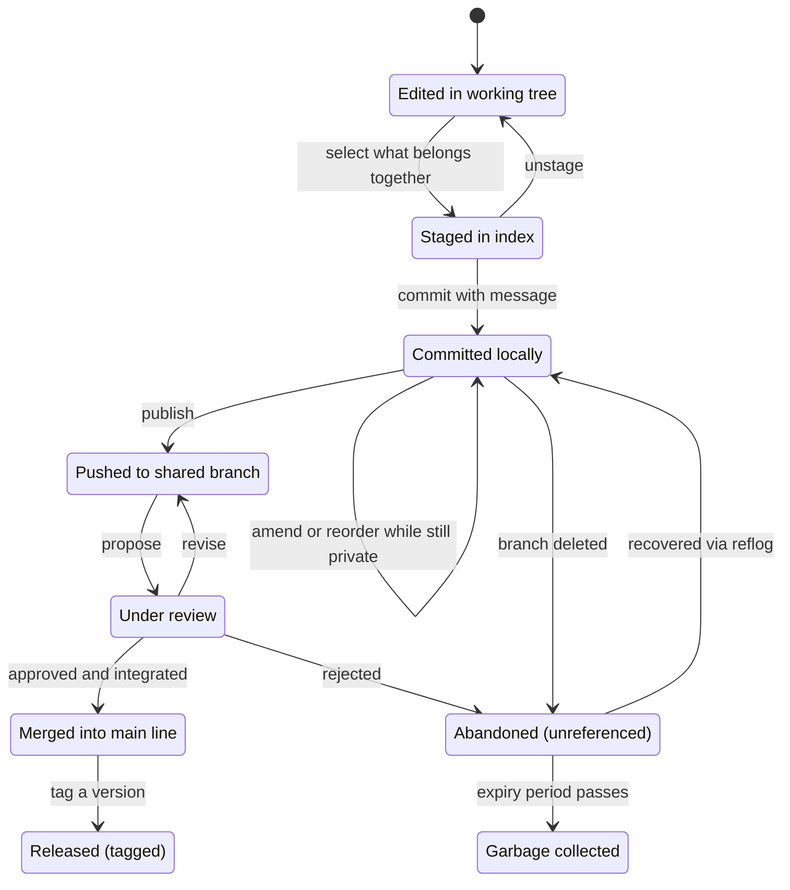
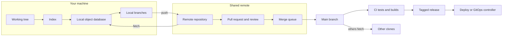
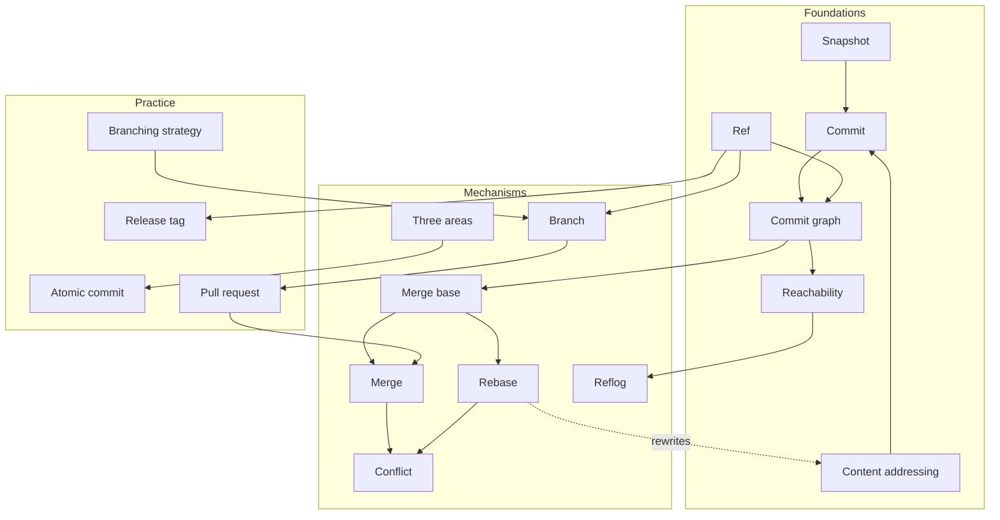
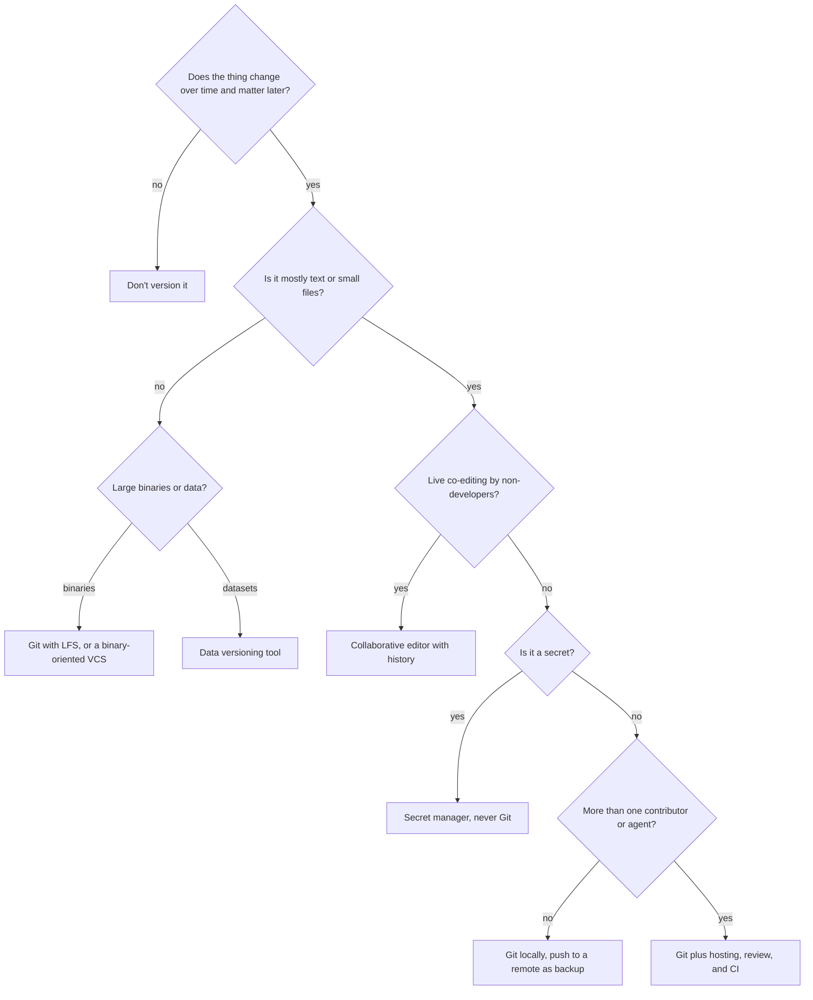
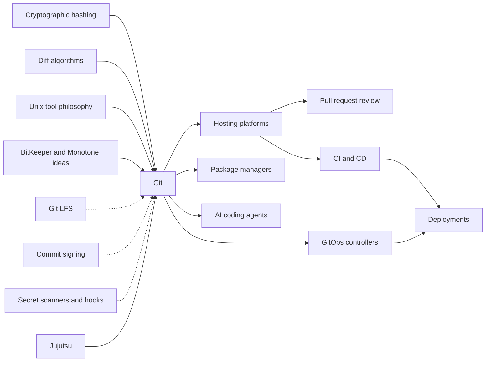
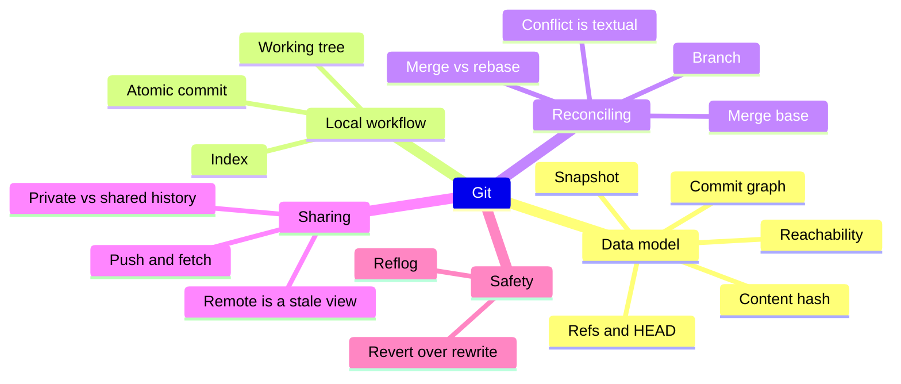

# Git — Learning Map

> Git is a distributed version control system: it records a project's history as a graph of immutable snapshots, so many people (and machines) can change the same files in parallel and later reconcile those changes deliberately.

**Generated:** 2026-10-24 · **Lens:** mental model, not manual

*Interpretation: Git the version control system (the tool created for Linux kernel development), not GitHub or other hosting platforms built on top of it.*

## Contents

1. [Essence](#1-essence)
2. [World Model](#2-world-model)
3. [Concept Map](#3-concept-map)
4. [Decision Map](#4-decision-map)
5. [Search Space Expansion](#5-search-space-expansion)
6. [Ecosystem](#6-ecosystem)
7. [Transferable Principles](#7-transferable-principles)
8. [Minimum Mental Model](#8-minimum-mental-model)
9. [Common Misconceptions](#9-common-misconceptions)
10. [Summary](#10-summary)

---

## 1. Essence

### What is it fundamentally?

Git is **a content-addressed database of snapshots, plus a handful of movable name tags pointing into it.** Every saved state of the project (a *commit*) is a full snapshot, identified by a cryptographic hash of its contents and its parents. Because the identifier is derived from the content, history cannot be silently altered: change one byte anywhere in the past and every identifier after it changes.

On top of that database sits a very small idea that does most of the work: **branches and tags are just names that point at commits.** Creating a branch costs almost nothing, so parallel lines of work become the default rather than an event.

### Why does it exist?

In 2005 the Linux kernel — thousands of contributors, no central office — lost free access to BitKeeper, the proprietary tool it used to coordinate changes. Linus Torvalds wrote Git in a few weeks with three non-negotiable requirements drawn from that project's reality:

- **Distributed** — no single server is the authority; every contributor has the full history.
- **Fast at merging** — the kernel integrates thousands of independent patches per release; merging had to be routine, not a crisis.
- **Integrity** — history must be tamper-evident, because trust in a large open project is earned through verifiable records.

### What problem does it solve?

It answers three questions that every evolving body of text eventually faces:

1. **What changed, when, why, and by whom?** (history and accountability)
2. **How can several people change the same thing at once without overwriting each other?** (parallelism and reconciliation)
3. **How do I get back to a state I trust?** (recoverability)

### What did people do before it?

| Before | Weakness Git exposes |
|---|---|
| Copying folders (`final`, `final_v2`, `final_really`) | No record of *why*, no way to combine two copies |
| Emailing patches and tarballs | Manual, error-prone integration; history lives in inboxes |
| Centralized VCS (CVS, Subversion) | Server is a single point of failure; branching was expensive, so people avoided it; offline work impossible |
| File locking (one editor at a time) | Serializes work; people wait instead of building |
| Proprietary distributed tools (BitKeeper) | The community's history depended on a vendor's goodwill |

### What new possibilities does it create?

- **Cheap experimentation** — a branch is a disposable universe; try three approaches and keep one.
- **Review before integration** — the pull request culture (popularized by GitHub from 2008) grew directly out of cheap branches.
- **Everything-as-code** — infrastructure, configuration, documentation, and policy can be versioned, reviewed, and rolled back like software (GitOps, docs-as-code).
- **Reproducibility** — any past state can be reconstructed exactly, which makes debugging by history (finding the commit that introduced a bug) possible.
- **Safe autonomy for machines** — CI bots and AI coding agents can work on isolated branches, and every change they make is inspectable and reversible before it touches the shared line.

---

## 2. World Model

### Objects

| Object | What it is |
|---|---|
| **Blob** | The contents of one file at one moment, identified by its hash. Has no name — names live in trees. |
| **Tree** | A directory listing: names mapped to blobs and sub-trees. |
| **Commit** | A snapshot (one root tree) plus metadata: author, message, time, and pointers to parent commit(s). |
| **Ref** | A human-readable name pointing at a commit: branches (move as work advances) and tags (meant to stay fixed). |
| **HEAD** | The ref that says "where I am now" — usually pointing at a branch. |
| **Working tree** | The ordinary files you see and edit. Not history — a scratchpad. |
| **Index (staging area)** | The proposed next snapshot, assembled piece by piece before committing. |
| **Repository** | The object database plus refs. Every clone is a complete repository. |
| **Remote** | Another repository you have a relationship with, plus your last-known copy of its refs. |

### Actors

- **Author** — makes changes and records commits.
- **Reviewer** — reads proposed changes before they join the shared line.
- **Maintainer / integrator** — decides what merges into the authoritative branch; in a distributed system, authority is a social role, not a technical one.
- **Hosting platform** (GitHub, GitLab, Bitbucket, self-hosted) — provides a conventional "central" copy, access control, and review UI.
- **Automation** — CI pipelines, merge queues, bots that update dependencies, deploy systems watching branches.
- **AI coding agents** — increasingly produce commits and pull requests themselves, often each in its own isolated branch or working directory.

### State changes

A single change moves through two machines: your local one and the shared one.

The crucial boundary is **Local → Pushed**. Before it, history is private and freely rewritable. After it, other people may have built on it, and rewriting it breaks their world.

### Workflows

1. **Feature branch** — branch off the main line, commit, push, open a review, merge, delete the branch.
2. **Trunk-based development** — everyone integrates into the main line at least daily; unfinished work hides behind feature flags instead of long-lived branches.
3. **Fork and pull request** — outsiders without write access copy the repository, work there, and propose changes back (the open-source default).
4. **Release branching** — cut a branch for a release, accept only fixes on it, carry those fixes back to the main line.
5. **History investigation** — binary-search the commit graph to find which change introduced a bug; read authorship and messages to recover the *why*.
6. **Parallel agents** — several humans or AI agents each work in their own branch or worktree against the same repository, then integrate through review.

### Systems

### Value

- **Created** when history is *legible* (small, well-described commits), when integration is frequent, and when any bad change can be reverted in minutes.
- **Captured** by teams as speed with safety: more people and agents can change the codebase at once because nothing is irrecoverable and everything is reviewable.
- **Destroyed** by rewriting shared history, committing secrets or huge binaries, long-lived branches that diverge into "merge hell", and commit messages like "fix" that erase the *why* forever.

---

## 3. Concept Map

### Layer 1 — Foundations: the data model

| Entity | Action | Purpose | Relationships |
|---|---|---|---|
| **Snapshot** | Captures the whole project state | Makes every commit independently reconstructable | Diffs are *computed* between snapshots, not stored as the model |
| **Content addressing** | Names objects by the hash of their content | Integrity, deduplication, tamper-evidence | Identical files share one blob; any change ripples into new IDs |
| **Commit** | Points to a tree and parent(s) | The unit of history and of meaning | Parents link commits into a graph |
| **DAG (commit graph)** | Grows by appending | History is a graph, not a line | Branches and merges are just shapes in this graph |
| **Ref** | Points at a commit | Gives humans stable names for moving targets | Branches move; tags stay; HEAD says where you are |
| **Reachability** | Determines what is "in" history | Anything not reachable from a ref is eventually discarded | Underlies deletion, recovery, and garbage collection |

### Layer 2 — Mechanisms: reconciling parallel change

| Entity | Action | Purpose | Relationships |
|---|---|---|---|
| **Three areas** | Working tree → index → repository | Separate *editing* from *deciding what to record* | Index lets one messy session become several clean commits |
| **Branch** | Diverges from a commit | Isolates a line of work cheaply | Ends in a merge, a rebase, or deletion |
| **Merge base** | Finds the common ancestor | Enables three-way comparison | Without a shared ancestor, there is no principled merge |
| **Merge** | Joins two lines with a new commit | Integrates while preserving true history | Produces a commit with two parents |
| **Rebase** | Replays commits onto a new base | Produces linear, readable history | Creates *new* commits; dangerous on shared branches |
| **Conflict** | Stops automation where both sides changed the same lines | Hands a judgment call back to a human or agent | Textual only — Git does not understand program meaning |
| **Remote tracking** | Records your last-known view of another repo | Makes distributed collaboration explicit | Fetch updates the view; push updates the other side |
| **Reflog** | Logs where refs have pointed | Local safety net for "lost" work | Expires; exists only on your machine |

### Layer 3 — Practice: collaboration at scale

| Entity | Action | Purpose | Relationships |
|---|---|---|---|
| **Atomic commit** | Contains one logical change | Easy to review, revert, and bisect | Depends on staging discipline |
| **Commit message** | Explains why | Preserves intent that code cannot | Read years later during investigation |
| **Pull / merge request** | Proposes a branch for integration | Review, discussion, automated checks | Platform feature, not part of Git itself |
| **Branching strategy** | Sets team rules for branch lifetimes | Balances isolation against integration pain | Trunk-based vs. release branches vs. Git Flow |
| **Tag / release** | Marks a commit as a version | Links shipped artifacts to exact source | Signed tags add provenance |
| **Ignore rules** | Exclude generated or private files | Keeps history about source, not output | Prevents secret and build-artifact leaks |
| **Repository topology** | Monorepo or many repos | Shapes ownership, tooling, and atomic changes | Interacts with submodules and package managers |

### Cross-layer concept graph

---

## 4. Decision Map

| Situation | Decision | Reason | Expected Outcome |
|---|---|---|---|
| A text-based artifact will change over time and more than one person (or agent) touches it | Put it in Git | History, review, and rollback for almost no cost | Changes become inspectable and reversible |
| You need to tidy commits you haven't shared yet | Rewrite freely (amend, reorder, squash) | Private history is a draft; nobody depends on it | A clean, reviewable story |
| The commits are already on a shared branch | Don't rewrite; add a new commit that reverts or fixes | Others have built on those commit IDs | No broken clones, no lost work for teammates |
| Integrating a feature branch | Pick one team convention — merge commits, squash, or rebase — and apply it consistently | Each trades true history against readability; mixing them gives you neither | A main line people can read and bisect |
| Work will take weeks and touches shared code | Integrate daily behind a feature flag instead of a long-lived branch | Merge pain grows with divergence, not with effort | Small, boring merges instead of one dangerous one |
| A secret (API key, password) was committed | Rotate the secret first; scrubbing history is secondary | Every clone and fork already has it; history rewriting can't recall copies | Exposure contained regardless of who cloned |
| Large binaries (video, game assets, model weights) need versioning | Use Git LFS, an artifact store, or a binary-oriented VCS — not plain Git | Every clone carries every version of every blob forever | Repository stays fast to clone |
| Terabyte-scale datasets or database state | **Don't use Git** — use data versioning (DVC, lakeFS) or database migrations | Git's model assumes files small enough to hash and diff | Versioned data without a crippled repo |
| Real-time co-editing of a prose document by non-developers | **Don't use Git** — use a collaborative editor with its own history | Git's commit/merge cycle is the wrong granularity for live collaboration | People write instead of resolving conflicts |
| A bug exists now but didn't in the last release | Binary-search history to find the introducing commit | Logarithmic search over a known-good/known-bad range | Exact change and its stated reason, fast |
| Several AI agents work on the same repo at once | Give each agent its own branch or worktree and integrate through review | Isolation keeps agents from overwriting each other; review keeps humans accountable | Parallel throughput with a human gate |
| Sharing code between repositories | Prefer a package manager over submodules unless you need exact source pinning | Submodules add a second, easily-forgotten layer of state | Fewer "why is this folder empty" surprises |

### Central decision: should I reach for Git here, and in which form?

---

## 5. Search Space Expansion

### Beginner questions rarely asked

| Question | Why it matters |
|---|---|
| What exactly is a commit a snapshot *of* — the folder, the index, or my last edit? | Exposes the index as the real source of the next snapshot |
| Where does a branch physically live, and how big is it? | Realizing it's a tiny pointer removes the fear of branching |
| If I delete a branch, is the work gone? | Introduces reachability, the reflog, and garbage collection |
| Is my commit on the server yet? | Separates local from shared state — the root of most confusion |
| What does "my branch is behind" actually compare against? | Reveals remote-tracking refs as a stale *view*, not the live server |
| Why does Git sometimes merge without asking and sometimes stop? | Leads to merge bases and the textual nature of conflicts |
| Why is the hash of my commit different from my teammate's identical change? | Shows that parents, time, and author are part of identity |

### Questions experts ask

| Question | Why it matters |
|---|---|
| What history shape do we want main to have, and who enforces it? | History is a product people read; it needs an owner |
| Which branches are protected, and what is the cost of bypassing that? | Authority in a distributed system is policy, not physics |
| How long can a branch live before its merge cost exceeds its isolation benefit? | Divergence, not effort, drives integration risk |
| Can every production artifact be traced to an exact, signed commit? | Supply-chain provenance depends on it |
| What happens to this repo at 10x the files, contributors, or history? | Clone time, CI cost, and tooling limits are architectural decisions |
| Is this conflict textual or semantic? | Clean merges can still break programs; tests are the real arbiter |
| When agents produce most commits, what does a reviewer actually need to see? | Review becomes the bottleneck and the safety boundary |

### Questions worth exploring next

| Question | Why it matters |
|---|---|
| How do packfiles and delta compression keep snapshot storage small? | Resolves the apparent paradox of "full snapshots" being cheap |
| What did Mercurial, Darcs, and Pijul do differently, and what did they get right? | Shows Git's choices were trade-offs, not inevitabilities |
| How does Jujutsu change the user model while keeping Git's storage? | The UX of version control is not settled |
| How do monorepos at Google and Meta scale beyond what plain Git handles? | Reveals the limits of the model and the patches around them |
| What does the SHA-1 to SHA-256 transition reveal about long-lived formats? | Content addressing ties identity to a hash function you must someday replace |
| How do merge queues change what "main is green" means? | Integration ordering becomes infrastructure |

### Questions that define mastery

| Question | Why it matters |
|---|---|
| Given any messy repository state, can I say exactly which commits are reachable from which refs, and what is safe to do? | That single picture makes every operation predictable |
| Can I design a branching and review policy that fits a specific team's release cadence and risk tolerance? | Moves from using Git to shaping how a team works |
| Can I explain why a merge produced a result neither side wrote? | Understanding three-way merge from the ancestor up |
| Do I know which history operations are recoverable, for how long, and on whose machine? | Distinguishes confident experimentation from reckless risk |
| Can I read a project's history and reconstruct why the architecture looks the way it does? | History as institutional memory, not just backup |
| Can I set rules under which AI agents commit autonomously without eroding trust in main? | The governance problem of the next few years |

---

## 6. Ecosystem

### Upstream (what Git builds on)

- **Cryptographic hashing** — SHA-1 historically, SHA-256 in transition; gives identity and integrity.
- **Diff algorithms** — Myers, patience, histogram; decide how changes are *displayed* and how merges line up.
- **Unix filesystem and tooling philosophy** — small composable programs, text as interface.
- **Earlier version control ideas** — BitKeeper's distributed model, Monotone's content-addressed history.
- **The Linux kernel process** — patch review by email, lieutenant-based trust; Git encodes that culture.

### Downstream (what is built on Git)

- **Hosting platforms** — GitHub, GitLab, Bitbucket, Gitea/Forgejo: access control, pull requests, issues.
- **CI/CD** — pipelines triggered by pushes and merges.
- **GitOps** — Argo CD, Flux: the repository *is* the desired state of infrastructure; a controller makes reality match.
- **Package and dependency ecosystems** — many fetch directly from Git refs or tags.
- **Docs-as-code, policy-as-code, infrastructure-as-code** — non-software artifacts adopting the review-and-revert workflow.
- **AI coding agents** — operate on branches and worktrees and deliver results as commits and pull requests.

### Alternatives

| Alternative | Choose it instead when… |
|---|---|
| **Subversion** | You want one central authority, path-based permissions, and file locking, and can accept weak branching |
| **Perforce / Helix Core** | Huge binary assets and exclusive file locks matter more than distributed work — common in game studios |
| **Mercurial** | You prefer a more consistent command model and append-only history, and the ecosystem gap is acceptable |
| **Jujutsu (jj)** | You want a simpler mental model (working copy as a commit, first-class conflicts, easy history editing) while staying Git-compatible |
| **Sapling** | You operate a very large monorepo and need tooling designed for that scale |
| **Fossil** | You want version control, tickets, and wiki in one self-contained file for a small project |
| **Pijul** | You want patch-based history where independent changes commute, and can accept a small ecosystem |
| **Cloud document version history** | Collaborators are non-technical and need live co-editing more than branching |

### Complements

- **Git LFS** — keeps large binaries out of the object database.
- **Pre-commit hooks and secret scanners** — stop mistakes before they become history.
- **Commit signing** (GPG, SSH, Sigstore-style keyless) — ties commits to verified identities.
- **Conventional commit messages and automated changelogs** — make history machine-readable.
- **Merge queues and branch protection** — enforce integration rules on the shared line.
- **Data versioning tools** (DVC, lakeFS) — extend Git-like workflows to data Git can't hold.

### Dependency graph

---

## 7. Transferable Principles

| Kind | Content | Invest memory or delegate? |
|---|---|---|
| **First principles** | History as an append-only graph of immutable, content-addressed snapshots. Names are cheap pointers; the graph is the truth. Anything unreachable is eventually gone. Merging needs a common ancestor. Distributed means every copy is complete and authority is social. | **Memorize** — these predict every behavior |
| **Transferable methodologies** | Make changes small and atomic. Record *why*, not *what*. Integrate often to keep divergence small. Review before integration. Prefer reversible operations; rewrite only what is private. | **Memorize** — apply to databases, documents, deployments, and organizations |
| **Implementation details** | Command names and flags, packfile and index formats, ref storage backends, configuration options, platform-specific UI. | **Delegate to AI** — look up or let an agent execute |
| **Stable knowledge** (true in 10 years) | The DAG model, three-way merge, the private-vs-shared rewrite boundary, review-before-merge culture, Git as the substrate for code collaboration. | **Memorize** |
| **Changing knowledge** (likely different in 2 years) | As of October 2026, Git 3.0 has been announced but has no release date; planned defaults are main as the initial branch, SHA-256 for new repositories, the reftable ref backend, and Rust required to build Git (2025–2026). Git-compatible front-ends such as Jujutsu are gaining users (2025–2026). Worktree-per-agent patterns and agent-authored pull requests are becoming normal (2025–2026). Hosting features like stacked pull requests and merge queues keep evolving. | **Delegate** — check current state when it matters |

---

## 8. Minimum Mental Model

1. **Snapshot** — each commit records the whole project state; diffs are computed on demand.
2. **Content hash** — identity is derived from content, so history is tamper-evident and duplicates are free.
3. **Commit graph** — history is a directed acyclic graph of commits pointing to their parents, not a straight line.
4. **Refs and HEAD** — branches and tags are cheap labels on commits; HEAD says where you are.
5. **Reachability** — what can be reached from a ref is history; everything else is eventually discarded.
6. **Working tree** — your editable files are a scratchpad, not the record.
7. **Index** — the staging area is the *proposed* next snapshot, letting you decide what belongs together.
8. **Atomic commit** — one logical change per commit keeps review, revert, and investigation cheap.
9. **Branch** — a disposable, nearly free line of work.
10. **Merge base** — the common ancestor is what makes three-way merging principled.
11. **Merge vs rebase** — merge preserves what happened; rebase rewrites it into a cleaner story with new identities.
12. **Conflict is textual** — Git reconciles lines, not meaning; clean merges can still break software.
13. **Remote is a stale view** — your copy of another repository's branches is only as fresh as your last fetch.
14. **Push and fetch** — the only moments when two repositories exchange history.
15. **Private vs shared history** — rewrite freely before publishing, never after.
16. **Reflog** — a local, expiring log of where your refs have been; the reason "lost" work usually isn't.
17. **Revert over rewrite** — on shared history, undo by adding a new commit that cancels the old one.

---

## 9. Common Misconceptions

| Common misunderstanding | Why it happens | Better mental model |
|---|---|---|
| "Git stores diffs between versions." | Every tool *shows* changes as diffs | Git stores snapshots; diffs are computed views. Compression happens underneath, invisibly. |
| "A branch is a copy of the code." | Older systems really did copy directories | A branch is a pointer to one commit. Creating one copies nothing. |
| "Git and GitHub are the same thing." | Most people meet Git through GitHub | Git is the local tool and data model; GitHub is one hosting service adding review, permissions, and social features on top. |
| "Once I commit, it's saved on the server." | In centralized tools, commit meant upload | Commit is local. Nothing leaves your machine until you push. |
| "If Git merged cleanly, the code works." | "No conflicts" sounds like "no problems" | Git checks only whether the same lines changed. Two compatible-looking edits can still break logic — tests decide. |
| "Deleting a commit or branch erases it instantly." | Deletion feels final in most software | Unreachable commits linger in the reflog and object store until expiry; meanwhile, anything already pushed may live forever in other clones. |
| "Removing a leaked password in a new commit fixes the leak." | The current files look clean | The secret is still in history and in every clone. Rotate it; scrubbing history is a secondary cleanup. |
| "Git is a backup system." | Remotes do hold copies | Git versions what you commit. Uncommitted work, ignored files, and unpushed branches are unprotected. |

---

## 10. Summary

> What I truly gain is not **memorizing Git commands**, but **the ability to reason about change as a graph of immutable snapshots with movable names — and so to know what is shared, what is safe, and what is recoverable.**

Git exists because large groups needed to change the same body of text in parallel, without a central authority, and with history nobody could quietly alter. Its whole design follows from one structure: content-addressed snapshots linked into a graph, with branches and tags as cheap pointers into it. Merging works because every two lines of work share an ancestor; danger appears only when you rewrite history that someone else has already built on. Around this core grew a culture — branch, review, integrate, tag, deploy — that now governs infrastructure, documentation, and increasingly the work of AI agents. Learn the graph and the private-versus-shared boundary, and every command becomes something you can predict, delegate, and check.
