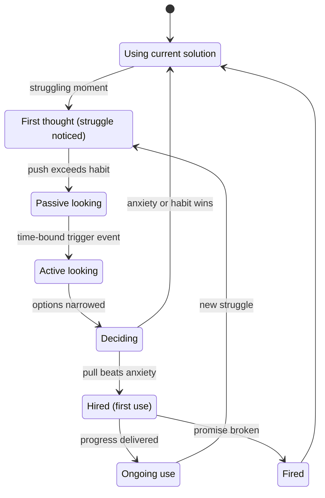
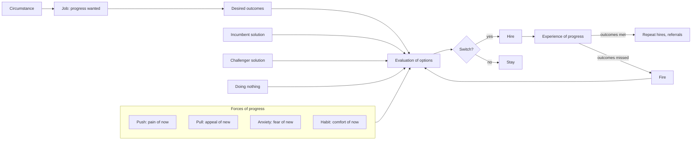
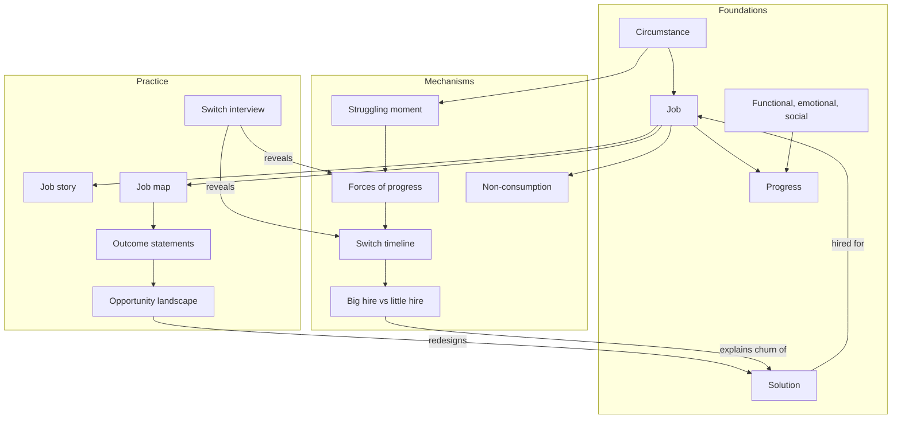
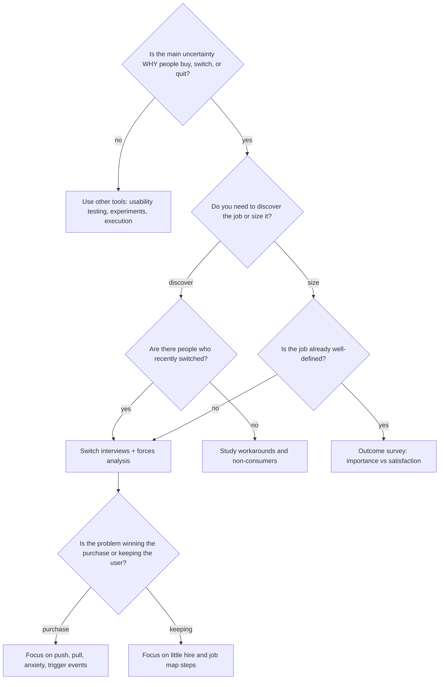
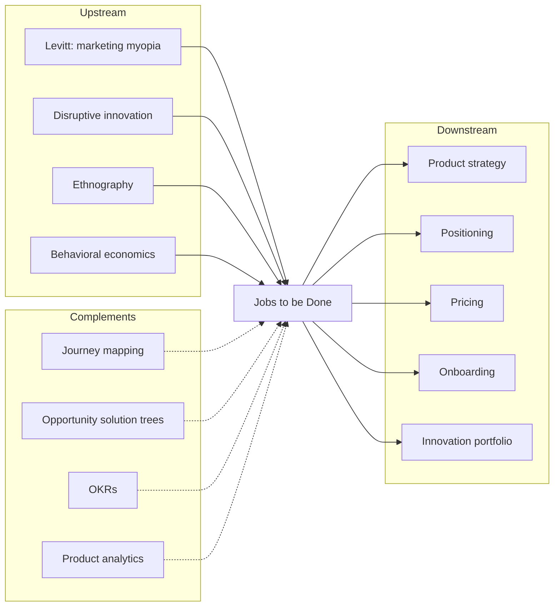
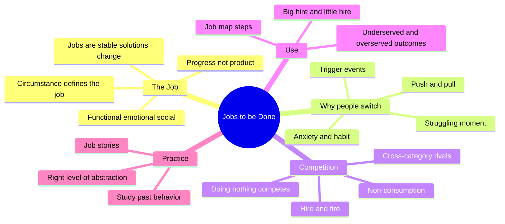

# Jobs to be Done — Learning Map

> Jobs to be Done (JTBD) is a theory of why people buy and switch: customers don't want products, they "hire" them to make progress in a specific circumstance — and they "fire" them when something else makes that progress better.

**Generated:** 2026-10-22 · **Lens:** mental model, not manual

## Contents

1. [Essence](#1-essence)
2. [World Model](#2-world-model)
3. [Concept Map](#3-concept-map)
4. [Decision Map](#4-decision-map)
5. [Search Space Expansion](#5-search-space-expansion)
6. [Ecosystem](#6-ecosystem)
7. [Transferable Principles](#7-transferable-principles)
8. [Minimum Mental Model](#8-minimum-mental-model)
9. [Common Misconceptions](#9-common-misconceptions)
10. [Summary](#10-summary)

---

## 1. Essence

### What is it fundamentally?

JTBD is a **change of unit of analysis**. Instead of studying the *customer* (who they are) or the *product* (what it does), it studies the **job**: the progress a person is trying to make in a particular circumstance. The job is the stable thing; customers and products are both temporary vehicles for it.

Theodore Levitt's line is the seed: *"People don't want a quarter-inch drill. They want a quarter-inch hole."* JTBD pushes one step further: they don't want the hole either — they want the shelf up, the room finished, and to feel competent in their own home.

### Why does it exist?

Because the dominant ways of explaining demand kept failing:

- **Demographics correlate but don't cause.** "Men aged 35–50" do not buy a milkshake *because* they are men aged 35–50. They buy it because they face a long, boring commute and need something that lasts, fills, and fits in one hand.
- **Feature requests describe solutions, not needs.** Customers asked for a faster horse; the need was getting there sooner with less effort.
- **Most new products fail despite market research**, because research measured satisfaction with today's solutions rather than the progress people are struggling to make.

Clayton Christensen popularized the framing (The Innovator's Solution, 2003; Competing Against Luck, 2016) to explain why incumbents miss disruptions: they optimize products for customers, while entrants win by serving a job better — often for people who weren't customers at all.

### What problem does it solve?

It answers **"What causes someone to switch?"** — the question underneath product strategy, positioning, pricing, and roadmap prioritization. With that answer you can predict which competitors actually matter, which features are noise, and which non-customers are a market.

### What did people do before it?

| Before | Weakness JTBD exposes |
|---|---|
| Segment by demographics / personas | Describes *who*, not *why now* |
| Ask customers what features they want | Gets solutions bounded by today's imagination |
| Benchmark against category competitors | Misses cross-category competition (milkshake vs. banana vs. boredom) |
| Satisfaction surveys on existing products | Measures the vehicle, not the destination |
| Build, launch, and see | Expensive way to learn the job after the fact |

### What new possibilities does it create?

- **Seeing invisible competition** — a meditation app competes with wine, Netflix, and doing nothing.
- **Finding markets in non-consumption** — people who "hire nothing" because every option is too costly, complex, or embarrassing.
- **Stable strategy** — jobs change slowly (people have needed to "pass time while waiting" for millennia); solutions change fast. Anchoring on jobs makes roadmaps survive technology shifts.
- **Shared language across functions** — product, marketing, sales, and support can all point at the same job instead of arguing from personas or feature lists.

---

## 2. World Model

### Objects

| Object | What it is |
|---|---|
| **Job** | The progress a person wants to make in a circumstance. Solution-agnostic and stable over time. |
| **Circumstance** | The when/where/with-whom context that triggers the job. Without circumstance there is no job. |
| **Solution** | Anything hired to do the job — product, service, workaround, person, or nothing. |
| **Desired outcomes** | The metrics a person uses (often unconsciously) to judge how well the job got done: speed, predictability, effort, risk. |
| **Struggling moment** | The point where the current solution's shortfall becomes felt enough to consider change. |
| **Forces** | Push, pull, anxiety, and habit — the energy balance that decides whether a switch happens. |

### Actors

- **Job executor** — the person trying to make progress.
- **Purchase decision-maker / influencers** — sometimes different from the executor (B2B buyer vs. user; parent vs. child).
- **Incumbent solution** — what is currently hired, including spreadsheets, habits, and "doing nothing".
- **Challenger solution** — the new option competing to be hired.
- **Researcher / product team** — reconstructs the job from switching stories and turns it into decisions.

### State changes

The core state machine is the **switch timeline**: a person moves from living with a solution to hiring a new one.

Two kinds of hire happen along this path: the **big hire** (the purchase) and the **little hire** (each moment of actual use). Many products win the big hire and lose the little one — gym memberships, enterprise software that nobody logs into.

### Workflows

1. **Discover** — reconstruct real switches through interviews about the last time someone hired or fired a solution.
2. **Define** — write the job in solution-free language, with circumstance and desired outcomes.
3. **Size** — find where outcomes are important but poorly satisfied (underserved) or overshot (overserved).
4. **Design** — build or reshape a solution that delivers progress and reduces anxiety and habit.
5. **Position** — speak to the struggling moment and the trigger, not the feature list.
6. **Monitor** — watch for little-hire failures and for new solutions doing the job better.

### Systems

### Value

- **Created** when a solution gets the job done better on the outcomes the executor cares about, *in their circumstance*.
- **Captured** in proportion to the struggle relieved and the alternatives available — pricing power comes from the job, not from cost.
- **Destroyed** when teams add features that serve no outcome (overserving), when onboarding fails the little hire, or when the team defines the job so broadly ("be happy") that it guides nothing.

---

## 3. Concept Map

### Layer 1 — Foundations: what a job is

| Entity | Action | Purpose | Relationships |
|---|---|---|---|
| **Job** | Is hired / fired | Unit of analysis that stays stable while solutions change | Exists only within a Circumstance; judged by Desired Outcomes |
| **Circumstance** | Triggers the job | Explains *why now* better than demographics | Turns a latent need into a Struggling Moment |
| **Progress** | Is sought | The real thing being bought — movement from a current state to a better one | Has functional, emotional, and social dimensions |
| **Functional / emotional / social dimensions** | Shape the job | Capture that people buy how they want to *feel* and *be seen*, not only what gets done | Emotional and social dimensions often drive the switch more than function |
| **Solution** | Is hired | A temporary vehicle for progress | Competes with every other vehicle for the same job, across categories |

### Layer 2 — Mechanisms: why people switch

| Entity | Action | Purpose | Relationships |
|---|---|---|---|
| **Struggling moment** | Creates energy for change | The seed of demand | Precedes the switch timeline; source of Push |
| **Forces of progress** | Balance for or against switching | Explain why good products don't get adopted | Push + Pull must exceed Anxiety + Habit |
| **Switch timeline** | Sequences the decision | Shows when people are reachable and what they need at each stage | Starts with First Thought, ends with ongoing use |
| **Big hire / little hire** | Separate purchase from use | Explain churn and shelfware | Little hires determine whether the big hire repeats |
| **Non-consumption** | Hires nothing | Reveals markets blocked by cost, skill, or access | Classic entry point for disruptive innovation |

### Layer 3 — Practice: how teams use the theory

| Entity | Action | Purpose | Relationships |
|---|---|---|---|
| **Switch interview** | Reconstructs a real decision | Grounds the job in behavior, not opinions | Feeds Forces and Timeline analysis |
| **Job statement / job story** | Names the job without solutions | Aligns teams on one target | Format: *When [circumstance], I want to [progress], so I can [outcome]* |
| **Job map** | Breaks a job into universal steps | Locates where execution breaks down | Steps: define, locate, prepare, confirm, execute, monitor, modify, conclude |
| **Outcome statements** | Make success measurable | Turn the job into prioritizable criteria | Scored by importance and satisfaction to find underserved needs |
| **Opportunity landscape** | Plots under/overserved outcomes | Directs where to innovate, where to cut | Informs roadmap, pricing, and positioning |

### Cross-layer concept graph

---

## 4. Decision Map

| Situation | Decision | Reason | Expected Outcome |
|---|---|---|---|
| Building a new product with no customers yet | Interview people who recently switched *to anything* in this space, including workarounds | The job already exists; current workarounds show its shape and the forces | Problem definition grounded in real behavior, not hypotheticals |
| Mature product with flat growth | Map competition by job, not category | Real competitors may sit in other categories or be "doing nothing" | New positioning or adjacent markets discovered |
| High sign-ups, high churn | Study the little hire: interview people who quit | Big hire succeeded; progress in use failed | Onboarding and core-loop fixes that target the actual failure |
| Roadmap overloaded with feature requests | Translate each request into the outcome it serves, then rank outcomes | Requests are solutions; outcomes are comparable | Smaller roadmap focused on underserved outcomes |
| Customers say they love it but don't buy | Analyze anxiety and habit, not pull | Pull is necessary but rarely sufficient | Trials, guarantees, migration help — lower switching cost beats more features |
| Market seems saturated | Look for non-consumers and overserved customers | Overshot outcomes create room for simpler, cheaper entrants | Disruptive or low-end entry point identified |
| Marketing copy isn't converting | Rewrite around the struggling moment and trigger events | People respond to their own circumstance, not to feature lists | Messages that sound like the customer's inner monologue |
| Team argues about which persona to serve | Replace persona debate with "which job, in which circumstance?" | Same person has different jobs at different times | Decisions that survive across segments |
| Need quantitative prioritization across a large market | Use outcome-based surveys (importance vs. satisfaction) | Qualitative interviews find jobs; surveys size them | Defensible, data-backed opportunity ranking |
| Problem is pure execution (a known spec, compliance requirement, bug) | **Don't** run JTBD research | The job is already clear; research adds delay without new information | Ship faster; save JTBD for strategic uncertainty |
| Job definition is "be happy" or "save time" | Narrow it until a team could build against it | Overly abstract jobs guide nothing | A job specific enough to rule options in or out |
| Evaluating where AI fits in a product | Ask which job steps or outcomes AI makes radically cheaper | AI changes solution cost, not the job itself | AI features attached to real progress, not novelty |

### Central decision tree

---

## 5. Search Space Expansion

### Beginner questions rarely asked

| Question | Why it matters |
|---|---|
| What is "doing nothing" competing for here? | Non-consumption is often the largest competitor and the biggest market. |
| What does the person have to *give up* to hire this? | Habit and switching cost explain most failed adoption. |
| Who executes the job versus who pays for it? | B2B and family purchases split the job across people with different outcomes. |
| What emotional or social job is hidden under the functional one? | People often switch for status, safety, or identity while citing function. |
| Is the job stable, or am I describing a solution in disguise? | "Manage email" is a solution; "stay on top of commitments" is closer to a job. |
| When was the last time someone *fired* a product like this, and why? | Firing stories are richer than buying stories. |

### Questions experts ask

| Question | Why it matters |
|---|---|
| What was the trigger event that turned passive looking into active looking? | Triggers tell you when customers are reachable and what to say. |
| Which outcomes are overserved? | Overshooting creates the opening for cheaper, simpler entrants. |
| At what level of abstraction should this job be defined for *this* decision? | Too high guides nothing; too low locks you into a solution. |
| Where does the big hire succeed but the little hire fail? | Churn and shelfware live there. |
| Which school is this team using — jobs as activities (outcome-driven) or jobs as progress (forces-driven)? | The two camps produce different artifacts and are often confused. |
| What anxieties appear only after purchase? | Post-purchase anxiety drives refunds and early churn. |

### Questions worth exploring next

| Question | Why it matters |
|---|---|
| How do you aggregate many individual switch stories into one job without averaging away the insight? | Synthesis is where most JTBD projects go wrong. |
| How do jobs nest — main job, related jobs, consumption-chain jobs (buy, install, learn, maintain)? | Opportunities often hide in the jobs around the main one. |
| How does JTBD connect to pricing and packaging? | Different circumstances justify different willingness to pay. |
| How do platforms and marketplaces serve two jobs at once? | Each side hires the platform for a different job. |
| What happens to JTBD when the "executor" is an AI agent acting for a person? | Agents may hire tools on outcomes alone, removing emotional and social dimensions. |
| How can JTBD findings be validated quantitatively without losing nuance? | Bridges qualitative discovery and roadmap accountability. |

### Questions that define mastery

| Question | Why it matters |
|---|---|
| Can you predict who will switch, and when, before they do? | That is the theory's real promise — prediction, not description. |
| Can you name the job well enough that a competitor's next move becomes obvious? | Shows the job is understood independently of any product. |
| Can you explain a failed launch purely in terms of forces? | Mastery means the model explains failures, not just successes. |
| Can you design a product that removes anxiety rather than adds pull? | Most teams only know how to add features. |
| Can you tell when JTBD is the wrong lens? | Knowing the theory's limits is part of knowing the theory. |
| Can you redefine a market around a job so incumbents look misaligned? | That is how category-creating strategy is born. |

---

## 6. Ecosystem

### Upstream — ideas JTBD builds on

- **Theodore Levitt's marketing myopia** — define the business by customer need, not product.
- **Disruptive innovation theory** (Christensen) — JTBD supplies the "why" behind which entrants win.
- **Ethnography and contextual inquiry** — observing behavior in context instead of asking opinions.
- **Behavioral economics** — loss aversion and status-quo bias formalize anxiety and habit.

### Downstream — what JTBD feeds

- **Product strategy and roadmaps** — prioritize by underserved outcomes.
- **Positioning and messaging** — speak to circumstance and struggle.
- **Pricing and packaging** — price by job and circumstance.
- **Onboarding and customer success** — design for the little hire.
- **Innovation portfolios** — choose markets by job, including non-consumption.

### Alternatives

| Alternative | Choose it instead when… |
|---|---|
| **Personas** | You need empathy and communication about *who* users are, and the job is already clear. |
| **Design Thinking** | You need a broad creative process with prototyping; JTBD can sit inside its "define" phase. |
| **Lean Startup / experiments** | Iterating on a solution is cheaper than researching the job. |
| **Value Proposition Canvas** | You want a lightweight workshop artifact linking jobs, pains, and gains to features. |
| **Conjoint analysis / quantitative segmentation** | You need precise trade-off and price-sensitivity data for known attributes. |
| **Kano model** | You want to classify features as must-have, performance, or delighters. |

### Complements

- **Customer journey mapping** — visualizes the experience; JTBD explains why the journey exists.
- **Opportunity Solution Trees** (Teresa Torres) — connect outcomes to experiments.
- **OKRs** — outcome statements make good key results.
- **Product analytics** — quantify little-hire success and failure.
- **Positioning frameworks** (April Dunford) — JTBD supplies the competitive alternatives.

---

## 7. Transferable Principles

| Category | Content | Remember or delegate? |
|---|---|---|
| **First principles** | Demand comes from progress sought in a circumstance. Solutions are temporary; jobs are stable. Every switch is a balance of forces. Competition is defined by the customer's alternatives, not your category. | **Remember** — these reshape how you see any market. |
| **Transferable methodologies** | Study past behavior, not stated intent. Ask about the last real decision. Separate need from solution. Map the forces against change. Look for non-consumption. | **Remember** — usable in hiring, policy, internal tools, personal habits. |
| **Implementation details** | Interview scripts, job-story templates, outcome-statement syntax, opportunity-score formulas, survey design. | **Delegate** — AI can draft and run these once you know what you want. |
| **Stable knowledge** | Forces of progress; big vs. little hire; functional, emotional, social dimensions; jobs outlive solutions. | **Remember** — true in 10 years. |
| **Changing knowledge** | Debates between JTBD schools; tooling for synthesis; AI-assisted interviewing and synthetic users (emerging as of 2026, validity contested); jobs shifting as AI agents take over job steps. | **Track lightly** — check current practice when you need it. |

---

## 8. Minimum Mental Model

1. **Progress, not product** — people buy movement toward a better state.
2. **Circumstance defines the job** — the same person has different jobs at 7 a.m. and 7 p.m.
3. **Functional, emotional, social** — every job has all three; the latter two often decide.
4. **Jobs are stable, solutions change** — anchor strategy on the stable layer.
5. **Hire and fire** — customers employ solutions and let them go when something better appears.
6. **Struggling moment** — no struggle, no switch.
7. **Push** — dissatisfaction with the current situation.
8. **Pull** — attraction of the new solution.
9. **Anxiety** — fear about the new solution.
10. **Habit** — comfort with the current way.
11. **Trigger event** — what turns passive looking into active looking.
12. **Doing nothing competes** — the default option is a real competitor.
13. **Non-consumption** — people who hire nothing are a hidden market.
14. **Cross-category competition** — rivals are defined by the job, not the industry.
15. **Big hire vs. little hire** — purchase is not adoption.
16. **Job map** — every job has steps; breakdowns reveal opportunity.
17. **Underserved and overserved outcomes** — where to innovate and where to simplify.
18. **Study past behavior** — what people did beats what they say they'll do.
19. **Job stories** — *When…, I want to…, so I can…*
20. **Right level of abstraction** — specific enough to act on, broad enough to escape today's solutions.

---

## 9. Common Misconceptions

| Misunderstanding | Why it happens | Better mental model |
|---|---|---|
| "A job is a task the user does in my product." | Teams start from their product and work outward. | A job exists before and without your product; your product is one way to make that progress. |
| "JTBD replaces personas." | Both are introduced as ways to understand customers. | Personas describe *who*; jobs explain *why now*. Use jobs for decisions, personas (if at all) for communication. |
| "Ask customers what job they're hiring the product for." | It sounds like the obvious research question. | People can't articulate jobs directly. Reconstruct them from the story of a real switch. |
| "A good enough product will get adopted." | Teams overweight pull because features are what they build. | Adoption requires push + pull to beat anxiety + habit; reducing anxiety often beats adding features. |
| "JTBD is one unified method." | The label is shared by different schools. | There are two main camps: jobs as activities with measurable outcomes (Ulwick) and jobs as desired progress driven by forces (Christensen, Moesta, Klement). Know which one a source uses. |
| "The job is 'save time' or 'be happy'." | Abstraction feels safe and universal. | A useful job is specific enough that it rules solutions in and out for a given circumstance. |
| "Once they buy, the job is done." | Revenue is recorded at purchase. | The little hire happens at every use. Churn means the job stopped getting done. |
| "Our competitors are the companies in our category." | Industry reports and analysts define categories. | Your competitors are whatever the customer would hire instead, including doing nothing. |

---

## 10. Summary

> What I truly gain is not **a research technique for writing job stories**, but **a causal model of why people change behavior — which lets me see real competition, predict switching, and design for progress instead of features.**

JTBD moves attention from the product and the customer profile to the progress a person is trying to make in a specific circumstance. Switching happens when the push of the present and the pull of the new outweigh anxiety and habit, and it only sticks if every little hire keeps delivering. Because jobs outlive solutions, defining them well gives strategy a foundation that survives technology shifts — including the current one, where AI changes how cheaply a job can be done but not what the job is. The skill worth keeping is not the interview script; it is the habit of asking, of any choice, *"what progress was this person trying to make, and what stood in the way?"*
