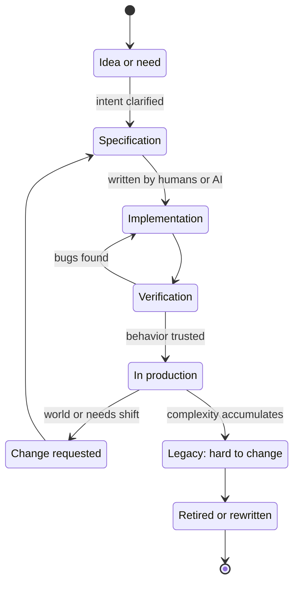
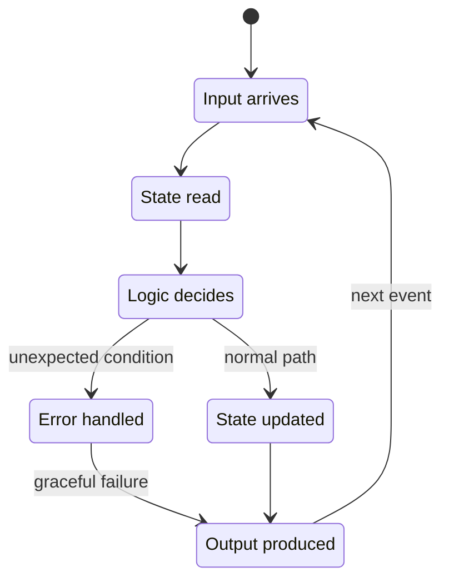
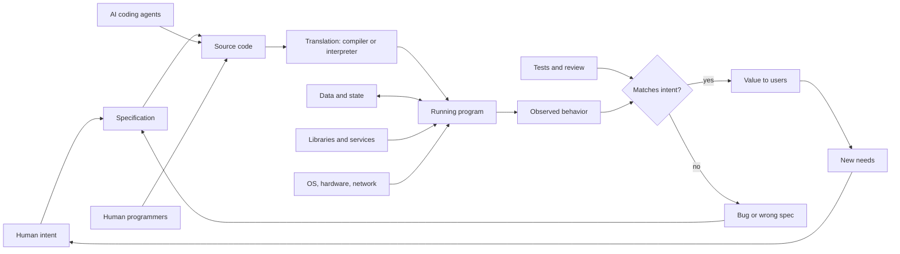
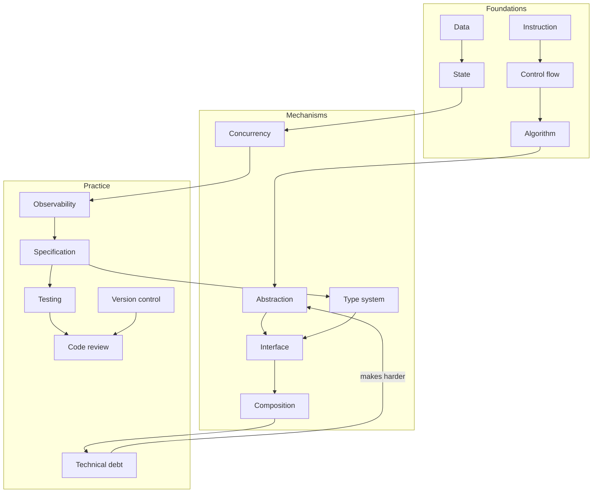
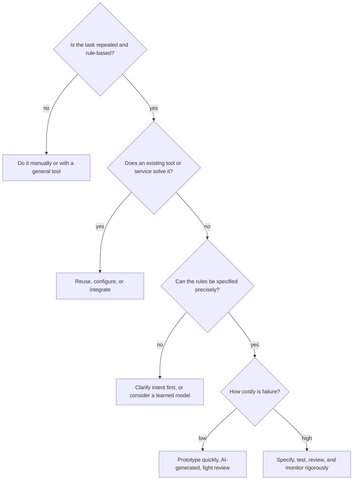
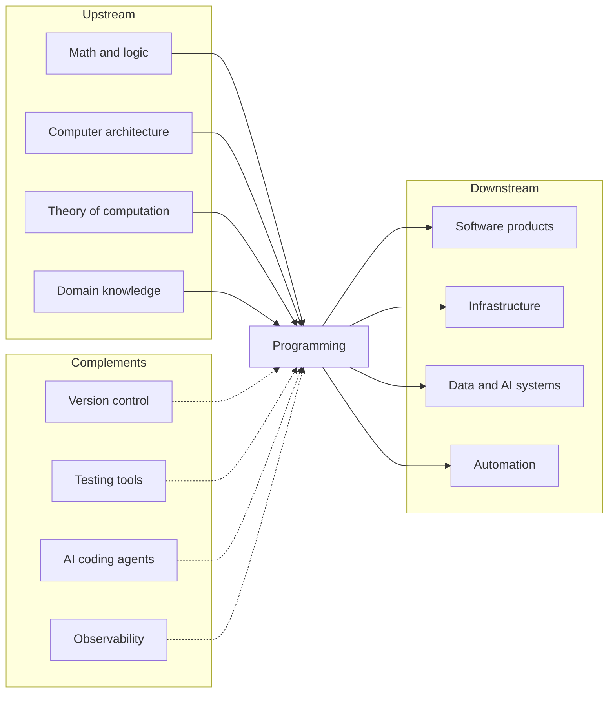
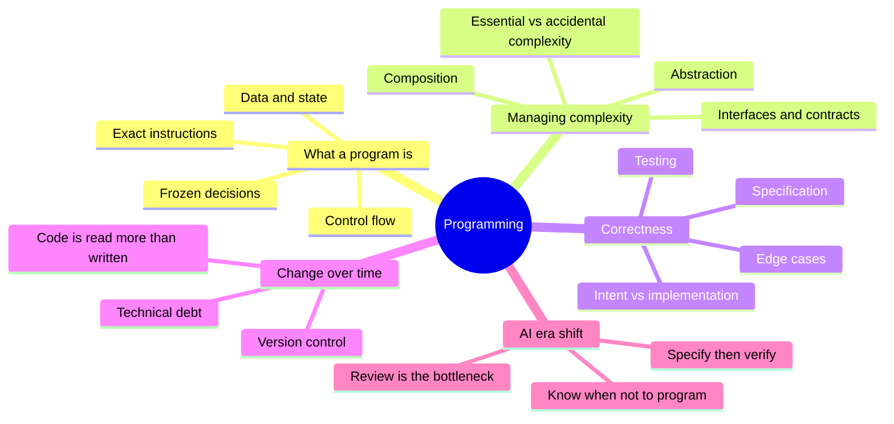

# Programming — Learning Map

> A program is a precise, executable description of a process: it turns human intent into instructions a machine follows exactly — and programming is the discipline of deciding what that description should say, keeping it correct, and keeping it changeable.

**Generated:** 2026-10-23 · **Lens:** mental model, not manual

*Interpretation: "program" is mapped here as computer programs and programming, not TV, academic, or project-management programs.*

## Contents

1. [Essence](#1-essence)
2. [World Model](#2-world-model)
3. [Concept Map](#3-concept-map)
4. [Decision Map](#4-decision-map)
5. [Search Space Expansion](#5-search-space-expansion)
6. [Ecosystem](#6-ecosystem)
7. [Transferable Principles](#7-transferable-principles)
8. [Minimum Mental Model](#8-minimum-mental-model)
9. [Common Misconceptions](#9-common-misconceptions)
10. [Summary](#10-summary)

---

## 1. Essence

### What is it fundamentally?

A program is **frozen decision-making**. Someone decides once how to handle a situation — calculate a payroll, route a packet, recommend a song — and the program repeats that decision millions of times, identically, at almost zero marginal cost.

Programming is therefore less about typing instructions and more about three acts:

1. **Specifying** — turning fuzzy intent into unambiguous rules, including every edge case a human would handle by common sense.
2. **Structuring** — organizing those rules into abstractions small enough for humans to understand and change.
3. **Verifying** — establishing that the machine does what was meant, not merely what was written.

### Why does it exist?

- **Machines only follow exact instructions.** Computers have no common sense; every assumption must be made explicit. Programs are the bridge between human ambiguity and machine literalness.
- **Repetition is expensive for humans and free for machines.** Once a process is captured as a program, it scales without fatigue or error drift.
- **Complexity exceeds human working memory.** Modern systems — banking, aviation, the internet — involve more rules and states than any person could execute or even hold in mind. Programs externalize that complexity.

### What problem does it solve?

**Automating judgment that can be made explicit.** Any process whose rules can be stated precisely can be run by a machine, faster, cheaper, and more consistently than by people. Programming solves the problem of making that statement precise *and* keeping it correct as the world changes.

### What did people do before it?

| Before | Limitation programs removed |
|---|---|
| Human clerks and "computers" (people who calculated) | Speed, cost, fatigue, and error rates |
| Mechanical machines (looms, tabulators) | Each machine did one fixed job; changing behavior meant rebuilding hardware |
| Written procedures and manuals | Humans interpret inconsistently; procedures don't execute themselves |
| Hard-wired electronic circuits | Programs made behavior *software*: changeable without changing the machine |

The pivotal idea is the **stored-program computer**: the instructions are data in memory, so one general machine can become any machine by loading a different program.

### What new possibilities does it create?

- **Zero marginal cost** — software copies and runs at near-zero cost, enabling global products built by small teams.
- **Composition** — programs build on other programs (operating systems, libraries, networks), stacking capability layer upon layer.
- **Simulation** — modeling weather, economies, proteins, and markets before acting in the real world.
- **In the AI era** — AI systems now write much of the code itself. The bottleneck moves from *producing code* to *specifying intent, judging correctness, and designing systems that stay understandable*. Programming becomes more like directing and reviewing than typing.

---

## 2. World Model

### Objects

| Object | What it is |
|---|---|
| **Intent / requirement** | What a person actually wants done, often vague and incomplete. |
| **Specification** | The intent made precise: inputs, outputs, rules, edge cases. |
| **Source code** | The human-readable description of the program. |
| **Data and state** | The information a program reads, transforms, and remembers. |
| **Abstraction** | A named unit (function, module, service) that hides details behind an interface. |
| **Interface** | The contract by which parts communicate; what each part promises others. |
| **Executable / running process** | The program as the machine actually runs it. |
| **Bug** | A gap between what the program does and what was intended. |
| **Tests** | Executable checks that encode expected behavior. |

### Actors

- **Stakeholders and users** — hold the intent; judge whether the program is useful.
- **Programmers** — translate intent into structure; increasingly act as specifiers, reviewers, and system designers.
- **AI coding agents** — generate, modify, explain, and test code at high speed; need clear intent and verification.
- **Compilers and interpreters** — translate source code into what the machine executes.
- **Runtime environment** — operating system, hardware, networks, other services the program depends on.
- **Reviewers and maintainers** — keep the code understandable and correct over years.
- **Attackers** — look for gaps between intended and actual behavior to exploit.

### State changes

A program has two lifecycles: **execution** (what happens when it runs) and **evolution** (how its code changes over time). Most of a program's cost is in evolution.

### Workflows

1. **Clarify** — understand what problem the program is solving and for whom.
2. **Specify** — define behavior precisely, including edge cases and failure modes.
3. **Design** — choose data representations and break the system into parts with clear interfaces.
4. **Implement** — write the code (today, often generated by AI and directed by humans).
5. **Verify** — test, review, and observe real behavior.
6. **Operate and evolve** — deploy, monitor, fix, and adapt as needs change.

### Systems

### Value

- **Created** when a repeated human decision becomes reliable automation, or when software enables something impossible by hand.
- **Captured** through scale: one program serving millions of users at near-zero marginal cost.
- **Destroyed** by bugs in critical paths, security holes, systems so tangled no one dares change them (technical debt), and code that does exactly what was written but not what was meant.

---

## 3. Concept Map

### Layer 1 — Foundations: what a program is

| Entity | Action | Purpose | Relationships |
|---|---|---|---|
| **Instruction** | Tells the machine one exact step | Smallest unit of behavior | Combined by Control Flow |
| **Data** | Represents the world as values | Gives the program something to reason about | Shaped by Data Structures; changed through State |
| **State** | Remembers what happened | Lets behavior depend on history | Source of most complexity and bugs |
| **Control flow** | Chooses which instructions run (sequence, branch, loop) | Encodes decisions and repetition | Operates on Data and State |
| **Algorithm** | Solves a problem in defined steps | Makes a solution efficient and correct | Expressed with Instructions and Control Flow |
| **Determinism** | Same inputs produce the same outputs | Makes programs predictable and testable | Broken by external State, time, concurrency, randomness |

### Layer 2 — Mechanisms: how programs manage complexity

| Entity | Action | Purpose | Relationships |
|---|---|---|---|
| **Abstraction** | Hides details behind a name | Lets humans think in larger chunks | Implemented as functions, modules, services |
| **Interface / contract** | Defines what a part promises | Allows parts to change independently | Boundary of every Abstraction |
| **Composition** | Combines small parts into larger ones | Builds big systems from understandable pieces | Requires clean Interfaces |
| **Type system** | Constrains what values may be | Catches categories of errors before running | A machine-checked form of Specification |
| **Concurrency** | Runs things at the same time | Uses resources efficiently and handles many users | Multiplies State complexity |
| **Translation** | Compiles or interprets source into machine actions | Lets humans write at a higher level than hardware | Introduces layers of abstraction between code and machine |

### Layer 3 — Practice: how software stays correct and changeable

| Entity | Action | Purpose | Relationships |
|---|---|---|---|
| **Specification** | States intended behavior precisely | The real source of truth — code is one expression of it | Feeds Implementation and Tests |
| **Testing** | Checks behavior automatically | Builds confidence and enables safe change | Encodes the Specification as executable examples |
| **Code review** | Has another mind check the change | Catches mistakes and spreads understanding | Critical when AI generates large volumes of code |
| **Version control** | Records every change | Enables collaboration, history, and rollback | Backbone of team and AI-agent workflows |
| **Technical debt** | Accumulates from shortcuts | Trades speed now for cost later | Reduced by Refactoring |
| **Observability** | Shows what the running system does | Reveals failures tests missed | Closes the loop from Production back to Specification |

### Cross-layer concept graph

---

## 4. Decision Map

| Situation | Decision | Reason | Expected Outcome |
|---|---|---|---|
| A task is repeated often with clear rules | Automate it with a program | Repetition plus clear rules is exactly what programs do best | Time saved, fewer errors |
| A task is rare or needs nuanced judgment | **Don't** write a program; do it manually or use an existing tool | Automation cost exceeds benefit; edge cases dominate | Avoided maintenance burden |
| An existing tool or service already does it | Buy or reuse instead of building | Every line of code is a liability to maintain | Faster delivery, less long-term cost |
| Asking AI to build a feature | Write a clear specification with examples and acceptance tests first | AI amplifies ambiguity as fast as it amplifies clarity | Code that matches intent on the first or second iteration |
| AI generated large amounts of code | Invest in review, tests, and understanding critical paths | Unread code is unowned code; bugs and security holes hide there | Confidence in what is actually deployed |
| System is getting hard to change | Refactor toward clearer abstractions before adding features | Complexity compounds; every new feature gets slower | Restored development speed |
| Choosing a programming language | Choose by ecosystem, team, and problem domain — not syntax preference | Libraries and people matter more than language features | Faster progress and easier hiring |
| Building a prototype to test an idea | Optimize for speed and throwaway; skip robustness | The goal is learning, not lasting software | Quick answer to whether the idea is worth building |
| Building something that handles money, health, or safety | Invest heavily in specification, testing, and review | Failure costs are high and sometimes irreversible | Reliable system and lower risk |
| Program needs to scale to many users | Design for state, concurrency, and failure from the start | Scaling problems are architectural, not cosmetic | A system that holds up under load |
| Unsure whether a bug is in code or in requirements | Re-check the specification with stakeholders | Many "bugs" are correct code implementing the wrong intent | Fixing the real problem once |

### Central decision tree

---

## 5. Search Space Expansion

### Beginner questions rarely asked

| Question | Why it matters |
|---|---|
| What exactly should happen when the input is empty, wrong, or huge? | Edge cases are where most real bugs live. |
| Who will change this program next, and will they understand it? | Code is read and modified far more than it is written. |
| Where does this program keep its state, and who else can change it? | Shared state is the root of many confusing failures. |
| What does this program depend on that I don't control? | Libraries, services, and networks fail in ways your code must survive. |
| Should this be a program at all? | Many problems are better solved by process changes or existing tools. |
| How will I know the program is wrong in production? | Without observability, failures stay invisible until users complain. |

### Questions experts ask

| Question | Why it matters |
|---|---|
| What are the invariants — things that must always be true? | Invariants define correctness more sharply than examples. |
| Where should the boundaries between modules be? | Good boundaries make change local; bad ones make every change global. |
| What happens under concurrency, partial failure, and retries? | Distributed and concurrent behavior breaks intuition. |
| What is the cost of change for this design in two years? | Maintainability is the dominant long-term cost. |
| Which parts are essential complexity and which are accidental? | Only accidental complexity can be removed. |
| How do I verify AI-generated code I didn't write? | Verification is becoming the core programming skill. |

### Questions worth exploring next

| Question | Why it matters |
|---|---|
| How do different programming paradigms (functional, object-oriented, declarative) shape thinking? | Each paradigm makes certain designs natural and others awkward. |
| How do type systems and formal methods prove correctness? | Stronger guarantees matter more as AI produces more code. |
| How should specifications be written so AI agents produce correct code? | Specification is becoming the primary programming interface. |
| What makes a system observable and debuggable? | Running systems reveal truths tests can't. |
| How do security vulnerabilities arise from gaps between intent and implementation? | Security is correctness under adversarial conditions. |
| When should a learned model replace explicit rules? | Machine learning handles patterns explicit programs can't specify. |

### Questions that define mastery

| Question | Why it matters |
|---|---|
| Can you design a system that a newcomer understands in an afternoon? | Simplicity is the hardest skill and the most valuable. |
| Can you predict where a system will break before it does? | Mastery means seeing failure modes in advance. |
| Can you specify a problem so precisely that any competent implementer — human or AI — builds the right thing? | Specification is now the leverage point. |
| Can you delete code confidently? | Knowing what is unnecessary requires deep system understanding. |
| Can you explain the trade-offs of a design to a non-programmer? | Shows understanding at the level of decisions, not syntax. |
| Can you tell when software is the wrong solution? | The best programmers know when not to program. |

---

## 6. Ecosystem

### Upstream — what programming builds on

- **Mathematics and logic** — algorithms, proofs, boolean logic, discrete math.
- **Computer architecture** — processors, memory, storage.
- **Theory of computation** — what can be computed at all, and how efficiently.
- **Domain knowledge** — finance, biology, logistics; programs encode domain rules.
- **Human language and reasoning** — now literally upstream, since natural-language intent drives AI code generation.

### Downstream — what programming enables

- **Software products** — applications, websites, games, platforms.
- **Infrastructure** — operating systems, networks, cloud services.
- **Data and AI systems** — pipelines, models, analytics.
- **Automation** — business processes, manufacturing, scientific research.
- **Embedded systems** — cars, medical devices, appliances.

### Alternatives

| Alternative | Choose it instead when… |
|---|---|
| **No-code / low-code tools** | The problem fits a common pattern and flexibility matters less than speed. |
| **Spreadsheets** | The logic is tabular, small-scale, and owned by non-programmers. |
| **Manual processes** | The task is rare, judgment-heavy, or changing too fast to codify. |
| **Machine learning models** | Rules can't be specified but examples are plentiful. |
| **Buying SaaS products** | The problem is generic and not a competitive differentiator. |
| **AI agents doing the task directly** | The task needs flexible judgment rather than a fixed reusable process. |

### Complements

- **Version control and collaboration platforms** — shared history and review.
- **Testing and verification tools** — automated confidence.
- **AI coding assistants and agents** — generation, explanation, refactoring.
- **Cloud and deployment platforms** — running software at scale.
- **Monitoring and observability** — seeing what software actually does.
- **Product and design practice** — deciding what is worth building.

---

## 7. Transferable Principles

| Category | Content | Remember or delegate? |
|---|---|---|
| **First principles** | Machines do exactly what they're told. Complexity is the enemy. Abstraction lets humans manage complexity. State is where bugs breed. Correctness means matching intent, not compiling. | **Remember** — these define how you think about any system. |
| **Transferable methodologies** | Decompose problems into parts. Define interfaces before internals. Make failures visible. Test assumptions with small experiments. Prefer simple over clever. Iterate in small, reversible steps. | **Remember** — they apply to organizations, processes, and writing. |
| **Implementation details** | Syntax, language features, framework APIs, build tools, deployment commands, library choices. | **Delegate** — AI handles these fluently. |
| **Stable knowledge** | Abstraction, data structures, algorithms, state, interfaces, testing, version control, technical debt, essential vs. accidental complexity. | **Remember** — stable for decades. |
| **Changing knowledge** | Popular languages and frameworks; AI coding agents and how much code they write (rising rapidly through 2025–2026); spec-driven and agent-driven workflows; cloud platforms; security practices for AI-generated code. | **Track lightly** — check the current state when you need it. |

---

## 8. Minimum Mental Model

1. **A program is frozen decisions** — choices made once, executed endlessly.
2. **Machines do exactly what they're told** — never what you meant.
3. **Data and state** — what the program knows and remembers.
4. **Control flow** — sequence, branching, repetition.
5. **Abstraction** — hiding details so humans can think bigger.
6. **Interfaces are contracts** — promises that let parts change independently.
7. **Composition** — big systems are built from small, understandable pieces.
8. **Essential vs. accidental complexity** — remove the accidental; manage the essential.
9. **Intent vs. implementation** — bugs live in the gap.
10. **Specification is the real source of truth** — code is one expression of it.
11. **Testing encodes expectations** — and makes change safe.
12. **Edge cases dominate** — the happy path is the easy part.
13. **Code is read far more than written** — optimize for understanding.
14. **Technical debt compounds** — shortcuts cost interest.
15. **Version control is shared memory** — history, collaboration, rollback.
16. **Specify, then verify** — the core loop when AI writes code.
17. **Review is the new bottleneck** — generation is cheap; trust is not.
18. **Know when not to program** — the best code is code you didn't need.

---

## 9. Common Misconceptions

| Misunderstanding | Why it happens | Better mental model |
|---|---|---|
| "Programming is about knowing a language's syntax." | Courses start with syntax because it's visible. | Programming is about modeling problems, managing complexity, and verifying behavior. Syntax is the smallest part — and the most delegable. |
| "If it runs, it's correct." | Working output feels like proof. | Correctness means matching intent across all inputs, including edge cases and failure modes. |
| "More code means more progress." | Output is easy to measure. | Every line is a liability. Less code that does the right thing is better. |
| "AI writes code, so programming skill no longer matters." | AI generates fluent, working code quickly. | AI shifts skill from writing to specifying, structuring, and verifying. Without those skills, you can't tell good code from plausible code. |
| "Bugs are typos." | Early bugs are often typos. | Most costly bugs come from wrong assumptions, misunderstood requirements, and unexpected state or interactions. |
| "A program is finished once it's shipped." | Shipping is a visible milestone. | Most software cost comes after launch — maintenance, change, and operation. |
| "Clever code is good code." | Cleverness feels like skill. | Clear code is good code; the next reader (or AI) must understand it to change it safely. |
| "Programming is a solitary activity." | Stereotype of the lone coder. | Software is a team and ecosystem activity: shared codebases, reviews, libraries, and now AI collaborators. |

---

## 10. Summary

> What I truly gain is not **the ability to write code in a specific language**, but **the ability to turn intent into precise, verifiable systems — and to judge whether any code, human- or AI-written, does what it should and can keep changing.**

A program is decision-making frozen into exact instructions, valuable because it repeats perfectly at almost no cost. The core difficulty was never typing; it is specifying intent precisely, managing complexity through abstraction and clear interfaces, and verifying that behavior matches what was meant. Those ideas — state, abstraction, interfaces, testing, technical debt — have been stable for decades and transfer to any complex system. As AI takes over code production, the lasting skill is specifying, structuring, and verifying, and knowing when not to write a program at all.
