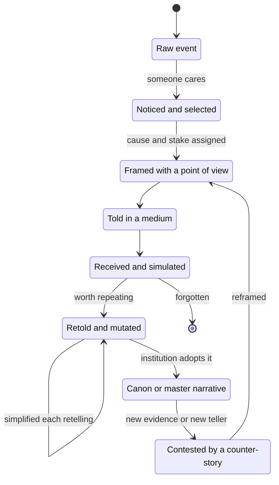
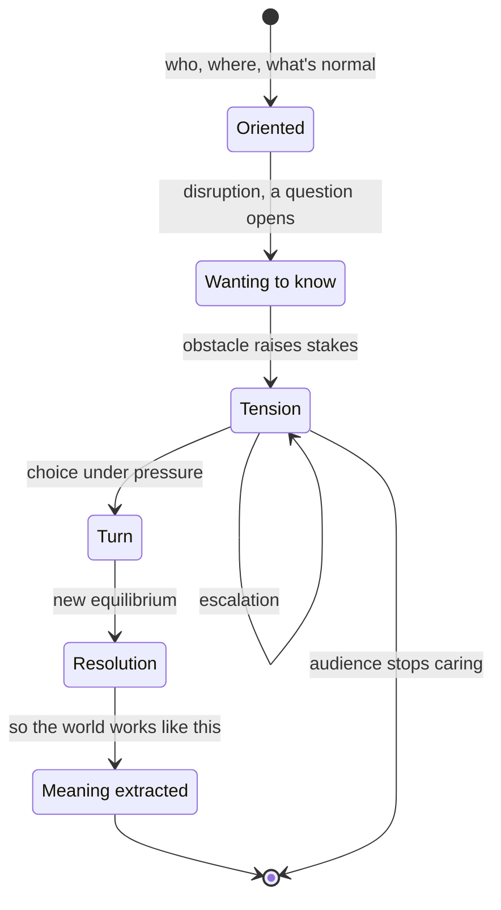
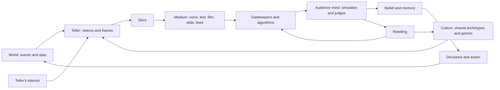
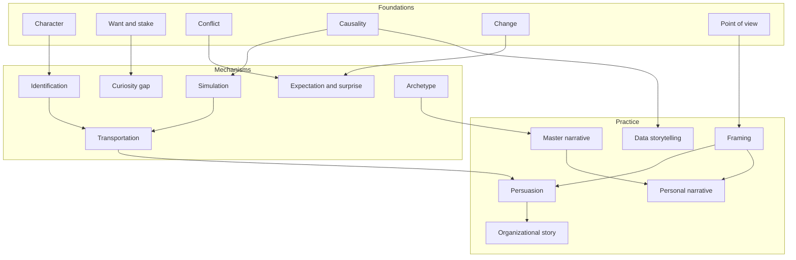
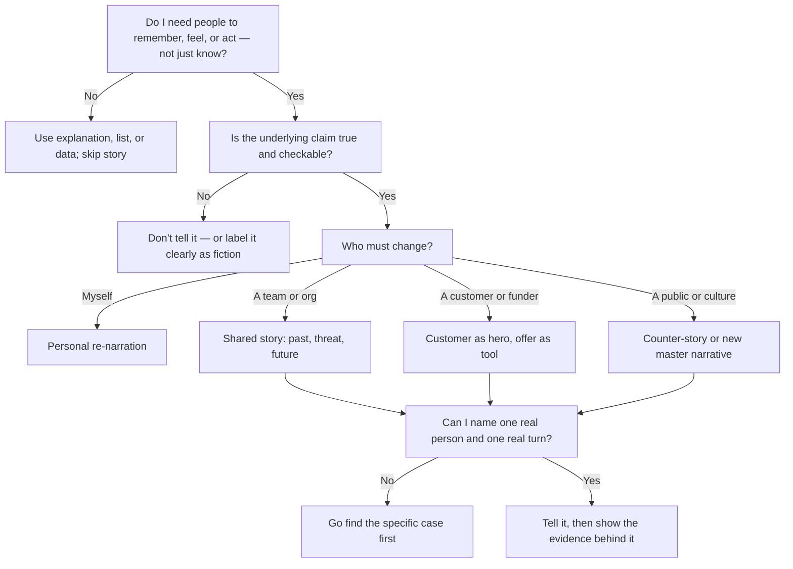
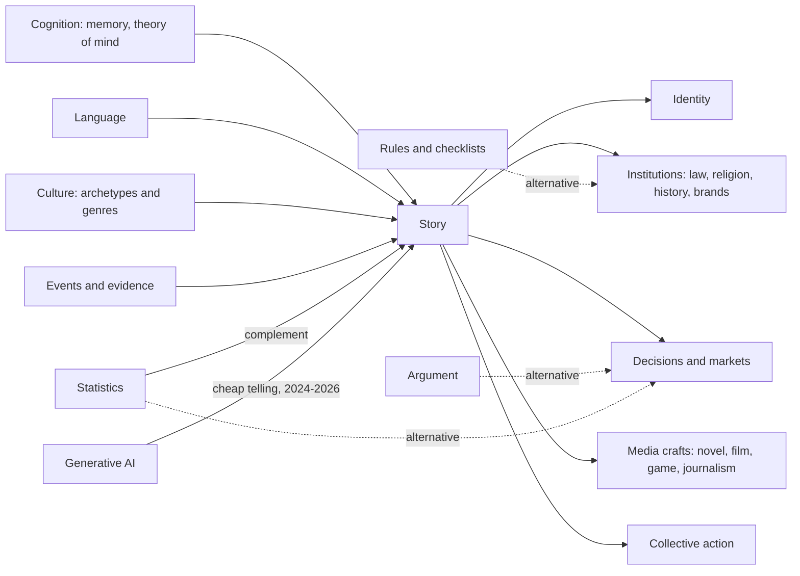
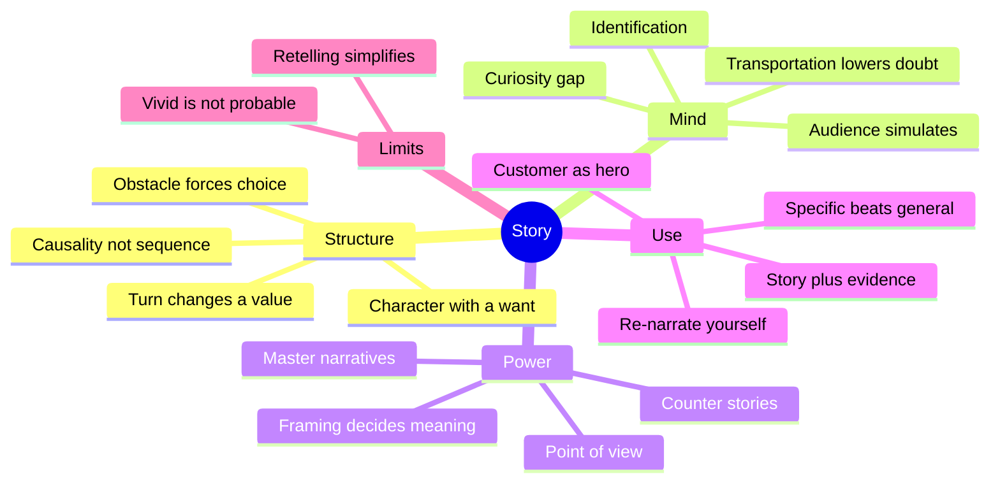

# Story — Learning Map

> A story is an account of someone who wants something, meets resistance, and is changed by what they choose — a shape the human mind uses to turn events into meaning it can remember and pass on.

**Generated:** 2026-10-28 · **Lens:** mental model, not manual

*Interpretation: "story" here means narrative as a general human technology — in myth, news, pitches, history, therapy, brands, and everyday talk — not the craft of any one medium. For the craft of long-form prose fiction, see [Fiction Novel Writing](../fiction-novel-writing/README.md).*

*A Chinese version of this map: [故事 — 学习地图](README.zh.md).*

## Contents

1. [Essence](#1-essence)
2. [World Model](#2-world-model)
3. [Concept Map](#3-concept-map)
4. [Decision Map](#4-decision-map)
5. [Search Space Expansion](#5-search-space-expansion)
6. [Ecosystem](#6-ecosystem)
7. [Transferable Principles](#7-transferable-principles)
8. [Minimum Mental Model](#8-minimum-mental-model)
9. [Common Misconceptions](#9-common-misconceptions)
10. [Summary](#10-summary)

---

## 1. Essence

### What is it fundamentally?

A story is **causality with a point of view and a stake**. A list of events ("the king died, then the queen died") becomes a story when a cause links them, a perspective selects them, and something is at risk ("the king died, and then the queen died of grief"). The listener's mind does the rest: it predicts, feels the gap between prediction and outcome, and extracts a rule about how the world works.

So a story is less a *thing* than a **compression format for experience**. It throws away almost everything that happened and keeps only what explains a change.

### Why does it exist?

Human brains cannot store raw experience, and they cannot easily reason with abstract rules. Stories sit between the two: concrete enough to feel, structured enough to generalize. Before writing, a story was the only durable way to move knowledge — where water is, who betrayed whom, what the gods want — across people and generations. It is the oldest knowledge-transfer protocol we have.

### What problem does it solve?

| Problem | What story does |
|---|---|
| Events are chaotic and endless | Selects a beginning, a middle, and an end, so experience becomes bounded |
| Causes are invisible | Asserts *why* — sometimes correctly, sometimes not |
| Abstract lessons don't stick | Binds a lesson to a person, a place, and an emotion |
| Groups need shared values without a rulebook | Models behavior to admire and avoid through characters |
| Identity is fragmented across time | Lets a person or a nation say "this is who we are and how we got here" |

### What did people do before it?

Strictly, there is no "before": story appears to be as old as language. What existed alongside it, and what it competes with, are **other modes of knowing**: direct imitation (watch and copy), ritual (repeat without explaining), lists and ledgers (record without meaning), and later, argument and statistics (explain without a protagonist). Story's distinctive move is to **explain through a particular case** rather than a general rule.

### What new possibilities does it create?

- **Borrowed experience**: you learn from a failure you never had to survive.
- **Coordination at scale**: strangers cooperate because they believe the same story about a nation, a company, a currency, or a cause.
- **Persuasion that bypasses counter-argument**: people resist claims, but they *lean into* stories — which is power and danger at once.
- **Identity and healing**: re-narrating your own life ("I'm not a failure; I'm someone in the middle of a hard chapter") changes how you act next.
- **Generative AI as a story engine (2024–2026)**: language models produce narrative fluently, which makes *telling* nearly free and moves the scarce skill to *choosing which story is true, useful, and worth telling*.

---

## 2. World Model

### Objects

| Object | What it is |
|---|---|
| **Event** | Something that happened, real or imagined — raw material, not yet a story |
| **Character** | An agent with a want; the lens through which events matter |
| **Want / stake** | What the character is after and what they lose if they fail |
| **Obstacle / conflict** | The resistance that forces choice |
| **Turn** | The moment the situation changes value (hope to fear, ignorance to knowledge) |
| **Frame** | Where the story starts and stops; what is left out |
| **Meaning / moral** | The rule the audience extracts about how the world works |
| **Telling** | One concrete performance of a story in a medium (a speech, a film, a slide, a tweet) |
| **Master narrative** | A story so widely shared it feels like reality ("hard work pays off", "the rise and fall of empires") |

### Actors

| Actor | Role |
|---|---|
| **Teller** | Selects, frames, and performs; carries an interest, stated or not |
| **Audience** | Simulates the story, fills gaps, judges credibility, decides whether to retell |
| **Protagonist** | The character whose choices carry the meaning — sometimes the teller, sometimes the audience ("you") |
| **Gatekeepers** | Editors, platforms, algorithms, elders, teachers — decide which stories circulate |
| **Institutions** | States, religions, companies, movements — sponsor master narratives that justify them |
| **Counter-tellers** | People who tell the same events differently; the source of history's arguments |

### State changes

A story moves through two parallel lifecycles: the **story's life in the world**, and the **audience's state while hearing it**.

### Workflows

- **Sense-making**: something surprising happens → people ask "what happened and why?" → a story forms within hours (news, gossip, post-mortems) → the first plausible story tends to stick.
- **Persuasion**: teller knows the outcome they want → picks a protagonist the audience identifies with → frames the obstacle as what the teller's proposal removes → ends on the future state.
- **Identity formation**: a person or group repeatedly selects events that confirm a self-image → the story becomes a guide to future choices → contradicting events are either ignored or force a re-narration.
- **Myth-making**: a story is retold by many → details sand down to an archetype → an institution adopts it → it becomes "how things are".
- **Counter-narration**: a group excluded from a master narrative retells the same events from its point of view → the frame shifts → history is rewritten.

### Systems

The loop matters: stories shape decisions, decisions change the world, and the changed world produces the next events to be storied. Culture is both the **input** (the templates a teller borrows) and the **output** (what survives retelling).

### Value

- **Created** when a story makes a true pattern memorable (a safety incident retold so no one repeats it), aligns people who must act together, or lets someone make sense of their own life.
- **Captured** by whoever owns the master narrative: founders raising money, politicians winning votes, brands commanding a premium, media owning attention.
- **Destroyed** when a vivid story overrides better evidence (one dramatic anecdote outweighs a thousand quiet data points), when a single story flattens a group of people, or when the same story is believed long after the world changed.

---

## 3. Concept Map

### Layer 1 — Foundations: what a story is made of

| Entity | Action | Purpose | Relationships |
|---|---|---|---|
| Character | Wants and chooses | Gives the audience someone to simulate | Needs a want; choices reveal it |
| Want and stake | Pull the character forward | Makes outcomes matter | Defined against an obstacle |
| Conflict | Resists the want | Forces choice, which reveals character | Without it, events are a report |
| Causality | Links events with "because" and "therefore" | Turns sequence into explanation | Separates story from chronicle |
| Change | Moves a value from one state to another | Is the content the audience takes away | The turn is where change happens |
| Point of view | Selects what is seen and how it is judged | Determines whose story it is | Frame and teller set it |

### Layer 2 — Mechanisms: why stories work on minds

| Entity | Action | Purpose | Relationships |
|---|---|---|---|
| Simulation | Audience runs the story as imagined experience | Produces felt rather than told knowledge | Requires concrete, sensory specifics |
| Curiosity gap | Opens a question and withholds the answer | Holds attention | Paid off by the turn |
| Identification | Audience adopts the protagonist's goals | Makes them care | Depends on a recognizable want |
| Expectation and surprise | Predict, then violate prediction plausibly | Creates emotion and memorability | Too much surprise breaks belief |
| Archetype | Reuses a shape the culture already knows | Lowers comprehension cost | Hero's journey, rags to riches, tragedy, rebirth |
| Narrative transportation | Absorption that lowers counter-arguing | Explains persuasion power | Ethical risk when used to mislead |

### Layer 3 — Practice: what stories do in the world

| Entity | Action | Purpose | Relationships |
|---|---|---|---|
| Framing | Chooses start, end, villain, and hero | Decides the meaning before the facts | Same events, different frames, opposite morals |
| Persuasive narrative | Casts audience as protagonist and offer as aid | Moves people to act | Pitches, campaigns, fundraising |
| Organizational story | Explains why we exist and where we're going | Coordinates without micromanaging | Strategy is often a story with numbers |
| Personal narrative | Selects life events into an identity | Guides future choices | Therapy works partly by re-narration |
| Master narrative | Becomes default common sense | Stabilizes a society or a market | Challenged by counter-stories |
| Data storytelling | Wraps evidence in a protagonist and a change | Makes numbers actionable | Risk: picking the data to fit the arc |

### Cross-layer concept graph

---

## 4. Decision Map

| Situation | Decision | Reason | Expected outcome |
|---|---|---|---|
| You need people to remember a lesson (safety, culture, a past failure) | Tell one specific incident with a person and a consequence | Abstract rules decay; a vivid case is recalled when a similar situation appears | The rule is applied in the moment, not just recited |
| You need people to act together toward an uncertain future | Tell a story of where we are, what threatens us, and what we become if we act | Coordination needs shared meaning, not just shared data | Fewer instructions needed; people improvise in the same direction |
| You must make a precise quantitative decision (pricing, dosage, risk limits) | **Don't lead with a story** — lead with the data and the model | Stories make vivid cases feel more probable than they are | Decision tracks base rates instead of the most memorable anecdote |
| You have data that should change minds | Use a story as the delivery vehicle, but let the data pick the story | Data alone rarely moves people; story alone can mislead | Audience understands *and* the claim stays honest |
| Someone tells you a compelling story to get a decision from you | Ask "what was left out of the frame?" and "who benefits from this telling?" | Transportation lowers critical thinking exactly when stakes are highest | You still feel the story but decide on evidence |
| A group feels misrepresented or invisible | Collect and tell counter-stories from their point of view | Single stories flatten people; plurality corrects the frame | More accurate shared understanding; new options appear |
| You are stuck in your own life or career | Re-narrate: who is the protagonist, what is the want, what chapter is this | Personal stories steer behavior; a new frame opens new choices | Action that the old story made unthinkable |
| You are pitching a product or idea | Make the customer the hero and your offer the tool, not the hero | Audiences identify with protagonists who resemble them | Listener imagines themselves using it |
| The truth is complex and has no clean villain | Tell a story with an honest unresolved ending, or use explanation instead | Forcing a neat arc onto messy reality breeds distrust once noticed | Credibility survives contact with the facts |
| AI can generate endless story variants for you (2026) | Spend your effort on selecting the true, specific detail and the right frame | Telling is cheap now; judgment about which story to tell is the scarce part | Fewer, better stories that only you could have chosen |
| A story has become an organization's or a nation's myth | Decide deliberately whether to reinforce, revise, or retire it | Old master narratives outlive the conditions that made them true | Identity stays useful rather than becoming a trap |

### Central decision tree

---

## 5. Search Space Expansion

### Beginner questions rarely asked

| Question | Why it matters |
|---|---|
| What is the smallest unit that still counts as a story? | Locates the boundary between story and description, which explains most failed "stories" |
| Why do we remember stories better than facts? | Points to memory and simulation, the real engine of story's power |
| Is every narrative manipulative, since it always selects and frames? | Forces the distinction between framing (unavoidable) and deception (a choice) |
| Why do so many cultures share the same story shapes? | Opens the archetype debate: universal minds, common experience, or diffusion |
| What happens to a story each time it is retold? | Explains rumor, myth, and why the earliest version is rarely the one that survives |
| Who owns a story about real events — the person who lived it or the one who tells it? | Surfaces ethics of memoir, journalism, and biography |

### Questions experts ask

| Question | Why it matters |
|---|---|
| What value changes in this story, and from what to what? | The turn is the content; if nothing changes value, nothing is said |
| Whose point of view is missing, and what would the story look like from there? | The fastest test of whether a frame is honest or merely convenient |
| Where does this story stop, and what happens if the frame extends one step further? | Many stories become false only because they end too early |
| Is the audience protagonist, witness, or target here? | Determines whether a story invites, informs, or manipulates |
| What archetype is this borrowing, and does it fit the facts or bend them? | Archetypes help comprehension but import assumptions |
| What would falsify this story? | Separates a story that explains from one that merely flatters |

### Questions worth exploring next

| Question | Why it matters |
|---|---|
| How do narrative and statistics combine without one corrupting the other? | Key skill for analysts, journalists, and executives |
| How do master narratives in economics and politics form, spread, and collapse? | Links story to markets, bubbles, and elections (see narrative economics) |
| How does narrative therapy change behavior by changing a self-story? | Shows story operating on the teller rather than an audience |
| What do interactive and game stories change when the audience makes the choices? | Tests which parts of story require authorial control |
| What happens to collective storytelling when AI can generate personalized narratives for each viewer? | Shared stories bind groups; fully personalized stories may not |
| How do oral cultures preserve stories accurately across centuries? | Reveals the memory technology inside rhythm, repetition, and formula |

### Questions that define mastery

| Question | Why it matters |
|---|---|
| Can I tell the same true events as three different stories with three different morals — and say which is most honest? | Mastery is control over framing, plus the conscience to choose |
| Can I recognize the story I am currently living inside and step outside it? | The hardest story to see is your own default narrative |
| When should I refuse to turn something into a story? | Some truths are distorted by any arc; restraint is part of the skill |
| Can I make a listener feel a statistic as vividly as an anecdote? | Bridges the gap that makes stories dangerous to rational decisions |
| Which stories in my organization or culture are still true, and which are fossils? | Leaders steer by retiring stories as much as by telling new ones |
| Can I find the one specific detail that makes a whole story believable? | Specificity is where credibility and memorability come from |

---

## 6. Ecosystem

### Upstream — what story draws on

- **Cognition**: memory, theory of mind (modeling other people's intentions), causal reasoning, and prediction.
- **Language and gesture**: the medium that made portable stories possible.
- **Culture**: inherited archetypes, genres, symbols, and taboos that tellers borrow.
- **Lived experience and evidence**: events, testimony, records, and data.

### Downstream — what story feeds

- **Identity**: personal, organizational, national.
- **Institutions**: religion, law (cases are stories judged), history, brands.
- **Decisions and markets**: investment theses, policy narratives, product strategy.
- **Media and art forms**: novels, film, games, journalism, podcasts — each a specialized craft of telling.
- **Collective action**: movements, campaigns, wars, and peace processes.

### Alternatives

| Alternative | Trade-off that would make you choose it instead |
|---|---|
| Logical argument | Choose it when the audience is expert, skeptical, and must be able to check every step; it loses on memorability |
| Statistics and models | Choose it when the decision depends on base rates and magnitudes; it loses on emotion and recall |
| Rules, checklists, procedures | Choose it when behavior must be identical every time; it loses when situations are novel |
| Direct experience or demonstration | Choose it when people can try it themselves; it is slow and doesn't scale |
| Ritual and symbol | Choose it when you need cohesion without explanation; it loses when people ask "why?" |

### Complements

- **Evidence**: a story backed by data persuades and survives scrutiny.
- **Visuals**: images give the simulation its concrete details.
- **Dialogue and listening**: stories told *with* people rather than *at* them build trust.
- **Explanation**: story opens the door; explanation carries the detailed load.

---

## 7. Transferable Principles

| Category | Content | Invest memory or delegate? |
|---|---|---|
| **First principles** | Story = want + obstacle + choice + change. Causality and stakes turn events into meaning. The audience completes the story in their own mind. Framing decides meaning before facts do. | **Memorize** — these apply to every medium and every era |
| **Transferable methodologies** | Find the turn and the value that changes. Make the audience or customer the protagonist. Use one specific case before the general rule. Test a story by telling it from the opposing point of view. Ask what's outside the frame. | **Internalize through practice** — use them until they become reflexes |
| **Implementation details** | Medium-specific techniques: slide pacing, screenplay format, podcast structure, social-post hooks, scene-level craft | **Delegate to AI and specialists**; look up when needed |
| **Stable knowledge (true in 10 years)** | Humans remember stories better than facts; vivid cases distort risk perception; shared stories coordinate groups; retelling simplifies; master narratives resist revision | **Memorize** |
| **Changing knowledge (likely different in 2 years)** | As of 2026: generative AI makes fluent narrative almost free; platform algorithms reward specific hook-driven formats; personalized and interactive stories are spreading; synthetic media makes the provenance of a true story harder to prove | **Track, don't memorize** — revisit yearly |

The durable skill is **judgment about which story is true, fair, and worth telling**. The production of the telling is increasingly delegable.

---

## 8. Minimum Mental Model

1. **Character with a want** — no one wanting anything means no story, only description.
2. **Obstacle forces choice** — resistance is what makes a choice reveal who someone is.
3. **The turn** — the moment a value flips (safe to endangered, ignorant to aware) is the actual content.
4. **Causality, not sequence** — "because" and "therefore" transform a chronicle into an explanation.
5. **The audience simulates** — listeners run the story as imagined experience, which is why it feels like knowledge.
6. **Curiosity gap** — an open question held open is what keeps attention.
7. **Identification** — people care about outcomes for characters whose wants they recognize.
8. **Transportation lowers doubt** — absorbed listeners argue back less, which is the source of persuasive power and its danger.
9. **Framing decides meaning** — where you start and stop, and who is hero or villain, settles the moral before any fact is weighed.
10. **Point of view** — every story is someone's; asking whose reveals what was selected out.
11. **Master narratives** — the most powerful stories are the ones nobody notices are stories.
12. **Counter-stories** — the same events told from another position are how frames get corrected.
13. **Specific beats general** — one named person with one concrete detail outperforms a summary of thousands.
14. **Customer or audience as hero** — persuasion works when the listener can step into the protagonist's place.
15. **Re-narrate yourself** — the story you tell about your own life steers your next choice and can be revised.
16. **Story plus evidence** — story carries attention; evidence earns trust; either alone is weaker.
17. **Vivid is not probable** — a memorable case feels more likely than it is; check base rates.
18. **Retelling simplifies** — each pass sands a story toward an archetype, losing nuance and sometimes truth.

---

## 9. Common Misconceptions

| Common misunderstanding | Why it happens | Better mental model |
|---|---|---|
| "A story is anything with a beginning, a middle, and an end." | School teaches story as sequence | A story needs a want, resistance, and a change in value; sequence alone is a report |
| "Stories are for entertainment; serious work uses facts." | Fiction is the most visible form of story | Strategy, law, science, history, and medicine all run on narratives; the question is whether they are good ones |
| "A good story is a true story." | Compelling stories feel true | Persuasiveness and truth are independent; transportation makes false stories feel *more* true |
| "Storytelling is a talent you have or don't." | Great tellers make it look effortless | Story is a structure plus a few learnable choices — protagonist, stake, turn, frame — practiced until fluent |
| "There's one right way to tell what happened." | We experience our own view as the view | Every telling selects; the honest move is to know your frame and show what it leaves out |
| "The hero's journey is the universal story formula." | It was popularized as a template | It is one archetype among many (tragedy, rebirth, quest, comedy, voyage and return); forcing it distorts material |
| "Data speaks for itself, so I don't need a story." | Analysts trust numbers | Audiences supply a story anyway — usually the wrong one; choose the narrative or someone else will |
| "With AI writing stories, story skill no longer matters." | AI makes fluent narrative cheap (2024–2026) | Fluency was never the bottleneck; selecting the true detail, the right frame, and the right moment still is |

---

## 10. Summary

> What I truly gain is not **the ability to tell entertaining tales**, but **control over how events become meaning — for others and for myself**.

A story is the mind's compression format: a character wants something, resistance forces a choice, and a value changes, with causality and point of view turning events into a lesson. It works because listeners simulate it, which makes it memorable and lowers their guard — so it can carry truth further than argument, or carry falsehood just as far. Its real power lies in framing: where it starts, where it stops, and whose eyes it uses decide its meaning before facts do. Use story when people must remember, feel, or act together; pair it with evidence and refuse it when base rates should decide. As AI makes telling nearly free, the lasting skill is choosing which story is true and worth telling, and noticing the stories you already live inside.
