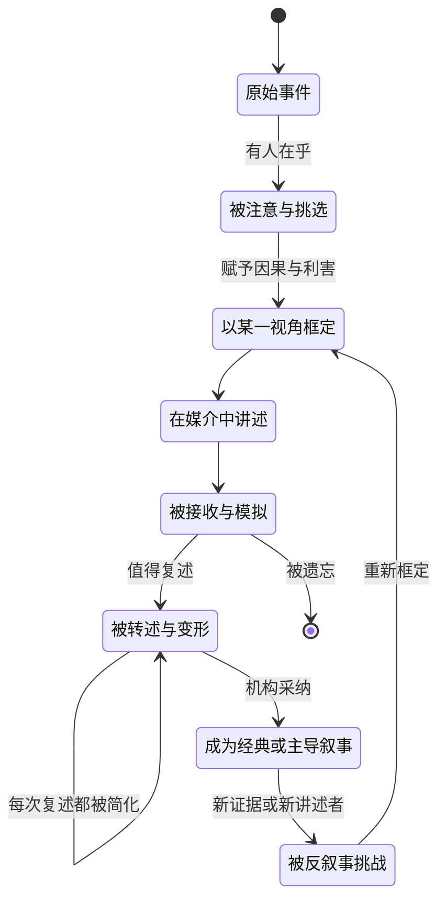
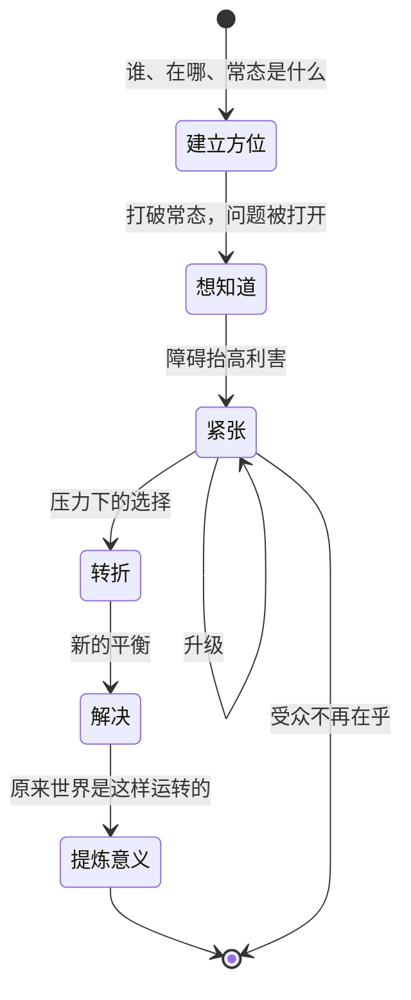
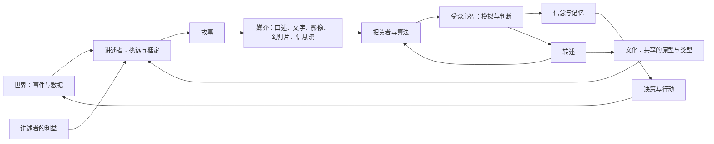
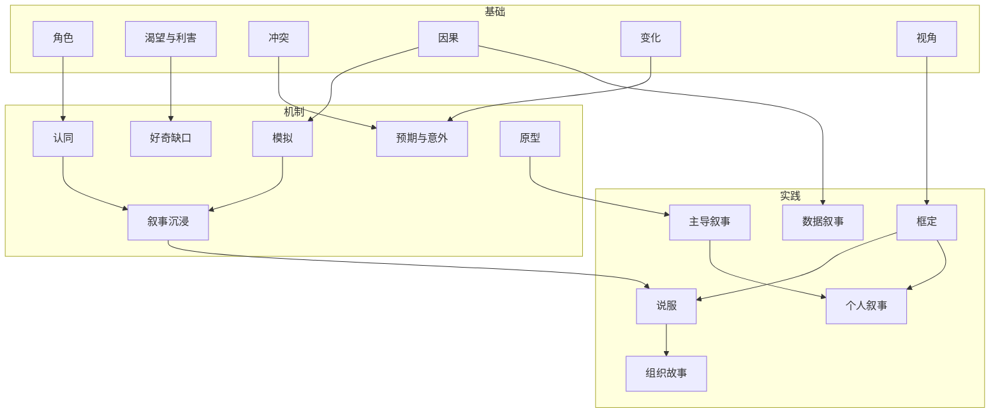
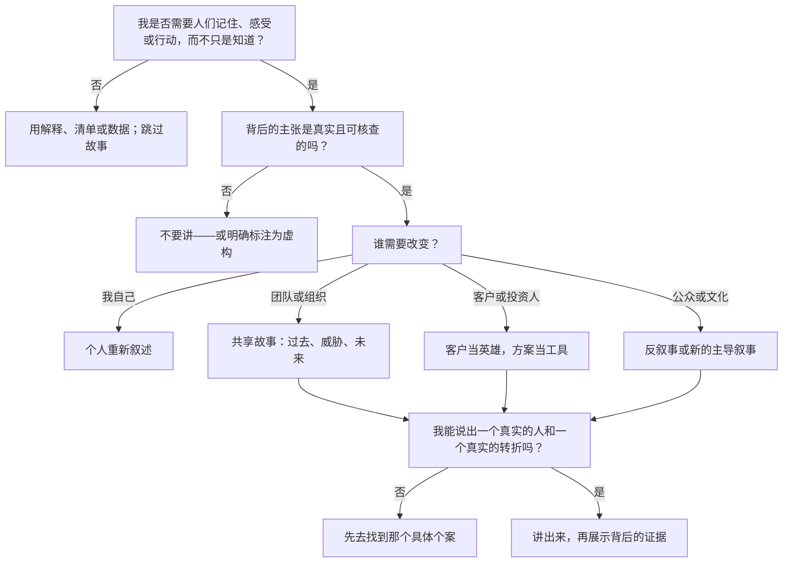
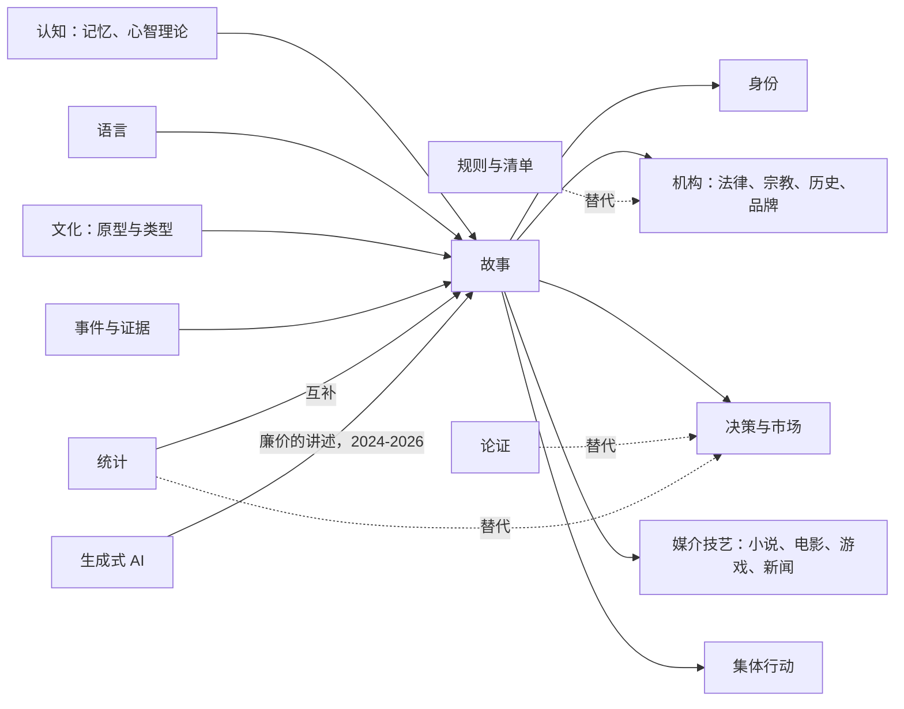
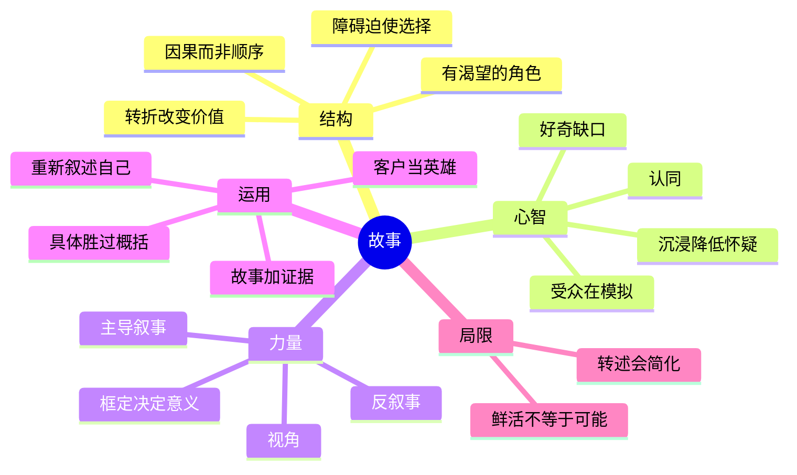

# 故事 — 学习地图

> 故事讲的是：一个人想要某样东西，遭遇阻力，并因自己的选择而改变——这是人类心智把事件变成可记忆、可传递的意义的一种形状。

**生成日期：** 2026-10-28 · **视角：** 心智模型，而非操作手册

*解读：此处的"故事"指作为普遍人类技术的叙事——存在于神话、新闻、路演、历史、心理治疗、品牌与日常交谈之中——而非某一种媒介的写作技艺。关于长篇虚构小说的技艺，见 [小说创作](../fiction-novel-writing/README.zh.md)。*

*本地图的英文版：[Story — Learning Map](README.md)。*

## 目录

1. [本质](#1-本质)
2. [世界模型](#2-世界模型)
3. [概念地图](#3-概念地图)
4. [决策地图](#4-决策地图)
5. [探索空间扩展](#5-探索空间扩展)
6. [生态系统](#6-生态系统)
7. [可迁移的原则](#7-可迁移的原则)
8. [最小心智模型](#8-最小心智模型)
9. [常见误解](#9-常见误解)
10. [总结](#10-总结)

---

## 1. 本质

### 它根本上是什么？

故事是**带有视角和利害的因果**。一串事件（"国王死了，然后王后死了"）要变成故事，需要一个原因把它们连起来、一个视角挑选它们、一样东西处于危险之中（"国王死了，王后因悲伤而死"）。剩下的由听者的大脑完成：预测、感受预测与结果之间的落差，并从中提炼一条"世界是这样运转的"规则。

所以故事与其说是一个*东西*，不如说是一种**经验的压缩格式**。它丢掉几乎所有发生过的事，只保留能解释一次变化的部分。

### 为什么会有它？

人脑存不下原始经验，也不擅长用抽象规则推理。故事恰好处在两者之间：具体到能被感受，结构化到能被推广。在文字出现之前，故事是跨越人群和世代传递知识的唯一持久方式——哪里有水、谁背叛了谁、神要什么。它是我们拥有的最古老的知识传输协议。

### 它解决什么问题？

| 问题 | 故事做了什么 |
|---|---|
| 事件混乱而无穷无尽 | 选定开头、中段和结尾，让经验有了边界 |
| 原因是看不见的 | 断言*为什么*——有时对，有时错 |
| 抽象的教训记不住 | 把教训绑定在一个人、一个地点、一种情绪上 |
| 群体需要共同价值观，却没有规则手册 | 借角色示范哪些行为值得敬佩、哪些应当避免 |
| 身份在时间中是碎片化的 | 让一个人或一个民族能说"我们是谁，我们如何走到今天" |

### 在它之前，人们做什么？

严格说没有"之前"：故事似乎与语言一样古老。与它并存、并与它竞争的，是**其他认知方式**：直接模仿（看着学）、仪式（重复而不解释）、清单与账簿（记录而不赋义），以及后来的论证与统计（解释但没有主角）。故事的独特之处在于**通过一个具体个案来解释**，而不是通过一条普遍规则。

### 它打开了什么可能性？

- **借来的经验**：你能从一次自己不必亲历的失败中学习。
- **大规模协作**：陌生人能合作，是因为他们相信关于国家、公司、货币或某项事业的同一个故事。
- **绕过反驳的说服力**：人们会抵抗论断，却会*投入*故事——这既是力量，也是危险。
- **身份与疗愈**：重新叙述自己的人生（"我不是失败者，我只是正处在艰难的一章"）会改变接下来的行动。
- **生成式 AI 作为故事引擎（2024–2026）**：语言模型能流畅地生成叙事，*讲述*几乎变得免费，稀缺的能力转移到*选择哪个故事是真实的、有用的、值得讲的*。

---

## 2. 世界模型

### 对象（Objects）

| 对象 | 是什么 |
|---|---|
| **事件** | 发生过的事，真实或想象——是原料，还不是故事 |
| **角色** | 有渴望的行动者；事件借由这个角色才变得重要 |
| **渴望 / 利害** | 角色追求什么，失败会失去什么 |
| **障碍 / 冲突** | 迫使人做出选择的阻力 |
| **转折** | 局面的价值发生翻转的时刻（希望变恐惧、无知变知晓） |
| **框架** | 故事从哪里开始、在哪里结束；什么被排除在外 |
| **意义 / 寓意** | 受众从中提炼的"世界如何运转"的规则 |
| **讲述** | 故事在某种媒介中的一次具体呈现（一场演讲、一部电影、一页幻灯片、一条推文） |
| **主导叙事** | 被广泛共享到让人觉得就是现实的故事（"努力就有回报""帝国的兴衰"） |

### 行动者（Actors）

| 行动者 | 角色 |
|---|---|
| **讲述者** | 挑选、框定、呈现；带有利益，无论是否明说 |
| **受众** | 在脑中模拟故事、填补空白、判断可信度、决定是否转述 |
| **主角** | 其选择承载意义的人物——有时是讲述者本人，有时是受众（"你"） |
| **把关者** | 编辑、平台、算法、长辈、老师——决定哪些故事得以流传 |
| **机构** | 国家、宗教、公司、运动——资助为自身正名的主导叙事 |
| **反叙事者** | 对同一事件给出不同讲法的人；历史争论的来源 |

### 状态变化（State changes）

故事同时经历两条生命周期：**故事在世界中的生命**，以及**受众聆听时的心理状态**。

### 工作流（Workflows）

- **意义建构**：发生了出人意料的事 → 人们问"发生了什么、为什么" → 数小时内就会形成一个故事（新闻、八卦、事后复盘）→ 第一个说得通的故事往往会固定下来。
- **说服**：讲述者心里有想要的结果 → 挑选一个受众能认同的主角 → 把障碍框定为讲述者的方案能消除的东西 → 以未来的状态收尾。
- **身份形成**：一个人或群体反复挑选印证自我形象的事件 → 故事成为未来选择的指南 → 与之矛盾的事件要么被忽视，要么迫使人重新叙述。
- **神话化**：故事被许多人复述 → 细节被磨平成原型 → 某个机构采纳它 → 它变成"事情本来就是这样"。
- **反叙事**：被主导叙事排除在外的群体，从自己的视角重讲同一批事件 → 框架移动 → 历史被改写。

### 系统（Systems）

这个回路是关键：故事塑造决策，决策改变世界，被改变的世界又产生下一批等待被讲成故事的事件。文化既是**输入**（讲述者借用的模板），也是**输出**（在转述中存活下来的东西）。

### 价值（Value）

- **创造**：当故事让一个真实的规律变得好记（一次安全事故被反复讲述，于是无人重蹈覆辙）、让必须一起行动的人对齐，或者让一个人理解了自己的人生。
- **攫取**：谁拥有主导叙事，谁就获得价值——融资的创始人、赢得选票的政客、享有溢价的品牌、占有注意力的媒体。
- **毁灭**：当一个鲜活的故事压倒了更好的证据（一个戏剧性的个案胜过一千个安静的数据点）、当单一故事把一群人扁平化，或当世界已经改变而人们仍相信同一个故事。

---

## 3. 概念地图

### 第一层 — 基础：故事由什么构成

| 实体 | 动作 | 目的 | 关系 |
|---|---|---|---|
| 角色 | 渴望并选择 | 给受众一个可以模拟的人 | 需要渴望；选择揭示渴望 |
| 渴望与利害 | 拉动角色向前 | 让结果变得重要 | 相对于障碍而被定义 |
| 冲突 | 阻挡渴望 | 迫使选择，选择揭示性格 | 没有它，事件只是一份报告 |
| 因果 | 用"因为"和"所以"连接事件 | 把顺序变成解释 | 区分故事与编年史 |
| 变化 | 让某种价值从一个状态转到另一个状态 | 是受众带走的内容本身 | 转折是变化发生之处 |
| 视角 | 决定看见什么、如何评判 | 决定这是谁的故事 | 由框架和讲述者设定 |

### 第二层 — 机制：故事为何能作用于心智

| 实体 | 动作 | 目的 | 关系 |
|---|---|---|---|
| 模拟 | 受众把故事当作想象中的经验来运行 | 产生"感到的"而非"被告知的"知识 | 需要具体、可感的细节 |
| 好奇缺口 | 抛出问题并扣住答案 | 维持注意力 | 由转折来兑现 |
| 认同 | 受众接纳主角的目标 | 让他们在乎 | 取决于一个可辨认的渴望 |
| 预期与意外 | 先让人预测，再合理地打破预测 | 制造情绪与记忆点 | 意外过多会破坏可信度 |
| 原型 | 复用文化中早已熟知的形状 | 降低理解成本 | 英雄之旅、白手起家、悲剧、重生 |
| 叙事沉浸 | 投入感降低了反驳 | 解释了说服力的来源 | 用于误导时存在伦理风险 |

### 第三层 — 实践：故事在世界中做什么

| 实体 | 动作 | 目的 | 关系 |
|---|---|---|---|
| 框定 | 选择起点、终点、反派与英雄 | 在事实之前就决定了意义 | 同样的事件，不同的框架，相反的寓意 |
| 说服性叙事 | 让受众当主角，让方案当助力 | 推动人们行动 | 路演、竞选、募款 |
| 组织故事 | 解释我们为何存在、去往何方 | 无需事无巨细地管理也能协调 | 战略常常是带数字的故事 |
| 个人叙事 | 把人生事件挑选成一种身份 | 引导未来的选择 | 心理治疗部分是靠重新叙述起作用 |
| 主导叙事 | 成为默认的常识 | 稳定一个社会或一个市场 | 受到反叙事的挑战 |
| 数据叙事 | 给证据配上主角和变化 | 让数字可以被付诸行动 | 风险：挑数据去迎合弧线 |

### 跨层概念图

---

## 4. 决策地图

| 情境 | 决策 | 理由 | 预期结果 |
|---|---|---|---|
| 你需要人们记住一条教训（安全、文化、一次过去的失败） | 讲一个具体事件，有人物、有后果 | 抽象规则会衰减；鲜活的个案会在相似情境出现时被想起 | 规则在当下被应用，而不只是被背诵 |
| 你需要人们一起走向不确定的未来 | 讲一个"我们在哪、什么在威胁我们、行动后我们会成为什么"的故事 | 协作需要共享的意义，而不只是共享的数据 | 需要的指令更少；人们会朝同一方向即兴发挥 |
| 你必须做一个精确的定量决策（定价、剂量、风险限额） | **不要以故事开场**——以数据和模型开场 | 故事会让鲜活的个案显得比实际更可能发生 | 决策跟随基础概率，而非最令人难忘的轶事 |
| 你手上有应该改变人们想法的数据 | 用故事作为载体，但让数据来挑选故事 | 单靠数据很少能打动人；单靠故事可能误导 | 受众既理解了，主张也保持诚实 |
| 有人讲一个动人的故事，想让你做决定 | 问"框架之外遗漏了什么？"和"这种讲法对谁有利？" | 叙事沉浸恰恰在利害最高时降低批判性思考 | 你仍能感受故事，但依据证据做决定 |
| 某个群体感到被误解或被忽视 | 收集并讲述来自他们视角的反叙事 | 单一故事会把人扁平化；多元讲述能校正框架 | 共同理解更准确；新的选项出现 |
| 你在自己的人生或职业中卡住了 | 重新叙述：谁是主角、渴望什么、这是哪一章 | 个人故事操纵着行为；新的框架打开新的选择 | 做出旧故事里无法想象的行动 |
| 你在推介一个产品或想法 | 让客户当英雄，你的方案当工具，而不是英雄 | 受众认同与自己相似的主角 | 听者想象自己在使用它 |
| 真相复杂，没有干净的反派 | 讲一个结局诚实而未解决的故事，或改用解释 | 把整齐的弧线强加于混乱现实，一旦被识破就会招致不信任 | 可信度经得起与事实的碰撞 |
| AI 能为你生成无数故事变体（2026） | 把精力花在挑选真实、具体的细节和正确的框架上 | 讲述已经很便宜；判断讲哪个故事才是稀缺的 | 更少但更好的、只有你才会选择的故事 |
| 某个故事已成为组织或国家的神话 | 有意识地决定是强化、修订还是让它退场 | 旧的主导叙事会比使它成立的条件活得更久 | 身份保持有用，而不是变成陷阱 |

### 核心决策树

---

## 5. 探索空间扩展

### 很少被问到的初学者问题

| 问题 | 为什么重要 |
|---|---|
| 仍然算作故事的最小单位是什么？ | 找到故事与描述的边界，这解释了大多数失败的"故事" |
| 为什么我们记故事比记事实更牢？ | 指向记忆与模拟——故事力量的真正引擎 |
| 既然叙事总在挑选和框定，是不是所有叙事都是操纵？ | 迫使你区分框定（不可避免）与欺骗（一种选择） |
| 为什么那么多文化拥有相同的故事形状？ | 打开原型之争：普遍的心智、共同的经验，还是传播扩散 |
| 故事每被转述一次，会发生什么？ | 解释了谣言、神话，以及为什么最早的版本很少是流传下来的那个 |
| 关于真实事件的故事归谁所有——亲历者还是讲述者？ | 揭示回忆录、新闻与传记的伦理问题 |

### 专家会问的问题

| 问题 | 为什么重要 |
|---|---|
| 这个故事中哪种价值发生了变化，从什么变成什么？ | 转折就是内容；如果没有价值发生变化，就什么也没说 |
| 谁的视角缺席了？从那里看，故事会是什么样？ | 检验一个框架是诚实还是仅仅方便的最快方法 |
| 故事在哪里结束？如果框架再往外延伸一步会怎样？ | 许多故事之所以变成谎言，只是因为结束得太早 |
| 受众在这里是主角、见证者，还是目标？ | 决定了故事是在邀请、告知还是操纵 |
| 它借用了哪个原型？这个原型是贴合事实，还是扭曲事实？ | 原型帮助理解，但也带入了预设 |
| 什么能证伪这个故事？ | 区分能解释的故事和只会讨好的故事 |

### 值得接下来探索的问题

| 问题 | 为什么重要 |
|---|---|
| 叙事与统计如何结合，而不让一方腐蚀另一方？ | 分析师、记者与管理者的关键能力 |
| 经济与政治中的主导叙事如何形成、传播与崩塌？ | 把故事与市场、泡沫和选举联系起来（参见叙事经济学） |
| 叙事疗法如何通过改变自我故事来改变行为？ | 展示故事作用于讲述者本身，而非受众 |
| 当受众自己做选择时，互动与游戏叙事改变了什么？ | 检验故事的哪些部分必须由作者掌控 |
| 当 AI 能为每位观众生成个性化叙事时，集体讲故事会怎样？ | 共享的故事凝聚群体；完全个性化的故事可能做不到 |
| 口述文化如何把故事准确地保存数百年？ | 揭示节奏、重复与套语中蕴含的记忆技术 |

### 定义精通的问题

| 问题 | 为什么重要 |
|---|---|
| 我能否把同一组真实事件讲成三个寓意不同的故事——并说出哪个最诚实？ | 精通意味着掌控框定，同时有良知去选择 |
| 我能否认出自己正身处其中的故事，并走出它？ | 最难看见的故事，是你自己的默认叙事 |
| 什么时候我应该拒绝把某件事讲成故事？ | 有些真相会被任何弧线扭曲；克制也是能力的一部分 |
| 我能否让听者像感受一则轶事那样鲜活地感受一个统计数字？ | 弥合让故事危及理性决策的那道鸿沟 |
| 我的组织或文化中，哪些故事仍然成立，哪些已成化石？ | 领导者靠让故事退场来掌舵，与讲新故事同样重要 |
| 我能否找到那一个让整个故事变得可信的具体细节？ | 可信度与记忆点都来自具体性 |

---

## 6. 生态系统

### 上游 — 故事从哪里汲取

- **认知**：记忆、心智理论（推测他人意图的能力）、因果推理与预测。
- **语言与姿态**：让故事得以随身携带的媒介。
- **文化**：讲述者借用的世代相传的原型、类型、符号与禁忌。
- **亲身经验与证据**：事件、证词、记录与数据。

### 下游 — 故事滋养什么

- **身份**：个人的、组织的、民族的。
- **机构**：宗教、法律（案件就是被审判的故事）、历史、品牌。
- **决策与市场**：投资逻辑、政策叙事、产品战略。
- **媒介与艺术形式**：小说、电影、游戏、新闻、播客——每一种都是讲述的专门技艺。
- **集体行动**：社会运动、竞选、战争与和平进程。

### 替代方案

| 替代方案 | 什么情况下应选择它 |
|---|---|
| 逻辑论证 | 当受众是专业、怀疑、且必须能核查每一步的人时；代价是不易记住 |
| 统计与模型 | 当决策取决于基础概率与量级时；代价是缺乏情绪与记忆点 |
| 规则、清单、流程 | 当行为必须每次完全一致时；在新情境下会失效 |
| 亲身体验或演示 | 当人们能自己去尝试时；慢，且难以规模化 |
| 仪式与符号 | 当你需要不加解释的凝聚力时；一旦人们问"为什么"就会失效 |

### 互补方案

- **证据**：有数据支撑的故事既能说服人，又经得起审视。
- **图像**：画面为脑中的模拟提供具体细节。
- **对话与倾听**：*与*人一起讲的故事，而不是*对着*人讲的故事，才能建立信任。
- **解释**：故事打开门；解释承载细节。

---

## 7. 可迁移的原则

| 类别 | 内容 | 投入记忆还是交给 AI？ |
|---|---|---|
| **第一性原理** | 故事 = 渴望 + 障碍 + 选择 + 变化。因果与利害把事件变成意义。受众在自己脑中完成故事。框定先于事实决定意义。 | **牢记**——适用于每一种媒介、每一个时代 |
| **可迁移的方法** | 找到转折，以及发生变化的那种价值。让受众或客户当主角。先讲一个具体个案，再讲普遍规则。从对立视角重讲一遍来检验故事。追问框架之外有什么。 | **在实践中内化**——反复使用直到成为本能 |
| **实现细节** | 各媒介的专门技巧：幻灯片节奏、剧本格式、播客结构、社交媒体的开头钩子、场景层面的技艺 | **交给 AI 和专业人士**；需要时再查 |
| **稳定知识（10 年后仍成立）** | 人记故事胜过记事实；鲜活个案扭曲风险感知；共享故事协调群体；转述会简化；主导叙事抗拒修正 | **牢记** |
| **变化中的知识（2 年内可能不同）** | 截至 2026 年：生成式 AI 让流畅叙事几乎免费；平台算法奖励特定的"钩子驱动"格式；个性化与互动叙事正在扩散；合成媒体让一个真实故事的来源更难被证明 | **追踪，而非记忆**——每年回顾 |

持久的能力是**判断哪个故事真实、公正、值得讲**。讲述本身的生产，越来越可以交出去。

---

## 8. 最小心智模型

1. **有渴望的角色**——没有人想要任何东西，就没有故事，只有描述。
2. **障碍迫使选择**——阻力让选择揭示一个人是谁。
3. **转折**——价值翻转的时刻（安全到危险、无知到知晓）才是真正的内容。
4. **因果而非顺序**——"因为"和"所以"把编年史变成解释。
5. **受众在模拟**——听者把故事当作想象中的经验来运行，所以它感觉像知识。
6. **好奇缺口**——一个被持续悬置的问题，是维持注意力的东西。
7. **认同**——人们在乎那些渴望可被辨认的角色的结局。
8. **沉浸降低怀疑**——投入的听者更少反驳，这是说服力的来源，也是它的危险。
9. **框定决定意义**——从哪里开始、在哪里结束、谁是英雄谁是反派，在任何事实被权衡之前就定下了寓意。
10. **视角**——每个故事都是某个人的；问一句"是谁的"，就能看出什么被挑掉了。
11. **主导叙事**——最有力量的故事，是没人察觉它是故事的那些。
12. **反叙事**——从另一个位置讲述同样的事件，是框架得以校正的方式。
13. **具体胜过概括**——一个有名有姓、有一个具体细节的人，胜过成千上万人的概述。
14. **客户或受众当英雄**——当听者能走进主角的位置时，说服才起作用。
15. **重新叙述自己**——你讲给自己的人生故事操纵着下一个选择，而且可以修改。
16. **故事加证据**——故事承载注意力，证据赢得信任；任一方单独都更弱。
17. **鲜活不等于可能**——令人难忘的个案感觉比实际更可能发生；去核对基础概率。
18. **转述会简化**——每讲一遍，故事就被磨向原型，丢失细微之处，有时也丢失真相。

---

## 9. 常见误解

| 常见误解 | 为什么会产生 | 更好的心智模型 |
|---|---|---|
| "有开头、中间、结尾的就是故事。" | 学校把故事当作顺序来教 | 故事需要渴望、阻力和价值的变化；只有顺序的是报告 |
| "故事是用来娱乐的，严肃工作靠事实。" | 虚构是最显眼的故事形式 | 战略、法律、科学、历史和医学都运行在叙事之上；问题在于它们是不是好的叙事 |
| "好故事就是真故事。" | 动人的故事感觉很真 | 说服力与真实性相互独立；叙事沉浸会让虚假的故事感觉*更*真 |
| "讲故事是天赋，有就有，没有就没有。" | 高手讲得毫不费力 | 故事是一种结构，加上几个可习得的选择——主角、利害、转折、框架——练到纯熟即可 |
| "发生了什么，只有一种正确讲法。" | 我们把自己的视角当成唯一的视角 | 每次讲述都在挑选；诚实的做法是知道自己的框架，并说明它遗漏了什么 |
| "英雄之旅是通用的故事公式。" | 它作为模板被广泛普及 | 它只是众多原型之一（悲剧、重生、探险、喜剧、远行与归来）；强行套用会扭曲素材 |
| "数据自己会说话，所以我不需要故事。" | 分析师信任数字 | 受众无论如何都会自己补一个故事——通常是错的那个；你不选叙事，别人会替你选 |
| "有了 AI 写故事，讲故事的能力不再重要。" | AI 让流畅叙事变得廉价（2024–2026） | 流畅从来不是瓶颈；挑选真实的细节、正确的框架和恰当的时机，仍然是 |

---

## 10. 总结

> 我真正获得的不是**讲有趣故事的本事**，而是**掌控事件如何变成意义的能力——对他人，也对我自己**。

故事是心智的压缩格式：一个角色想要某样东西，阻力迫使其做出选择，某种价值发生改变，因果与视角把事件变成一条教训。它之所以起作用，是因为听者在脑中模拟它，这让它易于记忆，也卸下了防备——所以它能把真相传得比论证更远，也能把谎言传得同样远。它真正的力量在于框定：从哪里开始、在哪里结束、借谁的眼睛去看，在事实之前就决定了意义。当人们需要记住、感受或一起行动时，使用故事；需要由基础概率来决定时，配上证据，或干脆拒绝讲故事。当 AI 让讲述几乎免费，持久的能力是选择哪个故事真实、值得讲，并察觉你早已身处其中的那些故事。
