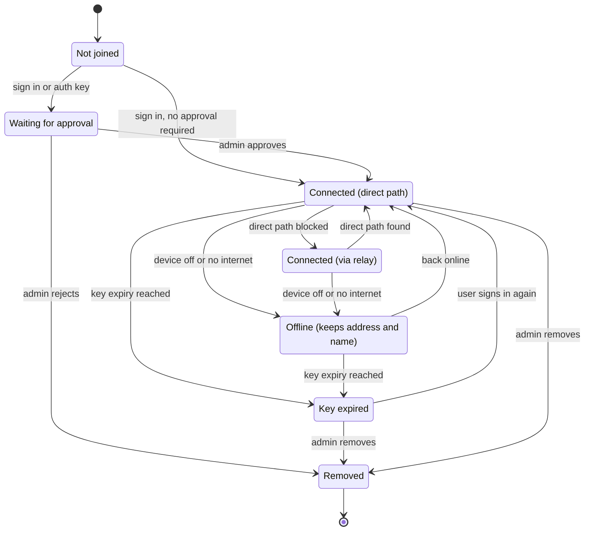
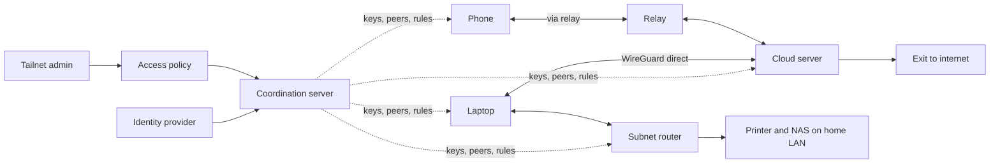
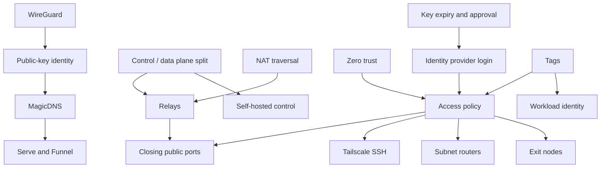
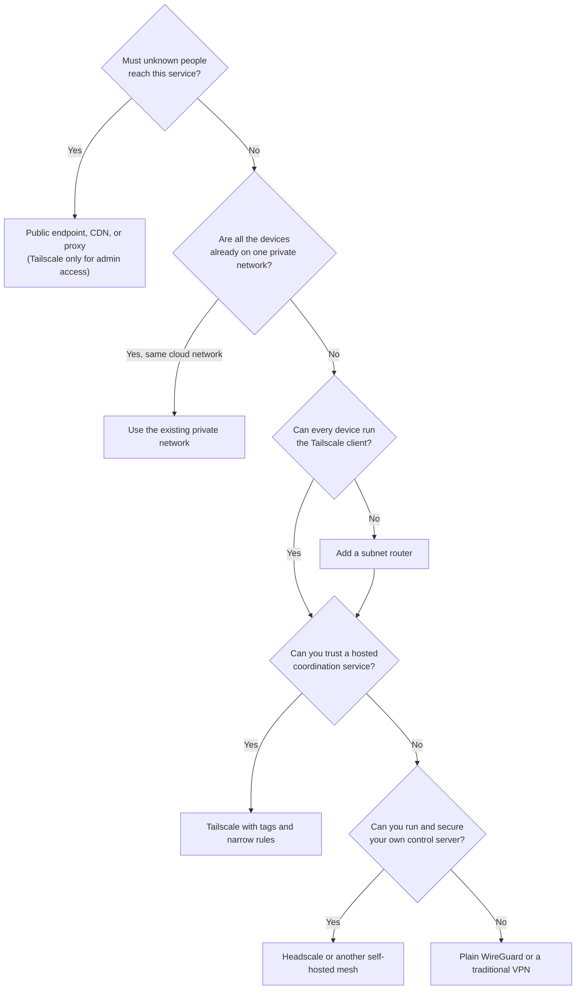
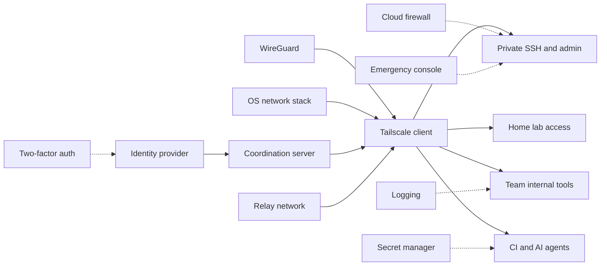
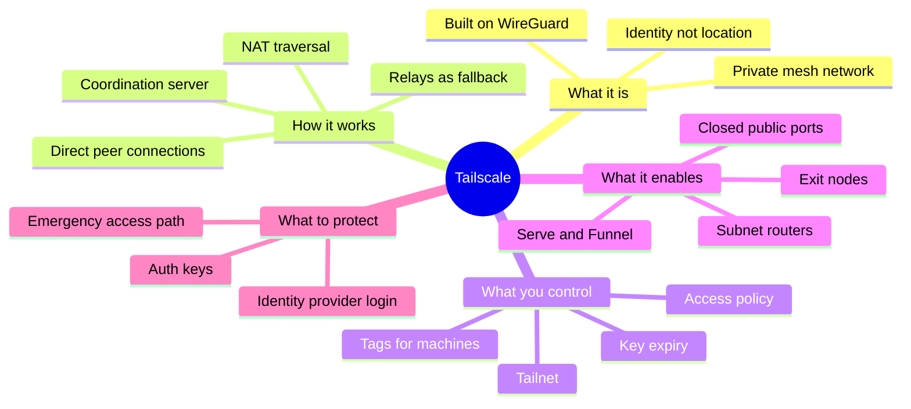

# Tailscale — Learning Map

> Tailscale joins your devices, wherever they are, into one private network where each device is reached by *who* it belongs to, not by *where* it sits on the internet.

**Generated:** 2026-11-15 · **Lens:** mental model, not manual

*Interpretation: "Tailscale" here means the networking product (and its open-source client) that builds a private mesh network on top of WireGuard. The company's newer products, such as its AI gateway, appear only as neighbors. For the machines you often connect with it, see [Cloud Server](../cloud-server/README.md) and [Server](../server/README.md). For a real lock-down of one server, with the mistakes and fixes, see the [lab notes](lab-lock-down-server.md).*

## Contents

1. [Essence](#1-essence)
2. [World Model](#2-world-model)
3. [Concept Map](#3-concept-map)
4. [Decision Map](#4-decision-map)
5. [Search Space Expansion](#5-search-space-expansion)
6. [Ecosystem](#6-ecosystem)
7. [Transferable Principles](#7-transferable-principles)
8. [Minimum Mental Model](#8-minimum-mental-model)
9. [Common Misconceptions](#9-common-misconceptions)
10. [Summary](#10-summary)

---

## 1. Essence

### What is it fundamentally?

Tailscale is **a private network that follows identity instead of location**. Every device you add gets a stable private address and a name, and it can talk to your other devices over an encrypted tunnel, whether it is on home Wi-Fi, a phone network, a café, or a cloud data center.

It splits networking into two separate jobs:

- **The control plane** (the "phone book" and "rule book"): a coordination service that checks who you are, hands out encryption keys, and tells each device which other devices it may talk to.
- **The data plane** (the actual traffic): encrypted WireGuard tunnels that go **directly between devices** whenever possible, never through the coordination service.

This split is the key idea. The company coordinates your network but does not carry or see your data.

### Why does it exist?

The classic network security model was a **castle and moat**: a company network is "inside" and trusted, the internet is "outside" and hostile, and a VPN is a drawbridge that brings remote people inside. That model broke down when:

- people worked from home and phones,
- servers moved to several clouds,
- and one stolen VPN password gave an attacker access to the whole castle.

WireGuard (2016–2020) gave the world a small, fast, modern encryption protocol, but it left the hard part unsolved: **who gets which keys, and how do two devices behind home routers find each other?** Tailscale (founded 2019) exists to solve that coordination problem so that a mesh of WireGuard tunnels "just works".

### What problem does it solve?

| Problem                                                                 | What Tailscale changes                                                                |
| ----------------------------------------------------------------------- | ------------------------------------------------------------------------------------- |
| A server must expose a public port (for example SSH) to be reachable    | The server can close every public port and still be reachable by your own devices    |
| Devices behind home routers cannot be reached from outside              | NAT traversal makes direct connections through most routers without port forwarding  |
| A traditional VPN routes all traffic through one central hub            | Devices connect peer to peer; the hub is only for coordination                        |
| VPN setup needs certificates, config files, and a server to run         | Joining is "install, sign in"; keys are created and rotated automatically            |
| Once inside a VPN, a user can often reach everything                    | Access rules decide exactly which identity may reach which device and port           |
| IP addresses change when devices move                                   | Each device keeps a stable private address and a name                                 |

### What did people do before it?

- **Open ports to the internet** and protect them with passwords or keys — and get scanned by bots constantly.
- **Hub-and-spoke VPNs** (OpenVPN, IPsec, corporate VPN appliances): one central server everything passes through.
- **Port forwarding on the home router**: fragile, and it exposes the home network.
- **Jump hosts / bastion servers**: one hardened public machine used as a stepping stone to private ones.
- **Raw WireGuard by hand**: fast and secure, but every key and address is managed manually for every pair of devices.

### What new possibilities does it create?

- **Servers with no public attack surface**: a cloud server that answers nothing on the open internet.
- **Personal networks across homes, phones, and clouds**: your laptop reaches your home NAS and your cloud server the same way.
- **Identity-based access**: rules like "my team may reach the database server on port 5432", written about people and roles, not IP ranges.
- **Easy private sharing**: give one friend access to one machine without giving them your whole network.
- **Machines and AI agents as network members (2025–2026)**: CI jobs and agents join with short-lived identities, connect to exactly what they need, and disappear.

---

## 2. World Model

### Objects

| Object                         | What it is                                                                                                 |
| ------------------------------ | ---------------------------------------------------------------------------------------------------------- |
| **Tailnet**                    | Your private network: the set of devices, users, and rules that belong together                            |
| **Node (device)**              | Anything running the Tailscale client: laptop, phone, server, container, router                            |
| **Tailnet address**            | A stable private IP address (in the `100.x` range) that a node keeps wherever it moves                      |
| **Name (MagicDNS)**            | A human-readable name for each node, so you reach `nas` instead of an address                              |
| **Node key**                   | The WireGuard key that identifies a node; it expires and must be renewed                                   |
| **Identity**                   | The user (from an identity provider such as Google, Microsoft, GitHub) or tag that owns a node            |
| **Tag**                        | An identity for a machine instead of a person, for example "server" or "ci"                                |
| **Access policy (ACL / grants)** | The tailnet's rule book: who may reach what, on which ports                                              |
| **Auth key**                   | A pre-made secret that lets a machine join without a person signing in                                     |
| **Relay (DERP or peer relay)** | A fallback path that forwards encrypted traffic when a direct connection is impossible                      |
| **Route**                      | A path into somewhere else: a subnet router (reach a whole local network) or an exit node (reach the internet) |

### Actors

| Actor                         | Role                                                                                                   |
| ----------------------------- | ------------------------------------------------------------------------------------------------------ |
| **Coordination server**       | Run by Tailscale (or by you, with Headscale); authenticates, distributes keys and policy, never sees traffic |
| **Identity provider**         | Proves who a user is; its security becomes your network's security                                     |
| **Tailnet admin**             | Writes the access policy, approves devices, and decides what is shared                                 |
| **Users**                     | People whose devices join the tailnet                                                                  |
| **Machines and agents**       | Servers, CI jobs, containers, and AI agents that join with tags or short-lived identities              |
| **Relays**                    | Forward encrypted packets when routers block direct paths; they cannot read them                       |
| **Attackers**                 | Target the weakest link: the identity provider login, a leaked auth key, or a too-wide access rule     |

### State changes

A node moves through a lifecycle that is mostly about **trust**: is it known, is its key still valid, and is it allowed?

Two lessons hide here. *Key expired* is a safety feature that can also lock you out of a remote server — machines usually get tags with expiry turned off, while people re-authenticate. *Relay* is not failure: the connection still works, just slower.

### Workflows

| Workflow                       | The recurring sequence                                                                                       |
| ------------------------------ | ------------------------------------------------------------------------------------------------------------ |
| **Join**                       | Install client → prove identity (person signs in, or machine uses an auth key or workload identity) → receive address, name, and peer list |
| **Connect**                    | Look up the peer's keys and addresses → try direct paths through routers → fall back to a relay → keep trying to upgrade to direct |
| **Lock down a server**         | Join the server → confirm you can reach it over the tailnet → close public ports → keep an emergency way in   |
| **Write policy**               | Group people and tag machines → write rules from groups to tags and ports → test → review changes like code  |
| **Share**                      | Share one node with an outside user, or publish one service with Serve (private) or Funnel (public)          |
| **Extend the network**         | Add a subnet router for devices that can't run Tailscale, or an exit node to send internet traffic elsewhere |
| **Offboard**                   | Remove the user in the identity provider → their devices lose access → expired or unused keys are cleaned up |

### Systems

Single nodes combine into larger structures:

- **The personal mesh**: a laptop, a phone, a home server, and one cloud server. Everyone can reach everyone; the rule book is simple.
- **The team network**: groups, tags, and rules decide who reaches which servers. Identity comes from the company login.
- **The bridge network**: subnet routers and exit nodes connect the tailnet to old networks, cloud private networks, and the wider internet.
- **The control plane**: the coordination server plus your identity provider — the real master of everything above. Whoever controls them decides who is in the network.

Dotted lines are coordination (small, occasional). Solid lines are your traffic (encrypted end to end, never through the coordination server).

### Value

- **Created** when a public port can be closed, when a remote device becomes reachable without router changes, and when access follows a person's role instead of their location.
- **Captured** by Tailscale through convenience: the hosted control plane, team features, and identity integration, paid per user for businesses, while the personal plan stays free.
- **Destroyed** by a weak identity-provider login (one account opens the whole network), by an "allow everything" policy that recreates the old castle, by auth keys left in scripts, and by servers that can only be reached through Tailscale with no emergency path.

---

## 3. Concept Map

### Layer 1: Foundations — what makes a mesh of private tunnels possible

| Entity                          | Action                                               | Purpose                                                   | Relationships                                              |
| ------------------------------- | ---------------------------------------------------- | --------------------------------------------------------- | ---------------------------------------------------------- |
| **WireGuard**                   | Encrypts packets between two keys                    | Gives fast, small, audited encryption                     | Tailscale adds key management and discovery on top          |
| **Public-key identity**         | Names each node by its key, not its address          | Makes "who" stable while "where" changes                  | Basis of tailnet addresses and access rules                |
| **Control / data plane split**  | Separates coordination from traffic                  | The coordinator never needs to see your data              | Explains why relays and the coordinator can't read traffic |
| **NAT traversal**               | Finds a direct path through home and office routers  | Avoids port forwarding and central hubs                   | Falls back to relays when routers are too strict           |
| **Zero trust**                  | Treats every connection as untrusted until checked   | Replaces "inside the network = trusted"                   | Implemented through identity and access policy             |

### Layer 2: Mechanisms — the controls you actually decide

| Entity                          | Action                                               | Purpose                                                   | Relationships                                              |
| ------------------------------- | ---------------------------------------------------- | --------------------------------------------------------- | ---------------------------------------------------------- |
| **Identity provider login**     | Proves who a user is                                 | Reuses an existing account and its two-factor protection  | The real front door of the tailnet                         |
| **Tags**                        | Give machines an identity of their own               | Servers don't depend on one person's account              | Used in access rules; avoid key expiry on servers          |
| **Access policy**               | Allows traffic from sources to destinations and ports | Least privilege across the whole network                 | Written in one policy file; reviewed like code             |
| **MagicDNS**                    | Gives every node a name                              | People and scripts use names, not addresses               | Works with sharing and Serve                               |
| **Key expiry and device approval** | Forces renewal and admin review                   | Limits damage from lost or stolen devices                 | Can lock out unattended servers if misconfigured           |
| **Relays (DERP and peer relays)** | Forward encrypted traffic when direct fails        | Connections always work, even on strict networks          | Peer relays let you run your own relay nodes               |

### Layer 3: Practice — running a tailnet in the world

| Entity                          | Action                                               | Purpose                                                   | Relationships                                              |
| ------------------------------- | ---------------------------------------------------- | --------------------------------------------------------- | ---------------------------------------------------------- |
| **Closing public ports**        | Removes services from the open internet              | Shrinks attack surface to almost nothing                  | Needs a tested emergency access path                       |
| **Subnet routers**              | Bring whole local networks into the tailnet          | Reach devices that can't run the client                   | Bridges old networks; widens what one node exposes         |
| **Exit nodes**                  | Send internet traffic through a chosen node          | Safe browsing on public Wi-Fi, or a fixed outgoing address | Exit node owner can see where your traffic goes          |
| **Tailscale SSH**               | Lets the tailnet identity decide SSH access          | No SSH keys to copy or rotate                             | Depends on the access policy being correct                 |
| **Serve and Funnel**            | Publish a local service to the tailnet or the internet | Share work without opening router or firewall ports     | Funnel makes something public again — use on purpose       |
| **Workload identity**           | Lets CI jobs and agents join with short-lived tokens | Removes long-lived auth keys from scripts                 | Pairs with tags and narrow rules                           |
| **Self-hosted control (Headscale)** | Replaces Tailscale's coordinator with your own   | Removes trust in the company's control plane              | You now run and secure the phone book yourself             |

### Concept Graph

---

## 4. Decision Map

| Situation                                                                         | Decision                                                                          | Reason                                                                                   | Expected Outcome                                                  |
| --------------------------------------------------------------------------------- | --------------------------------------------------------------------------------- | ---------------------------------------------------------------------------------------- | ----------------------------------------------------------------- |
| A public website or API that strangers must reach                                 | **Don't use Tailscale for the public side**; use a normal public endpoint, CDN, or reverse proxy | Tailscale is for known identities; strangers have none                      | The public stays public; use Tailscale only for the admin side    |
| One cloud server that only you log in to                                          | Join it to your tailnet and close its public SSH port                             | Bots can't attack a port that doesn't answer                                             | No more brute-force attempts; access from all your devices        |
| You want to reach a home NAS or computer while travelling                         | Install Tailscale on it (or a subnet router at home)                              | No port forwarding, works behind most home routers                                       | Home devices reachable by name from anywhere                      |
| A small team needs access to a few internal servers                               | Tag the servers, group the people, write narrow rules                             | Access follows role, not location; offboarding is one account change                     | Least privilege without a VPN appliance                           |
| Devices that cannot run software (printers, cameras, old machines)                | Add a subnet router on that network                                               | One node brings the whole local network into the tailnet                                 | Reachable, but the router node now carries more risk             |
| On public Wi-Fi and you want your traffic to leave from a trusted place           | Use an exit node (home server or cloud server)                                    | Traffic is encrypted until it reaches a machine you control                              | Safer browsing; speed depends on the exit node                    |
| CI jobs or AI agents need to reach a private server                               | Use tags with workload identity or short-lived, narrow keys                       | Long-lived auth keys in scripts are a common leak                                        | Machines connect only to what they need, then vanish             |
| You must not depend on a US company's control plane (law, policy, or principle)   | Run Headscale, or use another self-hosted mesh                                    | The coordinator is the trust point; self-hosting moves it to you                         | More control, more work, fewer features                           |
| You need to show a local demo to a friend or teammate for an afternoon            | Share the node, or use Serve; use Funnel only if they have no Tailscale           | Sharing is narrow; Funnel opens to the whole internet                                    | Quick sharing with the smallest needed exposure                   |
| A remote server's only access path is Tailscale                                   | Keep an emergency path: the cloud provider's web console, or a second admin      | Expired keys, client bugs, or policy mistakes can lock you out                           | A bad day is an inconvenience, not a rebuild                      |
| A large company with strict compliance needs                                      | Compare Tailscale with a zero-trust gateway vendor and your existing identity tools | Fit with logging, audit, and existing access systems matters more than setup speed    | A choice based on governance, not only convenience                |
| Two services in the same cloud private network talk to each other                 | Often **don't add Tailscale**; use the cloud's private network                    | They are already on a private, fast path                                                 | Fewer moving parts; use Tailscale for people and cross-cloud links |

### Decision Tree

---

## 5. Search Space Expansion

### Beginner questions rarely asked

| Question                                                                       | Why it matters                                                                     |
| ------------------------------------------------------------------------------ | ---------------------------------------------------------------------------------- |
| If my Google or GitHub account is stolen, what can the thief reach?            | The identity provider login is the real key to the whole tailnet                   |
| How do I get into my server if Tailscale stops working on it?                  | Closing public ports without an emergency path can lock you out                    |
| Is my connection direct or going through a relay?                              | Relays explain "it works but it's slow"                                            |
| What happens when a device's key expires while I'm away?                       | Unattended servers can drop off the network                                        |
| Can everyone in my tailnet reach everything by default?                        | The default policy is permissive; narrow it on purpose                             |
| Does an exit node owner see my browsing?                                       | Traffic leaves the tunnel there, so that machine sees where it goes                |
| What does Tailscale the company actually see?                                  | Separates metadata (who, when, which devices) from content (never)                 |
| Which connections do my tools make that I never see?                           | A narrow policy silently breaks tools that quietly depend on a tailnet port        |

### Questions experts ask

| Question                                                                       | Why it matters                                                                     |
| ------------------------------------------------------------------------------ | ---------------------------------------------------------------------------------- |
| Which machines are owned by tags, and which by a person who might leave?       | A server tied to a person's account breaks when that person is offboarded          |
| What is the blast radius of each subnet router and exit node?                  | These nodes can open whole networks; they deserve the strictest rules               |
| Is the access policy reviewed and tested like code?                            | One wrong line can reopen the castle                                               |
| Where do auth keys live, and how long do they last?                            | Long-lived keys in scripts are the most common leak                                |
| What happens to connections if the coordination server is unreachable?         | Existing tunnels keep working; new devices and rule changes do not                 |
| Which traffic is forced through relays, and should we run our own?             | Performance and data-path control on strict networks                               |
| How do Tailscale's logs feed into our audit and incident response?             | Identity-based access is only useful if you can see who used it                    |

### Questions worth exploring next

| Question                                                                       | Why it matters                                                                     |
| ------------------------------------------------------------------------------ | ---------------------------------------------------------------------------------- |
| How does NAT traversal actually punch through routers?                         | Explains when direct connections fail and why                                      |
| How is WireGuard different from older VPN protocols like IPsec and OpenVPN?    | Explains why Tailscale could be simple and fast                                    |
| What is "zero trust" beyond the marketing word?                                | The design philosophy behind identity-based networks                               |
| How do Headscale and other self-hosted meshes compare in features and effort?  | The real price of owning the control plane                                         |
| How should AI agents get network access that is narrow and short-lived?        | Agents are a new kind of network member with fast failure modes                    |
| How does Tailscale run inside containers and Kubernetes?                       | Where "a device" stops being a physical thing                                      |

### Questions that define mastery

| Question                                                                       | Why it matters                                                                     |
| ------------------------------------------------------------------------------ | ---------------------------------------------------------------------------------- |
| Can you draw your tailnet and explain who may reach what, and why?             | The policy has become understandable, not just working                             |
| Can you remove one person and be sure they lost all access?                    | The real test of identity-based networking                                         |
| Do any of your servers have public ports that don't need to be public?         | Measures whether you actually used the main benefit                                |
| Can you recover access to every server if Tailscale is down or broken?         | Proves you didn't trade one risk for a worse one                                   |
| Can you explain which parts depend on Tailscale the company, and which don't?  | Separates the control-plane trust from the data-plane trust                        |
| Can you decide between Tailscale, a cloud private network, a public endpoint, and a self-hosted mesh for a new service in five minutes? | The decision map has become intuition |

---

## 6. Ecosystem

### Upstream

- **WireGuard**: the encryption protocol and tunnel format underneath.
- **Identity providers**: Google, Microsoft, GitHub, Apple, Okta, and other sign-in systems that prove who users are.
- **Operating system networking**: virtual network interfaces on Linux, macOS, Windows, iOS, and Android.
- **The internet's routers and NAT**: the obstacles that NAT traversal and relays work around.
- **Tailscale's relay network**: DERP servers around the world that guarantee a fallback path.

### Downstream

- **Remote access to servers** (SSH, databases, admin panels) without public ports.
- **Home labs and self-hosting**: NAS boxes, media servers, and small home servers reached from anywhere.
- **Team internal tools** reachable only by employees.
- **CI, containers, and AI agents** that need private, narrow access to infrastructure.

### Alternatives

| Alternative                                    | Choose it instead when…                                                                           |
| ---------------------------------------------- | ------------------------------------------------------------------------------------------------- |
| **Plain WireGuard**                            | Only two or three fixed machines, and you prefer no third party at all                            |
| **Headscale (self-hosted Tailscale control)**  | You want the Tailscale clients but must own the coordination server                               |
| **Other mesh VPNs (NetBird, ZeroTier, Nebula)** | You prefer their licensing, self-hosting model, or network design                               |
| **Traditional VPN (OpenVPN, IPsec, vendor appliances)** | You need to fit an existing corporate setup or a device that only speaks these protocols  |
| **Cloud private networks and peering**         | All machines are in one cloud; people don't need direct access                                    |
| **Zero-trust access gateways (Cloudflare Access and similar)** | You mainly expose web apps to people and want a browser-based login in front            |
| **Public endpoint with strong authentication** | Users are unknown members of the public                                                          |
| **SSH bastion host**                           | You only need SSH and want one well-understood public entry point                                 |

### Complements

- **A strong identity provider with two-factor authentication**: the tailnet is only as safe as this login.
- **Cloud firewalls**: close public ports once Tailscale gives you a private path.
- **The cloud provider's emergency console**: the backup door when Tailscale is not available.
- **Secret managers and workload identity**: keep auth keys out of scripts.
- **Reverse proxies and certificates**: give private services clean HTTPS names inside the tailnet.
- **Logging and monitoring**: show who connected to what and when.

### Dependency Graph

Solid arrows are dependencies; dotted arrows are complements you add around Tailscale.

---

## 7. Transferable Principles

### First principles

- **Separate who you are from where you are.** Addresses change; identity and keys should not.
- **Separate coordination from traffic.** A service can decide who talks to whom without ever touching what they say.
- **Exposure invites attack.** The safest port is one that doesn't answer the public internet at all.
- **The front door moves to identity.** When the network trusts logins, the login system becomes the perimeter.
- **Never remove the last way in.** Every lock-down needs a tested emergency path.
- **Default deny means you must know your traffic.** Once "allow everything" is gone, anything not written down stops, including connections you never knew existed.
- **Old connections hide new rules.** A session opened before a change can keep working after it; only a fresh connection shows the truth.

### Transferable methodologies

- **Least privilege** — each person, machine, and agent reaches only what it needs.
- **Machines get their own identity** — servers should not depend on one person's account.
- **Policy as code** — write access rules as a reviewed, versioned file.
- **Short-lived credentials** — prefer keys that expire over secrets that live forever in scripts.
- **Test the break-glass path** — practice getting in when the normal path is down.
- **Guard rails on the rule book** — write tests for "must reach" and "must not reach" that run on every policy change, so a bad edit is refused before it breaks anything.
- **Inventory before you lock down** — list what listens on each machine and what each tool connects to, then close only what nothing needs.

### Implementation details (delegate to AI)

- Install steps for each operating system and container platform.
- The exact syntax of the access policy file.
- Admin console menus, client flags, and API fields.
- Current plan limits and prices.
- Platform-specific network quirks and troubleshooting steps.

### Stable knowledge (true in 10 years)

- Identity-based access is replacing location-based ("inside the network") trust.
- Control plane and data plane are separate concerns.
- NAT and strict firewalls will keep requiring traversal tricks and relays.
- Public-facing ports attract constant automated attacks.
- Whoever controls the identity system controls the network.

### Changing knowledge (likely different in 2 years)

| Claim (as of 2026)                                                                                                                         | Why it may change                                                 |
| ------------------------------------------------------------------------------------------------------------------------------------------ | ----------------------------------------------------------------- |
| The free Personal plan was reworked in April 2026 and is generous for non-commercial use; business plans are priced per user               | Pricing changes with company strategy                             |
| Peer relays and Tailscale Services became generally available in early 2026, letting you run your own relays and name services, not only devices | Features are still evolving quickly                           |
| Workload identity federation (2026) lets CI systems and cloud workloads join without long-lived auth keys                                   | Standards for machine identity are still settling                 |
| Tailscale is expanding into AI governance (its Aperture gateway, GA in August 2026) and tools that let coding agents add and reach nodes     | The company's product direction and AI agent norms are young      |
| Privileged access management (PAM, beta in 2026) is being built into the admin console                                                       | Beta features may change shape or merge                           |
| Self-hosted alternatives (Headscale, NetBird) are mature enough for small teams                                                             | Open-source projects rise and fall with their communities         |

### Where to invest your memory

Remember the **control/data plane split, the identity-as-perimeter idea, the node lifecycle, and the decision tree**. Delegate everything with a menu, a flag, a price, or a policy-file syntax to AI and the documentation.

---

## 8. Minimum Mental Model

1. **Private mesh network** — every device can reach every other device directly, not through one hub.
2. **WireGuard** — the small, fast encryption protocol that carries the traffic.
3. **Identity, not location** — devices are known by keys and owners, not by where they are.
4. **Coordination server** — the phone book and rule book; it never carries your data.
5. **Direct peer connections** — traffic goes straight between your devices whenever possible.
6. **NAT traversal** — the method that finds direct paths through home and office routers.
7. **Relays** — the encrypted fallback path when direct connections are blocked.
8. **Tailnet** — your private network of devices, users, and rules.
9. **Access policy** — the single rule book of who may reach what; narrow it on purpose.
10. **Tags** — identities for machines, so servers don't depend on one person.
11. **Key expiry** — keys must be renewed; protects against lost devices, can lock out servers.
12. **Closed public ports** — the main win: servers that don't answer the open internet.
13. **Subnet routers** — bring devices that can't run Tailscale into the tailnet.
14. **Exit nodes** — send your internet traffic out through a machine you trust.
15. **Serve and Funnel** — share a service privately, or deliberately make it public.
16. **Identity provider login** — the real front door; protect it with two-factor authentication.
17. **Auth keys** — machine join secrets; keep them short-lived and out of code.
18. **Emergency access path** — the backup way in when Tailscale is not available.

---

## 9. Common Misconceptions

| Common misunderstanding                                         | Why it happens                                                                 | Better mental model                                                                                                       |
| --------------------------------------------------------------- | ------------------------------------------------------------------------------ | ------------------------------------------------------------------------------------------------------------------------- |
| "Tailscale is just a VPN like the ones that hide my location."  | Consumer VPN marketing uses the same word                                      | Consumer VPNs send your traffic through their servers to the internet; Tailscale connects *your own* devices to each other |
| "All my traffic goes through Tailscale's servers."              | Most older VPNs work that way                                                  | Traffic goes directly between devices; Tailscale's servers coordinate, and relays only forward encrypted packets as a fallback |
| "Being in the tailnet means a device is safe to trust fully."   | It feels like a private home network                                           | A tailnet with an "allow everything" policy is the old castle again; zero trust means narrow rules even inside              |
| "Once I install it, my server is protected."                    | Joining feels like the security step                                           | The protection comes from *closing the public ports* afterwards; Tailscale only gives you the private path to do it safely |
| "If Tailscale goes down, my network stops."                     | The company is the visible centre                                              | Existing connections keep working without the coordinator; new joins, logins, and rule changes wait                       |
| "My Tailscale password protects my network."                    | People think of Tailscale as having its own account                            | Tailscale uses your identity provider; the strength of that login and its two-factor setup is your network's strength     |
| "Self-hosting with Headscale makes everything private and free." | Owning the server sounds safer                                                | You remove trust in a company but take on running, updating, and securing the control plane yourself                       |
| "Funnel is just another way to share privately."                | Serve and Funnel sound similar                                                 | Serve is for your tailnet; Funnel makes a service reachable by the whole internet                                         |
| "My open window still works, so the new rule is fine."          | Existing connections often survive a policy change                             | Test every change with a brand-new connection; old sessions can hide a break for hours                                     |
| "A tagged server never has key expiry."                         | Expiry is off by default for devices that *join* with a tag                    | A device tagged *after* joining can keep its old expiry date; check it and turn expiry off yourself                       |
| "Direct connections need an open UDP port on the server."       | Port forwarding taught us that inbound traffic needs an open door              | The firewall lets replies back in, so NAT traversal usually finds a direct path with no inbound rule at all               |

---

## 10. Summary

> What I truly gain is not **a VPN to reach my machines**, but **a network where access follows identity instead of location — so I can close the public internet's doors and still reach everything I own**.

Tailscale builds a private mesh of WireGuard tunnels between your devices and uses a coordination service to hand out keys, addresses, and rules, while your traffic flows directly between devices. Its main value is letting servers and home machines stop answering the public internet while staying reachable to the people and machines that should reach them. The real security boundary moves to your identity provider and your access policy, so those deserve the most care. Use it for people and machines that have identities, not for the anonymous public; give machines tags, keep keys short-lived, and always keep an emergency way in.
